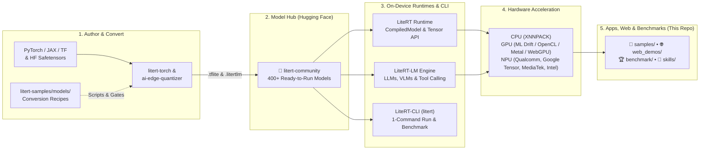

<div align="center">
  

  # Google AI Edge — LiteRT & LiteRT-LM Samples

  **Official sample applications, end-to-end model conversion recipes, model benchmarks, and AI coding agent skills for on-device ML & GenAI.**

  [](https://google-ai-edge.github.io/litert-samples/)
  [-FFD21E?style=for-the-badge)](https://huggingface.co/litert-community)
  [](https://huggingface.co/spaces/litert-community/find-your-models)
  [](https://github.com/google-ai-edge/litert-samples/tree/main/benchmark/developer_device_platform)
  [](LICENSE)

  [🌍 Ecosystem](#-the-google-ai-edge--litert-ecosystem) •
  [🤗 Hugging Face Hub](#-hugging-face-litert-community-hub) •
  [🚀 Quickstart (Level 1–5)](#-getting-started-from-zero-to-production) •
  [📱 Sample Apps](#-level-3--explore-sample-applications) •
  [🧪 Model Recipes](#-level-4--convert--quantize-models-models) •
  [🤖 Agent Skills](#-level-5--automate-with-ai-agent-skills--ddp-benchmarks) •
  [📂 Repo Map](#-repository-structure)
</div>

---

Welcome to **`litert-samples`** — the central developer hub for
* **[LiteRT](https://github.com/google-ai-edge/LiteRT)** (Google's high-performance, cross-platform, production-proven on-device inference, powering Google and 3P applications globally, succeeding TensorFlow Lite) and
* **[LiteRT-LM](https://github.com/google-ai-edge/LiteRT-LM)** (Google's specialized orchestration layer for running LLMs with LiteRT, unlocking maximum performance and efficiency).

Whether you want to **try a model in your browser in 30 seconds**, **drop a pre-converted model from [Hugging Face `litert-community`](https://huggingface.co/litert-community) into a mobile/desktop/web app**, or **convert, quantize, verify, and benchmark a new checkpoint on CPU, GPU, and NPU**, this repository takes you from first run to production deployment.

---

## 🔥 What's New

* 🦋 **Cross-Platform Flutter & Intel NPU Showcases**: Added a full multimodal Flutter app ([`samples/litert/flutter/`](samples/litert/flutter/)) running voice chat, live camera detection, RAG, and agent skills across Android, iOS, macOS, Linux, Raspberry Pi 5, Jetson Orin, and Qualcomm VENTUNO Q — plus a 3-act **Intel Core Ultra NPU** showcase ([`samples/litert/flutter_intel_npu/`](samples/litert/flutter_intel_npu/)) running Gemma 4 across CPU, GPU, and NPU.
* 📱 **LiteRT Model Zoo (34 Tasks in One App)**: Expanded [`samples/litert_model_zoo/`](samples/litert_model_zoo/) to **21 Vision, 8 Audio, and 5 Text Decision models** via the LiteRT `CompiledModel` API, streaming verified weights on-demand from [`litert-community`](https://huggingface.co/litert-community).
* 🎙️ **Offline Voice Assistant & Embodied Robotics**: Added an offline Android voice assistant with tool calling ([`samples/litert_lm/voice_assistant/`](samples/litert_lm/voice_assistant/)) and a Raspberry Pi Reachy voice robot that sees, hears, reasons, and speaks ([`samples/litert_lm/reachy-voice-robot/`](samples/litert_lm/reachy-voice-robot/)).
* 🌐 **Client-Side WebGPU Demos & Chrome Extension**: Added 5 zero-server browser demos built on `@litertjs/core` ([`samples/web_demos/`](samples/web_demos/): **SAM 2.1**, **CLIPSeg**, **MoGe-2 3D**, **PP-OCRv5**, **Matcha-TTS**) and a [Chrome Extension](samples/web_demos/chrome_extension/) for on-page OCR, TTS, and 3D photo hover.
* 🧪 **End-to-End Model Conversion Cookbook & Recipes**: Added [`models/conversion.md`](models/conversion.md) and reproducible conversion/verification pipelines under [`models/`](models/) for **MiniCPM5-2B**, **Hunyuan Hy-MT2-1.8B**, **Nemotron-3-Nano-4B**, **Bonsai Image 4B**, **Qwen3-TTS**, **SAM 3**, **Zipformer ASR**, **wav2vec2 KWS**, and **GLiNER2.5**.
* 🏆 **Real-Device Cloud Benchmarking & AI Agent Skills**: Added [Google Cloud Developer Device Platform (DDP) Colab notebooks](benchmark/developer_device_platform/), the [LiteRT Performance Leaderboard](benchmark/leaderboard/), and **9 end-to-end `SKILL.md` playbooks** ([`skills/`](skills/)) for AI coding agents.

---

## 🌍 The Google AI Edge & LiteRT Ecosystem

`litert-samples` connects the entire **[`google-ai-edge`](https://github.com/google-ai-edge)** open-source stack with the **[Hugging Face `litert-community`](https://huggingface.co/litert-community)** model ecosystem:



### Ecosystem Repositories at a Glance

| Repository / Hub | Role in the Stack | Artifact / API |
| :--- | :--- | :--- |
| **[`google-ai-edge/LiteRT`](https://github.com/google-ai-edge/LiteRT)** | Core on-device runtime featuring the **CompiledModel API** (V2), **C++ Tensor API**, **LiteRT.js** (WebGPU/WASM), and unified GPU/NPU acceleration. | `.tflite` |
| **[`google-ai-edge/LiteRT-LM`](https://github.com/google-ai-edge/LiteRT-LM)** | Production inference engine for LLMs & VLMs (prefill/decode orchestration, KV cache, multimodal vision/audio towers, tool calling). | `.litertlm` |
| **[`huggingface.co/litert-community`](https://huggingface.co/litert-community)** | Official community hub hosting **400+ pre-converted, quantized, and verified** `.tflite` and `.litertlm` models ready for on-device deployment. | `.tflite`, `.litertlm` |
| **[`google-ai-edge/litert-samples`](https://github.com/google-ai-edge/litert-samples)** *(You are here)* | Reference apps (Android, iOS, Flutter, Web, Linux/Pi), conversion recipes (`models/`), DDP benchmarks (`benchmark/`), and agent skills (`skills/`). | End-to-End Code |
| **[`google-ai-edge/LiteRT-CLI`](https://github.com/google-ai-edge/LiteRT-CLI)** | Unified command-line tool (`litert`) to download, convert, quantize, run, and benchmark models locally or on cloud device farms (`--ddp`). | `litert` CLI |
| **[`google-ai-edge/litert-torch`](https://github.com/google-ai-edge/litert-torch)** & **[`ai-edge-quantizer`](https://github.com/google-ai-edge/ai-edge-quantizer)** | PyTorch-to-LiteRT converter, Generative Torch API for re-authoring LLMs, and accuracy-safe PTQ/quantization toolkit (`fp16` / `int8` / `int4`). | Python SDK |
| **[`google-ai-edge/gallery`](https://github.com/google-ai-edge/gallery)** & **[`model-explorer`](https://github.com/google-ai-edge/model-explorer)** | End-user showcase app for trying local GenAI models (`gallery`) and interactive hierarchical graph visualizer/debugger (`model-explorer`). | App & Visualizer |

---

## 🤗 Hugging Face `litert-community` Hub

Every sample application, web demo, and recipe in this repository is tightly integrated with **[Hugging Face `litert-community`](https://huggingface.co/litert-community)** — no manual conversion is required to get started, and no heavy model weights are bloated into git history.

### 🧭 Discover & Compare Models Instantly

| Interactive Portal | What You Can Do | Source in This Repo |
| :--- | :--- | :--- |
| **[🤗 `litert-community` Organization](https://huggingface.co/litert-community)** | Browse **400+ pre-converted models** across LLMs, VLMs, ASR, TTS, Image Generation, Detection, Segmentation, and Depth. | [`models/`](models/) |
| **[🔍 Find Your Models (HF Space)](https://huggingface.co/spaces/litert-community/find-your-models)** | Filter every `litert-community` model by family, parameter size, task, on-device latency/tokens-per-sec, conversion recipe, and copy ready-to-run `litert` CLI commands. | [`community/models_page/`](community/models_page/) |
| **[📈 Trending & Weekly Picks (HF Space)](https://huggingface.co/spaces/litert-community/trending-models)** | Track trending & newest edge models, weekly community picks, matching apps in `litert-samples`, and live browser Spaces. | [`community/trending_page/`](community/trending_page/) |

### 🌟 Featured Model Families on `litert-community`

| Modality | Featured Models on `litert-community` | Format | Matching Sample / Recipe in `litert-samples` |
| :--- | :--- | :---: | :--- |
| **Multimodal & Text LLMs** | [Gemma 4 (E2B / E4B / 12B)](https://huggingface.co/collections/litert-community/gemma-family), [Gemma 3 1B](https://huggingface.co/litert-community/Gemma3-1B-IT), [Qwen 3.5 & Qwen 3 (0.6B–4B)](https://huggingface.co/collections/litert-community/qwen-family), [DeepSeek-R1-Distill-Qwen-1.5B](https://huggingface.co/litert-community/DeepSeek-R1-Distill-Qwen-1.5B), [Phi-4-mini](https://huggingface.co/litert-community/Phi-4-mini-instruct), [MiniCPM5-2B](https://huggingface.co/litert-community/MiniCPM5-2B), [Nemotron-3-Nano-4B](https://huggingface.co/litert-community/Nemotron-3-Nano-4B), [Hy-MT2-1.8B](https://huggingface.co/litert-community/Hy-MT2-1.8B), [FastVLM-0.5B](https://huggingface.co/litert-community/FastVLM-0.5B) | `.litertlm` | [`flutter/`](samples/litert/flutter/), [`flutter_intel_npu/`](samples/litert/flutter_intel_npu/), [`voice_assistant/`](samples/litert_lm/voice_assistant/), [`qualcomm/`](samples/litert/qualcomm/), [`google/sample_app_tpu/`](samples/litert/google/sample_app_tpu/), [`models/`](models/) |
| **Embeddings & NLP** | [EmbeddingGemma 2 (270M / 440M / 740M)](https://huggingface.co/litert-community/embeddinggemma-2-740m-litert-lm), [Laya Multilingual](https://huggingface.co/litert-community/Laya-Multilingual-LiteRT), [GLiNER2.5-Small](https://huggingface.co/litert-community/GLiNER2.5-Small-LiteRT), [GLiClass-Edge](https://huggingface.co/litert-community/GLiClass-Edge-v3.0-LiteRT) | `.litertlm` / `.tflite` | [`semantic_similarity/`](samples/litert/semantic_similarity/), [`zero_shot_classification/`](samples/litert/zero_shot_classification/), [`litert_model_zoo/`](samples/litert_model_zoo/), [`models/gliner/`](models/gliner/gliner2_5_small/) |
| **Speech & Audio (ASR / TTS)** | [Parakeet TDT & CTC 0.6B](https://huggingface.co/collections/litert-community/asr), [Whisper Tiny/Base](https://huggingface.co/litert-community/whisper-tiny), [Moonshine Tiny](https://huggingface.co/litert-community/moonshine-tiny), [Zipformer CR-CTC](https://huggingface.co/litert-community/Zipformer-medium-CR-CTC-LiteRT), [Qwen3-ASR-0.6B](https://huggingface.co/litert-community/Qwen3-ASR-0.6B), [Qwen3-TTS-0.6B](https://huggingface.co/litert-community/Qwen3-TTS-12Hz-0.6B-Base), [Matcha-TTS](https://huggingface.co/litert-community/Matcha-TTS), [KittenTTS Nano](https://huggingface.co/litert-community/kitten-tts-nano-0.8) | `.tflite` | [`speech_recognition/`](samples/litert/speech_recognition/), [`text_to_speech_lm/`](samples/litert/text_to_speech_lm/), [`text_to_speech_streaming/`](samples/litert/text_to_speech_streaming/), [`text_to_speech/`](samples/litert/text_to_speech/), [`web_demos/matcha-tts/`](samples/web_demos/) |
| **Image Gen & Vision** | [Bonsai-Image-ternary-4B](https://huggingface.co/litert-community/Bonsai-Image-ternary-4B), [FLUX.2-klein-4B](https://huggingface.co/litert-community/FLUX.2-klein-4B-LiteRT), [SAM 2.1 Tiny](https://huggingface.co/litert-community/SAM2.1-Hiera-Tiny-Image-Encoder), [CLIPSeg](https://huggingface.co/litert-community/CLIPSeg-rd64-LiteRT), [MoGe-2 3D](https://huggingface.co/litert-community/MoGe-2-LiteRT), [PP-OCRv5](https://huggingface.co/litert-community/PP-OCRv5-LiteRT), [RF-DETR Nano](https://huggingface.co/litert-community/RF-DETR-Nano-LiteRT), [Depth Anything 3](https://huggingface.co/litert-community/Depth-Anything-3-Small-LiteRT) | `.tflite` | [`image_generation/`](samples/litert/image_generation/), [`image_segmentation/`](samples/litert/image_segmentation/), [`litert_model_zoo/`](samples/litert_model_zoo/), [`web_demos/`](samples/web_demos/), [`models/bonsai/`](models/bonsai/bonsai_image_4b/) |

> 💡 **Browse by Hardware & Platform Collections on Hugging Face:**
> [Android](https://huggingface.co/collections/litert-community/android-models-68c1d00fa08404b27e420a2e) •
> [iOS](https://huggingface.co/collections/litert-community/ios-models-68c1d24793b4f12a3d948a21) •
> [Web LLM](https://huggingface.co/collections/litert-community/web-llm-models-68c1d5e66b5461ef41bc4943) •
> [Web Classical](https://huggingface.co/collections/litert-community/web-classical-models-6a1fc1ba70a35860474350ad) •
> [Desktop](https://huggingface.co/collections/litert-community/desktop-models-68c1d70d39c6ba3310f6e194) •
> [Google Tensor TPU](https://huggingface.co/collections/litert-community/google-tensor-69fd6b0b02e7eee8a3ab9ff6) •
> [Qualcomm NPU](https://huggingface.co/collections/litert-community/qualcomm-69f263c83ee387580cb6d118)

---

## 🚀 Getting Started: From Zero to Production

We organized this repository **progressively** so you can start at the depth that matches your goal:

1. **[Level 1 — Zero Install (30s)](#-level-1--try-in-your-browser-zero-install)**: Run client-side WebGPU/WASM demos right in your browser.
2. **[Level 2 — 3-Minute CLI Quickstart](#-level-2--run--benchmark-from-the-terminal-3-minutes)**: Download, run, and benchmark any `litert-community` model in 3 commands.
3. **[Level 3 — Run & Build Sample Apps](#-level-3--explore-sample-applications)**: Build full apps for Android, iOS, Flutter, macOS, Windows, Linux, Web, and Raspberry Pi.
4. **[Level 4 — Convert & Quantize Models](#-level-4--convert--quantize-models-models)**: Turn Hugging Face / PyTorch checkpoints into verified `.litertlm` and `.tflite` artifacts.
5. **[Level 5 — Agent Skills & Cloud Device Farm](#-level-5--automate-with-ai-agent-skills--ddp-benchmarks)**: Automate the entire lifecycle with AI coding agents and benchmark on real cloud phones.

---

### 🌐 Level 1 — Try in Your Browser (Zero Install)

Experience LiteRT running **100% client-side** in your browser via **[LiteRT.js](https://www.npmjs.com/package/@litertjs/core)** (WebGPU + multi-threaded WASM) with weights streamed directly from `litert-community`:

* **[Interactive Samples Portal (`google-ai-edge.github.io/litert-samples`)](https://google-ai-edge.github.io/litert-samples/)**: Unified showcase of web demos and interactive playgrounds.
* **[Client-Side Web Demos (`samples/web_demos/`)](samples/web_demos/)** *(also available on [HF Spaces Demos](https://huggingface.co/collections/litert-community/demos-68efdb213c93efee10c2116f))*:
  * 🖱️ **[SAM 2.1 Click-to-Segment](https://huggingface.co/spaces/litert-community/sam2-1-tiny-click-to-segment)** (`~60 ms` encoder / `~4 ms` per click on WebGPU) — [Source](samples/web_demos/src/sam2/)
  * 🎯 **[CLIPSeg Open-Vocabulary Segmentation](https://huggingface.co/spaces/litert-community/clipseg-text-prompted-segmentation)** (Segment any photo by typing text prompts) — [Source](samples/web_demos/src/clipseg/)
  * 🧊 **[MoGe-2 Photo-to-3D Point Cloud](https://huggingface.co/spaces/litert-community/moge-2-photo-to-3d)** (Monocular geometry rendered in interactive Three.js) — [Source](samples/web_demos/src/moge/)
  * 📄 **[PP-OCRv5 Document & Screenshot OCR](https://huggingface.co/spaces/litert-community/pp-ocrv5-image-to-text)** (Text detection + recognition in browser) — [Source](samples/web_demos/src/ppocr/)
  * 🗣️ **[Matcha-TTS Neural Speech Synthesis](https://huggingface.co/spaces/litert-community/matcha-tts-text-to-speech)** (Flow-matching TTS + HiFi-GAN vocoder at 22 kHz) — [Source](samples/web_demos/src/matcha-tts/)
  * 🧩 **[LiteRT Chrome Extension](samples/web_demos/chrome_extension/)**: Run MoGe-2 3D hover, PP-OCRv5, and Matcha-TTS on any webpage you browse.
* **[C++ Tensor API Web Playground (`samples/tensor_api_playground/`)](samples/tensor_api_playground/)**: Interactive browser sandbox demonstrating C++ LiteRT Tensor API programs compiled to WebAssembly (Gemma 3, Image Segmentation, Mandelbrot, Game of Life).

---

### ⚡ Level 2 — Run & Benchmark from the Terminal (3 Minutes)

Use **[LiteRT-CLI (`litert`)](https://github.com/google-ai-edge/LiteRT-CLI)** or **[LiteRT-LM (`litert-lm`)](https://github.com/google-ai-edge/LiteRT-LM)** to pull any model from `litert-community` and run or benchmark it immediately:

```bash
# 1. Install LiteRT-CLI and LiteRT-LM
pip install litert-cli-nightly

# 2. Run an LLM (.litertlm) from Hugging Face litert-community
litert download litert-community/Qwen3-0.6B
litert lm run Qwen3-0.6B.litertlm --prompt "Explain on-device AI in two sentences."

# 3. Benchmark any .tflite or .litertlm model locally or on real cloud phones (--ddp)
litert download litert-community/efficientnet_b1
litert benchmark efficientnet_b1.tflite --gpu
```

> ☁️ **No phone attached?** Run benchmarks on real physical Android & iOS devices in Google Cloud's **Developer Device Platform (DDP)** directly from Colab — see **[`benchmark/developer_device_platform/`](benchmark/developer_device_platform/)**.

---

### 📱 Level 3 — Explore Sample Applications

All runnable applications live under **[`samples/`](samples/)**. New applications use the **LiteRT `CompiledModel` API** (for `.tflite` models with automatic GPU/NPU acceleration and zero-copy buffers) and **LiteRT-LM** (for `.litertlm` generative models).

#### 🌟 Flagship Multi-Model & Cross-Platform Apps

| Sample App | Highlights & Modality | Platforms & Accelerators | Models Used (`litert-community`) |
| :--- | :--- | :--- | :--- |
| **[`samples/litert_model_zoo/`](samples/litert_model_zoo/)** | **34 Tasks in One Android App** (21 Vision, 8 Audio, 5 Text Decision). On-demand SHA-256 verified downloads from HF, live latency/backend cards, 122 JVM tests. | Android (`CompiledModel` GPU / CPU) | 34 repos on `litert-community` (RF-DETR, PIDNet, MODNet, DINOv2, PP-OCRv5, Depth Anything 3, Zipformer, Matcha-TTS, Laya, etc.) |
| **[`samples/litert/flutter/`](samples/litert/flutter/)** | **All-in-One Edge AI Assistant**: Spoken voice chat, live camera object detection + visual memory, local RAG knowledge base, and function-calling agent skills. | Android, iOS, macOS, Linux, Windows, Raspberry Pi 5, Jetson Orin, Qualcomm VENTUNO Q, Intel Core Ultra PCs (CPU / GPU / NPU) | [Gemma 4 E2B](https://huggingface.co/litert-community/gemma-4-E2B-it-litert-lm), [EmbeddingGemma 2](https://huggingface.co/litert-community/embeddinggemma-2-740m-litert-lm), [Whisper Base](https://huggingface.co/litert-community/whisper-base), [Moonshine Tiny](https://huggingface.co/litert-community/moonshine-tiny), [Inflect-Nano-v2](https://huggingface.co/litert-community/Inflect-Nano-v2), YOLO26n |
| **[`samples/litert/flutter_intel_npu/`](samples/litert/flutter_intel_npu/)** | **3-Act Hardware Showcase**: Compare CPU vs. GPU vs. Intel Core Ultra NPU in a live speed race, 45-min transcript Q&A, and live 3D scene narration. | Windows 11 (Intel Core Ultra CPU / GPU / NPU), macOS (CPU / Metal GPU) | [Gemma 4 E2B](https://huggingface.co/litert-community/gemma-4-E2B-it-litert-lm) & [Gemma 4 12B](https://huggingface.co/litert-community/gemma-4-12B-it-litert-lm) |
| **[`samples/litert_lm/voice_assistant/`](samples/litert_lm/voice_assistant/)** | **100% Offline Voice Agent**: Listens to speech, executes device tool calls (alarm, timer, calendar), and speaks back offline. | Android (Kotlin) | [Gemma 4 E2B](https://huggingface.co/litert-community/gemma-4-E2B-it-litert-lm) + [Zipformer CR-CTC](https://huggingface.co/litert-community/Zipformer-medium-CR-CTC-LiteRT) + [KittenTTS Nano](https://huggingface.co/litert-community/kitten-tts-nano-0.8) |
| **[`samples/litert_lm/reachy-voice-robot/`](samples/litert_lm/reachy-voice-robot/)** | **Embodied Voice Robot**: Sees via camera, hears questions, reasons with Gemma, and speaks aloud on Raspberry Pi. | Raspberry Pi (Python) | [Gemma 4 E2B](https://huggingface.co/litert-community/gemma-4-E2B-it-litert-lm) + [Moonshine Tiny](https://huggingface.co/litert-community/moonshine-tiny) + [Inflect-Nano-v2](https://huggingface.co/litert-community/Inflect-Nano-v2) + YOLO26 |
| **[`samples/litert/phototalk_sample_app/`](samples/litert/phototalk_sample_app/)** | **Vision + LLM Pipeline**: Combines `CompiledModel` image classification with `LiteRT-LM` multimodal conversation. | Android (Kotlin) | EfficientNet-Lite0 + [Gemma 4 E2B](https://huggingface.co/litert-community/gemma-4-E2B-it-litert-lm) / [Gemma 3 1B](https://huggingface.co/litert-community/Gemma3-1B-IT) / [FastVLM-0.5B](https://huggingface.co/litert-community/FastVLM-0.5B) |

#### ⚡ NPU & TPU Hardware-Accelerated Samples

| Sample Directory | Target Silicon | What It Demonstrates |
| :--- | :--- | :--- |
| **[`samples/litert/google/sample_app_tpu/`](samples/litert/google/sample_app_tpu/)** | **Google Tensor TPU** (Pixel) | Multimodal chat with [Gemma 4 E2B (`gemma-4-E2B-it_Google_Tensor_G5.litertlm`)](https://huggingface.co/litert-community/gemma-4-E2B-it-litert-lm) on Pixel Tensor TPU. |
| **[`samples/litert/qualcomm/llm_chatbot_npu/`](samples/litert/qualcomm/llm_chatbot_npu/)** | **Qualcomm Snapdragon NPU** | Multimodal chat (text, image, audio) with [Gemma 4 E2B](https://huggingface.co/litert-community/gemma-4-E2B-it-litert-lm) and [FastVLM-0.5B](https://huggingface.co/litert-community/FastVLM-0.5B) on Snapdragon 8 Elite NPU. |
| **[`samples/litert/qualcomm/gemma3/`](samples/litert/qualcomm/gemma3/)** & **[`gemma4/`](samples/litert/qualcomm/gemma4/)** & **[`fast_vlm/`](samples/litert/qualcomm/fast_vlm/)** | **Qualcomm NPU / GPU / CPU** | Dedicated [Gemma 3 1B](https://huggingface.co/litert-community/Gemma3-1B-IT), [Gemma 4 E2B](https://huggingface.co/litert-community/gemma-4-E2B-it-litert-lm), and FastVLM 0.5B Android apps with NPU compilation guides. |
| **[`samples/litert/qualcomm/mobilenet_v2/`](samples/litert/qualcomm/mobilenet_v2/)** & **[`object_detection/`](samples/litert/qualcomm/object_detection/efficientdet/kotlin_npu/)** | **Qualcomm NPU (JIT & AOT)** | Zero-config on-device JIT NPU compilation (MobileNet-v2) and live camera NPU object detection (EfficientDet-Lite0). |
| **[`samples/litert/colab/`](samples/litert/colab/LiteRT_AOT_Compilation_Tutorial.ipynb)** | **Multi-Vendor NPU AOT** | Interactive Colab tutorial for Ahead-of-Time (AOT) NPU compilation with LiteRT. |

#### 🎨 Vision, Speech, Audio & Text Task Samples (`samples/litert/`)

| Sample | Task | Platforms | `litert-community` Model(s) |
| :--- | :--- | :--- | :--- |
| **[`speech_recognition/`](samples/litert/speech_recognition/)** | Multi-model Automatic Speech Recognition (ASR) | Android, Python | [Parakeet TDT/CTC 0.6B](https://huggingface.co/litert-community/parakeet-tdt-0.6b-v3), [Whisper Tiny](https://huggingface.co/litert-community/whisper-tiny), [Moonshine Tiny](https://huggingface.co/litert-community/moonshine-tiny), [Qwen3-ASR-0.6B](https://huggingface.co/litert-community/Qwen3-ASR-0.6B) |
| **[`text_to_speech_lm/`](samples/litert/text_to_speech_lm/)** | LLM-based TTS with zero-shot voice cloning | Android, Python | [Qwen3-TTS-12Hz-0.6B-Base](https://huggingface.co/litert-community/Qwen3-TTS-12Hz-0.6B-Base) |
| **[`text_to_speech_streaming/`](samples/litert/text_to_speech_streaming/)** | Ultra-light (15M, 32 MB) sentence-streaming TTS with live TTFA/RTF metrics | Android, Python | [KittenTTS Nano](https://huggingface.co/litert-community/kitten-tts-nano-0.8) + [Matcha-TTS G2P](https://huggingface.co/litert-community/Matcha-TTS) |
| **[`text_to_speech/`](samples/litert/text_to_speech/)** | Fast neural Text-to-Speech | Android, iOS | [Matcha-TTS](https://huggingface.co/litert-community/Matcha-TTS) |
| **[`image_generation/`](samples/litert/image_generation/)** | On-device Text-to-Image diffusion | iOS, macOS | [Bonsai-Image-ternary-4B](https://huggingface.co/litert-community/Bonsai-Image-ternary-4B) |
| **[`image_segmentation/`](samples/litert/image_segmentation/)** | Real-time camera segmentation (CPU, GPU, NPU JIT/AOT) | Android (Kotlin & C++), iOS (Swift) | [MediaPipe-Selfie-Segmentation](https://huggingface.co/litert-community/MediaPipe-Selfie-Segmentation) |
| **[`zero_shot_classification/`](samples/litert/zero_shot_classification/)** | Runtime-defined zero-shot text decisions (choice, score, yes/no) | Android (CPU / GPU / NPU JIT) | [Laya-Multilingual-LiteRT](https://huggingface.co/litert-community/Laya-Multilingual-LiteRT) |
| **[`semantic_similarity/`](samples/litert/semantic_similarity/)** | C++ sentence embedding & similarity | Linux, Android (C++) | [embeddinggemma-300m](https://huggingface.co/litert-community/embeddinggemma-300m) |
| **[`image_classification/`](samples/litert/image_classification/)**, **[`text_classification/`](samples/litert/text_classification/)**, **[`digit_classifier/`](samples/litert/digit_classifier/)** | Starter `CompiledModel` API templates for Vision & Text | Android | EfficientNet-Lite, BERT Classifier, MNIST |
| **[`samples/end_to_end/imagenet/`](samples/end_to_end/imagenet/)** | End-to-end PyTorch conversion → preprocessing → evaluation pipeline | Python / Android | ImageNet classifiers |

#### 🖥️ Dedicated Hardware & Platform Setup Guides (`samples/platforms/`)

Step-by-step instructions to build, deploy, and run LiteRT & LiteRT-LM demos on specific hardware targets:
* 🤖 **[Android Phones (`samples/platforms/android/`)](samples/platforms/android/)** — GPU, CPU, and Snapdragon NPU setup.
* 🍎 **[iPhone / iOS (`samples/platforms/ios/`)](samples/platforms/ios/)** — Xcode signing and Metal GPU acceleration.
* 🟢 **[NVIDIA Jetson Orin (`samples/platforms/nvidia/`)](samples/platforms/nvidia/)** — Edge Linux GPU deployment.
* 🔌 **[Qualcomm / Arduino VENTUNO Q (`samples/platforms/qualcomm/ventuno/`)](samples/platforms/qualcomm/ventuno/)** — Development board NPU/CPU guide.
* 🍓 **[Raspberry Pi 5 (`samples/platforms/raspberry/`)](samples/platforms/raspberry/)** — Embedded Linux setup for voice & vision agents.
* 💻 **[Intel Core Ultra PCs, Windows (`samples/platforms/intel/`)](samples/platforms/intel/)** — Windows build with the Intel NPU, GPU and CPU.

---

### 🧪 Level 4 — Convert & Quantize Models (`models/`)

Want to bring a new Hugging Face checkpoint to LiteRT and publish it to `litert-community`? Start with the **[Model Conversion Cookbook (`models/conversion.md`)](models/conversion.md)**.

#### Two Conversion Lanes + C++ Tensor API

| Model Type | Output Artifact | Target Runtime | Guide & Tooling |
| :--- | :---: | :--- | :--- |
| **Text LLMs & Multimodal VLMs** | `.litertlm` bundle | [LiteRT-LM](https://github.com/google-ai-edge/LiteRT-LM) | [Cookbook §1–11](models/conversion.md) + [`litert-conversion-workflow`](skills/litert-conversion-workflow/) |
| **Vision, Audio, Diffusion & Encoders** | `.tflite` graph(s) | [LiteRT `CompiledModel` API](https://github.com/google-ai-edge/LiteRT) | [Cookbook §12](models/conversion.md#12-other-models-the-tflite-lane) + [`utilities/litert_gpu_toolkit/`](utilities/litert_gpu_toolkit/) |
| **Zero-Converter C++ Graphs** | Native C++ binary / WASM | [LiteRT Tensor API](https://github.com/google-ai-edge/LiteRT/tree/main/tensor) | `models/*/tensor_api/` & [`samples/tensor_api_playground/`](samples/tensor_api_playground/) |

#### Worked Model Recipes in `models/`

Each directory under [`models/`](models/) is a complete, reproducible recipe containing export scripts, numerical parity checks against the source checkpoint, and published weights on Hugging Face:

| Recipe Directory | Task & Architecture | Artifact | Source Checkpoint | Published Weights on Hugging Face |
| :--- | :--- | :---: | :--- | :--- |
| **[`models/minicpm/minicpm5_2b/`](models/minicpm/minicpm5_2b/)** | Chat LLM with optional `<think>` reasoning (CPU & GPU) | `.litertlm` | [`openbmb/MiniCPM5-2B`](https://huggingface.co/openbmb/MiniCPM5-2B) | [`litert-community/MiniCPM5-2B`](https://huggingface.co/litert-community/MiniCPM5-2B) |
| **[`models/hunyuan/hy_mt2_1_8b/`](models/hunyuan/hy_mt2_1_8b/)** | 33-language Translation LLM (CPU & GPU) | `.litertlm` | [`tencent/Hy-MT2-1.8B`](https://huggingface.co/tencent/Hy-MT2-1.8B) | [`litert-community/Hy-MT2-1.8B`](https://huggingface.co/litert-community/Hy-MT2-1.8B) |
| **[`models/nemotron/nemotron_3_nano_4b/`](models/nemotron/nemotron_3_nano_4b/)** | Mamba2-Attention Hybrid Reasoning LLM | `.litertlm` | [`nvidia/NVIDIA-Nemotron-3-Nano-4B-BF16`](https://huggingface.co/nvidia/NVIDIA-Nemotron-3-Nano-4B-BF16) | [`litert-community/Nemotron-3-Nano-4B`](https://huggingface.co/litert-community/Nemotron-3-Nano-4B) |
| **[`models/bonsai/bonsai_image_4b/`](models/bonsai/bonsai_image_4b/)** | Ternary 4B Text-to-Image Diffusion (3 graphs + host loop) | `.tflite` | [`prism-ml/bonsai-image-ternary-4B-unpacked`](https://huggingface.co/prism-ml/bonsai-image-ternary-4B-unpacked) | [`litert-community/Bonsai-Image-ternary-4B`](https://huggingface.co/litert-community/Bonsai-Image-ternary-4B) |
| **[`models/qwen/qwen3_tts/`](models/qwen/qwen3_tts/)** | Qwen3-TTS 0.6B Speech Synthesis (3 graphs + C++ Tensor API) | `.tflite` & Tensor API | [`Qwen/Qwen3-TTS-12Hz-0.6B-Base`](https://huggingface.co/Qwen/Qwen3-TTS-12Hz-0.6B-Base) | [`litert-community/Qwen3-TTS-12Hz-0.6B-Base`](https://huggingface.co/litert-community/Qwen3-TTS-12Hz-0.6B-Base) |
| **[`models/sam3/sam3_image/`](models/sam3/sam3_image/converted/)** | Text-prompted Detection & Segmentation (3 GPU-resident graphs) | `.tflite` | [`facebookresearch/sam3`](https://github.com/facebookresearch/sam3) | [`mlboydaisuke/SAM3-LiteRT`](https://huggingface.co/mlboydaisuke/SAM3-LiteRT) |
| **[`models/zipformer/zipformer_ctc/`](models/zipformer/zipformer_ctc/)** | Streaming/Offline Speech Recognition (Zipformer-medium CR-CTC) | `.tflite` | [`Zengwei/icefall-asr-...`](https://huggingface.co/Zengwei/icefall-asr-librispeech-zipformer-medium-cr-ctc-20241018) | [`litert-community/Zipformer-medium-CR-CTC-LiteRT`](https://huggingface.co/litert-community/Zipformer-medium-CR-CTC-LiteRT) |
| **[`models/wav2vec2/wav2vec2_kws/`](models/wav2vec2/wav2vec2_kws/)** | Keyword Spotting (wav2vec2 2-graph split) | `.tflite` | [`superb/wav2vec2-base-superb-ks`](https://huggingface.co/superb/wav2vec2-base-superb-ks) | [`litert-community/wav2vec2-keyword-spotting`](https://huggingface.co/litert-community/wav2vec2-keyword-spotting) |
| **[`models/gliner/gliner2_5_small/`](models/gliner/gliner2_5_small/)** | Zero-shot Named Entity Extraction (GLiNER2.5 Small) | `.tflite` | [`fastino/gliner2.5-small-v1`](https://huggingface.co/fastino/gliner2.5-small-v1) | [`litert-community/GLiNER2.5-Small-LiteRT`](https://huggingface.co/litert-community/GLiNER2.5-Small-LiteRT) |
| **[`models/sam2/sam2_hiera_tiny_video/`](models/sam2/sam2_hiera_tiny_video/)** | Video & Image Object Tracking (C++ Tensor API, iOS & Web Demo) | Tensor API | SAM 2.1 Hiera-Tiny | [`SAM2.1-Hiera-Tiny-Image-Encoder`](https://huggingface.co/litert-community/SAM2.1-Hiera-Tiny-Image-Encoder) |
| **[`models/llada/llada_8b/tensor_api/`](models/llada/llada_8b/tensor_api/)** | Diffusion Language Model Denoise Step (LLaDA-8B) | Tensor API | LLaDA-8B | — |

---

### 🤖 Level 5 — Automate with AI Agent Skills & DDP Benchmarks

#### 1. AI Coding Agent Skills (`skills/`)

Point your AI coding agent (Claude Code, Gemini CLI, Cursor, etc.) at **[`skills/`](skills/)** to automate model conversion, GPU surgical patching, quantization, verification, benchmarking, and Android app generation.

* **Model Lifecycle Skills (in execution order)**:
  1. [`skills/litert-conversion-workflow/`](skills/litert-conversion-workflow/) — Convert HF LLM/VLM checkpoints into verified `.litertlm` bundles (architecture classification, export, chat templates, quality gates).
  2. [`skills/gpu-clean-conversion/`](skills/gpu-clean-conversion/) — Convert PyTorch/HF models into 100% GPU-resident `.tflite` graphs using [`utilities/litert_gpu_toolkit/`](utilities/litert_gpu_toolkit/).
  3. [`skills/accuracy-safe-quantization/`](skills/accuracy-safe-quantization/) — Quantize (`fp16` / `int8` / `int4`) with `ai-edge-quantizer` while enforcing numerical parity against float reference.
  4. [`skills/on-device-verification/`](skills/on-device-verification/) — Verify GPU residency, numerical accuracy, and multi-turn stability on physical devices.
  5. [`skills/benchmark-on-ddp/`](skills/benchmark-on-ddp/) — Benchmark models on Google Cloud Developer Device Platform (DDP) phones or macOS and update the leaderboard.
  6. [`skills/compiled-model-app-scaffolding/`](skills/compiled-model-app-scaffolding/) — Scaffold a production Android app (Kotlin, Jetpack Compose, `CompiledModelRunner`) around a verified model.
  7. [`skills/litert-compiled-model-migration/`](skills/litert-compiled-model-migration/) — Migrate legacy TensorFlow Lite (`Interpreter`) Android apps to LiteRT `CompiledModel` V2 with zero-copy buffers and NPU JIT.
* **Android App Developer Skills (a mirror of [`android/skills`](https://github.com/android/skills/tree/main/device-ai/litert) `device-ai/litert`, device-tested via [`skills/android/tests/`](skills/android/tests/))**:
  * [`skills/android/litert-runtime/`](skills/android/litert-runtime/) — Build an Android app running a `.tflite` model on CPU/GPU via `CompiledModel`.
  * [`skills/android/litert-lm/`](skills/android/litert-lm/) — Build an Android app running a `.litertlm` model from `litert-community` with streaming multi-turn chat.

#### 2. Real-Device Cloud Benchmarking (`benchmark/`)

Don't have a fleet of test phones? Run reproducible benchmarks on real phones in Google Cloud's **Developer Device Platform (DDP)** straight from your browser:

| Resource | Description | Launch |
| :--- | :--- | :---: |
| **[`litert_cli_benchmark.ipynb`](benchmark/developer_device_platform/litert_cli_benchmark.ipynb)** | Benchmark any `litert-community` `.tflite` or `.litertlm` model on cloud phones with `litert benchmark --ddp`. | [](https://colab.research.google.com/github/google-ai-edge/litert-samples/blob/main/benchmark/developer_device_platform/litert_cli_benchmark.ipynb) |
| **[`ddp_cli_benchmark.ipynb`](benchmark/developer_device_platform/ddp_cli_benchmark.ipynb)** | Multi-device fleet benchmarking for [Gemma 4 E2B](https://huggingface.co/litert-community/gemma-4-E2B-it-litert-lm) using `gcloud beta device-run` with warmup & cooldown control. | [](https://colab.research.google.com/github/google-ai-edge/litert-samples/blob/main/benchmark/developer_device_platform/ddp_cli_benchmark.ipynb) |
| **[`embedding_gemma_ddp_benchmark.ipynb`](benchmark/developer_device_platform/embedding_gemma_ddp_benchmark.ipynb)** | Benchmark tri-modal (text + image + audio) [EmbeddingGemma](https://huggingface.co/litert-community/embeddinggemma-2-740m-litert-lm) on DDP devices. | [](https://colab.research.google.com/github/google-ai-edge/litert-samples/blob/main/benchmark/developer_device_platform/embedding_gemma_ddp_benchmark.ipynb) |
| **[`benchmark/leaderboard/`](benchmark/leaderboard/)** & **[`benchmark/ios/`](benchmark/ios/)** | Data-driven [Performance Leaderboard](https://google-ai-edge.github.io/litert-samples/benchmark/leaderboard/) and iOS XCTest / Metal benchmark harness. | [View Leaderboard](https://google-ai-edge.github.io/litert-samples/benchmark/leaderboard/) |

---

## 📂 Repository Structure

```text
litert-samples/
├── samples/                        # 📱 Runnable sample applications across platforms
│   ├── litert/                     # Core LiteRT CompiledModel API & NPU/GPU samples (Android, iOS, Flutter, C++, Python)
│   ├── litert_model_zoo/           # 34-task Android Model Zoo app streaming on-demand from HF litert-community
│   ├── litert_lm/                  # LiteRT-LM agentic showcases (Offline Android Voice Assistant, Raspberry Pi Reachy Robot)
│   ├── web_demos/                  # Client-side WebGPU/WASM demos (@litertjs/core) + Chrome Extension
│   ├── tensor_api_playground/      # Interactive browser playground for the C++ LiteRT Tensor API
│   ├── platforms/                  # Hardware setup guides (Android, iOS, NVIDIA Jetson, Qualcomm VENTUNO Q, Raspberry Pi, Intel PCs)
│   ├── end_to_end/                 # Full conversion-to-deployment pipelines (ImageNet)
│   └── litert_interpreter/         # Legacy TensorFlow Lite Interpreter API reference samples (maintenance mode)
├── models/                         # 🧪 End-to-end model conversion recipes & verification gates
│   ├── conversion.md               # Step-by-step Model Conversion Cookbook (.litertlm & .tflite)
│   └── <family>/<model>/           # Reproducible export, quantization & verification recipes linked to litert-community
├── skills/                         # 🤖 SKILL.md playbooks for AI coding agents (convert, quantize, verify, benchmark, scaffold)
├── benchmark/                      # 🏆 Real-device performance benchmarking suite
│   ├── leaderboard/                # Live performance leaderboard UI & measurement datasets (Android, iOS, macOS)
│   ├── developer_device_platform/  # Colab notebooks for benchmarking on Google Cloud DDP real phones
│   ├── ios/                        # Xcode / XCTest benchmark framework for local & DDP iPhones
│   └── driver/                     # Matrix runners and result collectors for building leaderboard rows
├── community/                      # 🤗 Source apps for Hugging Face litert-community Spaces
│   ├── models_page/                # Powers huggingface.co/spaces/litert-community/find-your-models
│   └── trending_page/              # Powers huggingface.co/spaces/litert-community/trending-models
└── utilities/                      # 🛠️ Shared libraries & conversion toolkits
    ├── common/                     # Shared Kotlin helpers for Android (CompiledModelRunner, camera, audio, tensor math)
    └── litert_gpu_toolkit/         # PyTorch pre-conversion surgical patches & post-conversion GPU residency checker
```

---

## 🛑 AI Coding Directives (For Developers & Coding Agents)

When authoring new application or inference code with LiteRT:
* ✅ **MUST USE**: The **LiteRT `CompiledModel` API** for `.tflite` models (Kotlin, C++, Swift, Python, JS) and **[LiteRT-LM](https://github.com/google-ai-edge/LiteRT-LM)** for `.litertlm` LLM/VLM bundles.
* ❌ **DO NOT USE**: The legacy TensorFlow Lite `Interpreter` API (`tflite::Interpreter`, `org.tensorflow.lite.Interpreter`, `tf.lite.Interpreter`) or manual delegate wiring. Samples under [`samples/litert_interpreter/`](samples/litert_interpreter/) are preserved only for legacy migration reference.
* 🔄 **MIGRATING**: Follow the [LiteRT Migration Guide](https://ai.google.dev/edge/litert/migration) or run the [`litert-compiled-model-migration`](skills/litert-compiled-model-migration/) agent skill.

---

## 📚 Official Documentation & Resources

* **LiteRT Developer Docs**: [ai.google.dev/edge/litert](https://ai.google.dev/edge/litert)
* **LiteRT-LM Developer Docs**: [ai.google.dev/edge/litert-lm](https://ai.google.dev/edge/litert-lm)
* **Unified NPU Acceleration**: [ai.google.dev/edge/litert/next/npu](https://ai.google.dev/edge/litert/next/npu)
* **LiteRT for Web (`LiteRT.js`)**: [ai.google.dev/edge/litert/web](https://ai.google.dev/edge/litert/web)
* **Hugging Face Community Hub**: [huggingface.co/litert-community](https://huggingface.co/litert-community)

---

## 🤝 Contributing & License

Contributions of new sample apps, model conversion recipes, and community models are welcome!

1. Read [CONTRIBUTING.md](CONTRIBUTING.md) and [GOVERNANCE.md](GOVERNANCE.md).
2. To contribute a converted `.tflite` or `.litertlm` model, follow the [Model Conversion Cookbook](models/conversion.md) and publish to [Hugging Face `litert-community`](https://huggingface.co/litert-community).
3. Licensed under the **Apache License 2.0** — see [LICENSE](LICENSE) for details.

*Disclaimer: This is a sample repository maintained by Google. It is provided "as is" without warranty of any kind.*
