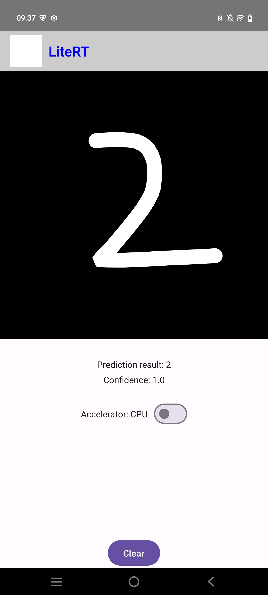
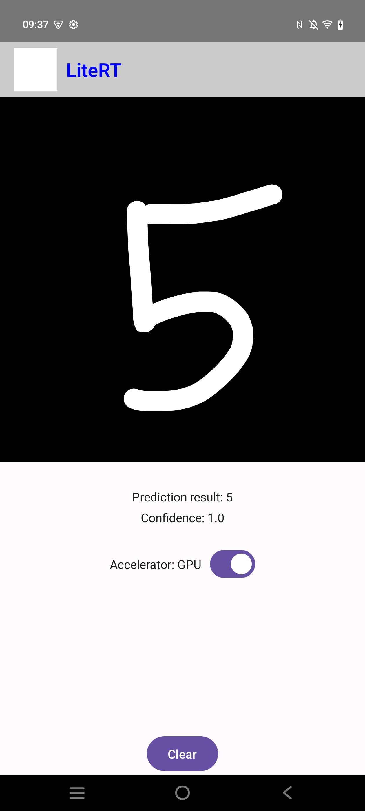

# LiteRT Digit Classifier Sample

This directory contains an Android sample demonstrating how to use LiteRT (Google's new runtime for TensorFlow Lite) to classify handwritten digits.

## Overview

The Digit Classifier sample allows users to draw digits (0-9) on the screen and uses a machine learning model to classify the drawn digit in real-time. It demonstrates the use of the LiteRT Compiled Model API with support for hardware acceleration.

## Available Implementations

### kotlin_npu

An implementation utilizing the LiteRT Compiled Model API with support for **CPU**, **GPU**, and **NPU** acceleration (`BuiltinNpuAcceleratorProvider` + `CompiledModel.QualcommOptions`), allowing runtime switching between all three backends via `FilterChip` selectors and reporting active backend status.

### kotlin_cpu_gpu

A standard implementation utilizing the Compiled Model API with support for CPU and GPU delegates.

**Features:**
-   **Canvas Drawing**: Interactive canvas to draw digits.
-   **Hardware Acceleration**: Switch between CPU, GPU, and NPU (`kotlin_npu`) delegates at runtime.
-   **Real-time Inference**: Classifies the drawing as you draw (or upon updates).
-   **Jetpack Compose**: Modern Android UI toolkit.

### Screenshots

| CPU Execution | GPU Execution |
| :---: | :---: |
|  |  |

## Technical Details

### Model Architecture
-   **Task**: Single digit classification (MNIST-style).
-   **Input**: 28x28x3 RGB image (preprocessed from drawing canvas).
-   **Output**: Probability score for 10 classes (digits 0-9).
-   **Model format**: TensorFlow Lite (`.tflite`).

### Key Dependencies
-   **LiteRT** (`com.google.ai.edge.litert:litert`, `litert-gpu`, `litert-npu-runtime-qualcomm`)
-   **Jetpack Compose** (UI)
-   **Kotlin Coroutines** (Async operations)

### Architecture Components
-   **`DigitClassificationHelper`**: Handles model initialization, hardware accelerator selection (CPU/GPU/NPU), and inference execution.
-   **`MainActivity`**: Setup of the main screen and UI components.
-   **`Board` Composable**: Handles touch input for drawing and renders the strokes.
-   **`MainViewModel`**: Manages UI state and communicates between the UI and the Helper.

## Getting Started

### Option 1: NPU + GPU + CPU (`kotlin_npu/android`)
1.  *(Optional for Qualcomm NPU hardware)* Populate `kotlin_npu/android/app/src/main/jniLibs/arm64-v8a` using `./fetch_qualcomm_library.sh` or pass `-Pnpu.libs=/path/to/qnn/libs` to Gradle.
2.  Open `kotlin_npu/android` in Android Studio (or run `./gradlew assembleDebug` / `./gradlew installDebug`).
3.  Draw a digit on the canvas and switch between **CPU**, **GPU**, and **NPU** chips at runtime.

### Option 2: CPU + GPU (`kotlin_cpu_gpu/android`)
1.  Open `kotlin_cpu_gpu/android` in Android Studio.
2.  Build and run the application on an Android device.
3.  Draw a digit on the board area and use the toggle switch to change between CPU and GPU acceleration.

