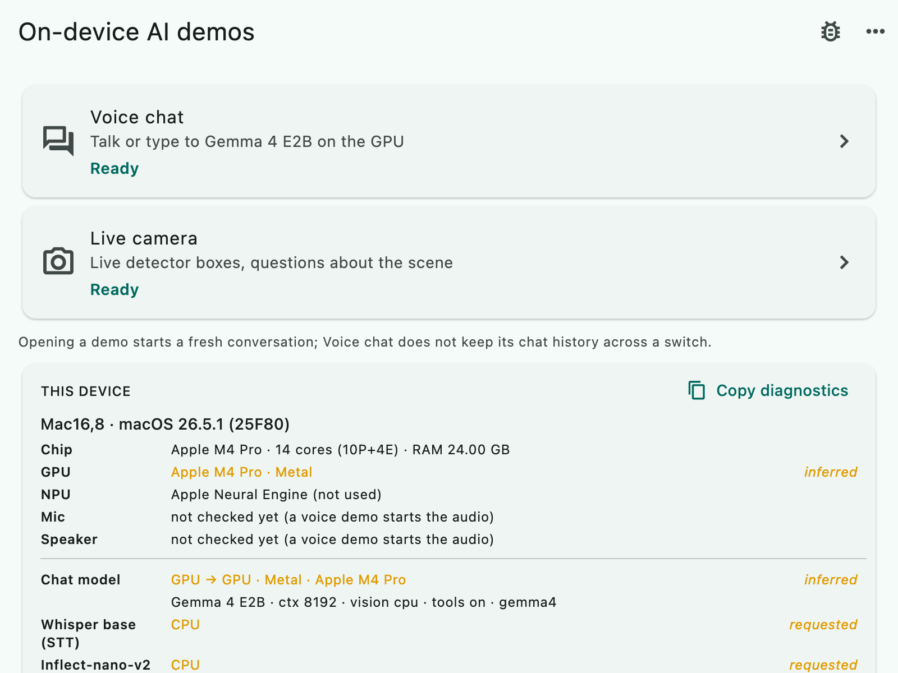
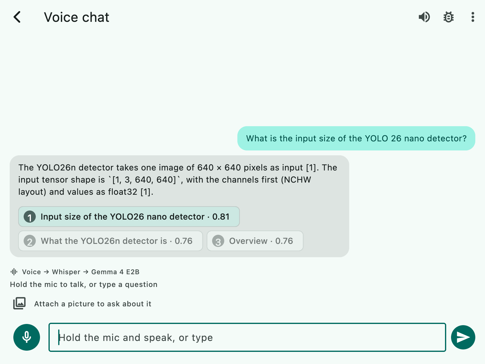
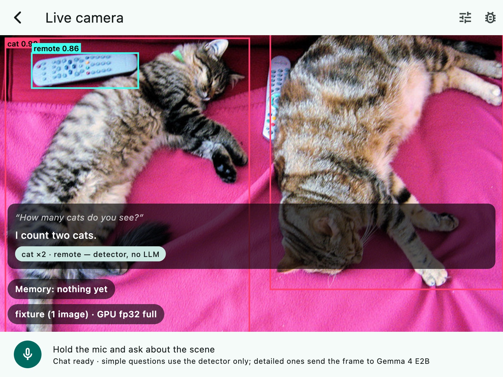

# LiteRT Demos (Flutter)

One Flutter app with two on-device AI demos for Android, iOS, macOS and Linux. Everything runs on the device: a chat
model through LiteRT-LM (Gemma 4 E2B on the GPU, CPU or a Qualcomm NPU), speech in and out, EmbeddingGemma 2 for a
local knowledge base and the camera's visual memory, and a LiteRT object detector. Once the chat model is on the
device, the demos need no network (only the optional network camera, **Download from URL** and, on macOS and Linux,
the calendar intent's Google Calendar page use one).

| Home | Voice chat | Live camera |
|---|---|---|
|  |  |  |

- **Voice chat.** Hold the mic button and ask; the chat model streams the answer, and Inflect-nano-v2 speaks it
  from the first finished sentence. With a chat model that hears audio (a file with an audio tower, such as Gemma 4 E2B),
  the recording itself goes to the model, and EmbeddingGemma 2 searches the knowledge base with the recording too;
  Whisper base transcribes it after the reply has played, for the chat bubble and the text history. Otherwise
  Whisper transcribes first. The screen shows the mode with the loaded file's name ("Voice → gemma-4-E2B-it";
  "Voice → Whisper → …" for a chat model without an audio tower).
  Attach a photo and ask about it. Questions about LiteRT and the Flutter packages are answered from a built-in
  knowledge base (EmbeddingGemma 2 and sqlite-vec) with citation chips. Agent skills come from Markdown files
  (`SKILL.md`) and can be added at run time without a rebuild: the current time, and device and accelerator info
  (the chip, the GPU and where each model runs).
- **Live camera.** Live boxes from a YOLO26n detector on the GPU (or the CPU, in the camera settings). Ask by voice (moonshine tiny): simple questions
  ("How many cats do you see?") are answered from the detections without the LLM; detailed ones ("Describe the
  scene", "What does the sign say?") send the current frame to the chat model.
- **Visual memory (Live camera).** While the demo is idle, it keeps a frame every few seconds when the scene
  changes, as an EmbeddingGemma 2 image vector, in memory only. "Where was the yellow sign?" or "Have you seen my
  mug?" finds the frame by meaning, not only among the detector's 80 classes, and the answer comes with a card: the
  frame and how long ago it was seen.

The app is built on [`flutter_edge_ai`](https://pub.dev/packages/flutter_edge_ai) (formerly `flutter_gemma`) and its
LiteRT-LM, speech, RAG and agent packages, plus [`flutter_litert`](https://pub.dev/packages/flutter_litert)
for the detector. Both are community packages, not Google SDKs. How the pieces fit:
[docs/architecture.md](docs/architecture.md).

## Models and accelerators

The chat model is the `.litertlm` file you choose: the app ships none. Every other model is built into the app. Where
each one runs:

| Role | Model and source | Android: Snapdragon with the NPU | Android: other | iOS | macOS | Linux: NVIDIA GPU (x86_64, Jetson Orin) | Linux: Raspberry Pi 5 | Linux: VENTUNO Q (QCS8275) |
|---|---|---|---|---|---|---|---|---|
| Chat (both demos) | the `.litertlm` you choose, such as Gemma 4 E2B from [litert-community/gemma-4-E2B-it-litert-lm](https://huggingface.co/litert-community/gemma-4-E2B-it-litert-lm) (Gemma 4: Apache-2.0); the files are [below](#chat-model-files) | NPU, with a build for that chip; or GPU | GPU | GPU | GPU | GPU | CPU | NPU, with the `qcs8275` build; or GPU |
| Chat: vision and audio towers | in the chat model's file | CPU; NPU in builds whose towers are compiled for it | CPU | CPU | CPU | CPU | CPU | CPU |
| Object detector (Live camera) | YOLO26n, raw head, derived from [Arm/yolo26n-fp16-litert](https://huggingface.co/Arm/yolo26n-fp16-litert) (Ultralytics YOLO26, AGPL-3.0) | GPU | GPU | GPU | GPU | GPU | GPU | GPU |
| Embeddings (knowledge base, spoken questions, visual memory) | EmbeddingGemma 2 740m, text, audio and images, from [litert-community/embeddinggemma-2-740m-litert-lm](https://huggingface.co/litert-community/embeddinggemma-2-740m-litert-lm) (Apache-2.0) | CPU | CPU | CPU | CPU | CPU | CPU | CPU |
| Speech to text (Voice chat) | Whisper base, int8, from [litert-community/whisper-base](https://huggingface.co/litert-community/whisper-base) (Apache-2.0) | CPU | CPU | CPU | CPU | CPU | CPU | CPU |
| Speech to text (Live camera) | moonshine tiny, from [litert-community/moonshine-tiny](https://huggingface.co/litert-community/moonshine-tiny) (MIT) | CPU | CPU | CPU | CPU | CPU | CPU | CPU |
| Text to speech | Inflect-nano-v2 (fp16) from [litert-community/Inflect-Nano-v2](https://huggingface.co/litert-community/Inflect-Nano-v2) (Apache-2.0), with Matcha's G2P from [litert-community/Matcha-TTS](https://huggingface.co/litert-community/Matcha-TTS) (G2P model and config MIT; `g2p_dict.txt.gz` BSD-3-Clause-Clear, from OpenPhonemizer) | CPU | CPU | CPU | CPU | CPU | CPU | CPU |


- **GPU** is Metal on iOS and macOS, and LiteRT's WebGPU accelerator on Vulkan on Linux.
- **Speech** (Whisper, moonshine, Inflect) is requested on the CPU; flutter_edge_ai_speech does not report where it
  ran.
- **NPU** is Qualcomm's Hexagon NPU, through LiteRT's Qualcomm dispatch library and Qualcomm's QNN runtime, both
  fetched at build time ([Set up](#set-up-once-per-checkout)). The app offers it on Android phones where Qualcomm's
  FastRPC library (`libcdsprpc.so`) opens, and on Linux arm64 boards with a Qualcomm compute DSP
  (`/dev/fastrpc-cdsp`); nowhere else. NPU builds are compiled per chip.
- **The CPU is a choice** for the detector in the Live camera settings, and for any chat model file not compiled for
  an NPU. A build compiled for an NPU runs only on the NPU (flutter_edge_ai_litertlm refuses it on the GPU and the
  CPU), so its card offers neither.

### Chat model files

| File | Source | Compiled for | Text | Vision and audio towers |
|---|---|---|---|---|
| `gemma-4-E2B-it.litertlm` (2.6 GB) | [litert-community/gemma-4-E2B-it-litert-lm](https://huggingface.co/litert-community/gemma-4-E2B-it-litert-lm) | no chip: any device | GPU or CPU | CPU |
| Qualcomm NPU builds, compiled for one chip each: `…_qualcomm_sm8750.litertlm`, `…_qualcomm_qcs8275.litertlm` | the same repository | Snapdragon 8 Elite (SM8750) phones; QCS8275 boards such as the VENTUNO Q | NPU | CPU: their towers are not compiled for the NPU |
| Gemma 4 E2B with the vision and audio towers compiled for the NPU too, one file per chip | provided by Google, not yet published | one chip each | NPU | NPU |

The app does not choose where a tower runs: it loads every tower the file has and leaves the backend to
flutter_edge_ai_litertlm, which places each one from the file (a backend the tower declares, the NPU for a tower
compiled for one, else the CPU). The chat model card's **Towers** rows show which towers the chosen file has and,
once it is loaded, where each one runs ([The chat model](#the-chat-model)).

Measured on [Developer Device Platform](https://docs.cloud.google.com/developer-device-platform/overview), Google
Cloud's lab of real phones: the first token of a spoken question sent as audio and of a typed question about a
photo, from the moment the app hands the question to the chat.

| Phone | Chat model | Text | Towers | Spoken question, first token | Photo, first token |
|---|---|---|---|---|---|
| Galaxy S24 (Snapdragon 8 Gen 3, SM8650) | `gemma-4-E2B-it.litertlm` | GPU | CPU | 0.86 s | 5.5 s |
| Galaxy S25 Ultra (Snapdragon 8 Elite, SM8750) | `gemma-4-E2B-it_qualcomm_sm8750.litertlm` | NPU | CPU | 0.32 s | 3.2 s |
| Galaxy S24, S25 Ultra, S26 (SM8850) | the builds with NPU towers, one for each phone's chip | NPU | NPU | 0.27–0.32 s | 0.64–0.76 s |

The app never moves a model to another backend on its own. The chat model's engine is registered without its
backend fallback (`LiteRtLmEngine(backendFallback: false)`): a load runs on the backend asked for or fails, and the
card shows the plugin's reason (the file cannot run there, LiteRT-LM's own message, or an NPU this device cannot
reach) and offers another backend as an explicit choice. A build compiled for an NPU runs nowhere else: its card
never offers the GPU or the CPU. A refusal the plugin makes before any engine (the file cannot run there, or is
incomplete) has no Retry: the same load would be refused again. A GPU that is a software rasterizer (llvmpipe and the like, on a Linux machine without a GPU driver) counts as
unusable for the detector: Live camera says so and offers **Run detector on CPU**. **This device** (on Home) and the
diagnostics overlay show the backend each model asked for and, where the runtime reports it, the one it got.

## Platform guides

This README covers what every platform shares. Each guide has the device-specific build, install and run steps:

| Platform | Guide |
|---|---|
| Android phones (Android 11+, arm64), including the Qualcomm NPU | [samples/platforms/android](../../platforms/android/README.md) |
| iPhone (iOS 26+) | [samples/platforms/ios](../../platforms/ios/README.md) |
| Raspberry Pi 5 | [samples/platforms/raspberry](../../platforms/raspberry/README.md) |
| NVIDIA Jetson Orin | [samples/platforms/nvidia](../../platforms/nvidia/README.md) |
| Arduino VENTUNO Q (Qualcomm QCS8275), including the NPU | [samples/platforms/qualcomm/ventuno](../../platforms/qualcomm/ventuno/README.md) |

macOS (Apple silicon) and Linux desktops run from this folder directly ([Run](#run)).

## Requirements

| | |
|---|---|
| Flutter | 3.47.3 (Dart 3.13), stable channel. [fvm](https://fvm.app) users get it from `.fvmrc` |
| Python | 3.10 to 3.14 with `venv`, used once by `tool/fetch_models.sh` to derive the detector model. macOS ships 3.9: install a newer one (for example `brew install python@3.12`) and run `PYTHON=python3.12 tool/fetch_models.sh` |
| Disk | about 720 MB for the built-in models (plus a Python venv under `build/`), 2.6 GB for the chat model, the build output, and about 385 MB of embedder caches the app writes at its first launch (an embedder that could write no cache at all does not load, and says why: `requireWeightCache`) |
| macOS | Xcode 26 and CocoaPods; Apple silicon, macOS 14 or newer |
| Linux | x64 or arm64, Ubuntu 22.04+ / Debian 12+; a Vulkan GPU for GPU inference; the packages below |
| Android, iOS | see the platform guides |

On Linux, install the build and runtime packages first:

```sh
sudo apt install git curl unzip xz-utils patch python3-venv clang cmake ninja-build pkg-config lld \
  libgtk-3-dev liblzma-dev libstdc++-12-dev libgstreamer1.0-dev libgstreamer-plugins-base1.0-dev \
  libasound2-dev libturbojpeg pulseaudio-utils gstreamer1.0-plugins-base gstreamer1.0-plugins-good \
  libvulkan1 vulkan-tools
```

On Debian and Raspberry Pi OS the JPEG library is `libturbojpeg0`; on Ubuntu 22.04 add `libunwind-dev`. The GPU also
needs its Vulkan driver: `mesa-vulkan-drivers` for a Mesa GPU, NVIDIA's own driver for an NVIDIA GPU.

## Set up (once per checkout)

```sh
tool/flutter_litert/vendor.sh        # flutter_litert 3.9.3 + a small patch into third_party/ (gitignored)
tool/fetch_models.sh                 # the built-in models into assets/models/, each one verified
flutter pub get
```

- **`vendor.sh`.** On Linux, `flutter_litert` must run on the same LiteRT library as LiteRT-LM (one LiteRT per
  process). The patch makes it do that, and changes nothing on the other platforms. `pubspec.yaml` points
  `dependency_overrides` at the patched copy, so `flutter pub get` fails until this has run.
- **`fetch_models.sh`.** The models built into the app are not in git. [`tool/models.lock`](tool/models.lock) pins
  every file (repository, commit, path, size and SHA-256); the script resumes interrupted downloads, skips files it
  has already verified, and `--check` verifies without the network. Until it has run, every `flutter build`, `run`
  and `test` fails with "No file or variants found for asset: assets/models/…". Every file is public: no Hugging
  Face account or token is needed.
- **The detector model is derived, not downloaded.** The script downloads Arm's
  [`yolo26n_conv2d_f16_weights.tflite`](https://huggingface.co/Arm/yolo26n-fp16-litert) and cuts its head with
  [`tool/prune_yolo26n_head.py`](tool/prune_yolo26n_head.py) in a venv under `build/`, so the whole graph runs on the
  GPU. The output must match the lock byte for byte. If you were given `yolo26n_fp16_rawhead.tflite`, put it in
  `assets/models/` first: the script then verifies it and skips the derivation.
- **The first build** of each platform downloads native prebuilts: the LiteRT-LM runtime and sqlite-vec, both built
  by the `flutter_edge_ai` project (GitHub releases), and, because `pubspec.yaml` sets `qualcomm_npu: true`,
  Qualcomm's QNN runtime for the NPU (Android: from Maven Central; Linux arm64: read out of Qualcomm's public QAIRT
  SDK zip). Each is checked against pinned SHA-256 values; the QNN libraries are under Qualcomm's licence. Set
  `qualcomm_npu: false` to build without them.

## The chat model

The app ships no chat model: it loads the `.litertlm` file you choose ([which files run
where](#chat-model-files)). Start with Gemma 4 E2B from
[litert-community/gemma-4-E2B-it-litert-lm](https://huggingface.co/litert-community/gemma-4-E2B-it-litert-lm) (no
login needed): `gemma-4-E2B-it.litertlm` (2.6 GB).

Start the app once, then put the file in its models folder and choose it on **Set up models › Chat model** (later
**Home › More › Models**):

| Platform | Models folder |
|---|---|
| Android | `/data/local/tmp/litert-models` (`adb push`) or `/sdcard/Android/data/com.google.ai.edge.examples.litert_edge_demos/files/models` |
| iOS | the app's Documents/models (visible in the Files app) |
| macOS | the app's Documents/models (`~/Library/Containers/com.google.ai.edge.examples.litertEdgeDemos/Data/Documents/models`) |
| Linux | `~/litert-demos/models` |

Tap the file, check its settings, then **Use this model** (**Apply and reload** once a model is chosen); a tapped
file changes nothing until then. On Android and iOS, with no model chosen yet and a single file in the models folders,
the app uses that file at once.

**Download from URL…** takes a direct link (for example
`https://huggingface.co/litert-community/gemma-4-E2B-it-litert-lm/resolve/main/gemma-4-E2B-it.litertlm`).
**Import file…** (iOS and desktop) copies a file in. **Path…** uses a file where it is; a macOS build is sandboxed:
a release build reads only its own container, a debug or profile build also `~/Downloads`. Each of these, too, waits
for **Use this model**.

The app reads a chosen file only through flutter_edge_ai_litertlm (`readLiteRtLmBundleInfo`), and refuses at the pick
only what a load would refuse: a file it cannot open, or one shorter than its sections (a copy or download that
stopped early), with the plugin's message or the lengths it reports. A file whose header the plugin cannot read (not a
container it knows, a newer container version) is not refused, because the plugin loads such a file without reading
it: the card shows the plugin's reason, and the file loads text only, since no tower is known.

The card's starting settings: the backend comes from the file: a build compiled for an NPU starts on the NPU, with
tools off (it runs only on the NPU; on a device without one the card says why it cannot be applied); any other file
starts on the GPU. The context length and the model type come from the file name (`_ekv4096_`; otherwise 8192 tokens
on the GPU or CPU, 4096 on the NPU). The type picks the tool-call format and how a thinking channel is read; the
prompt format is the file's own chat template, whatever the type. An imported or downloaded file gets the same, read
from its stored copy. Change any of it on the card.

The model's towers (vision and audio) are not settings: every tower the file has is loaded, and
flutter_edge_ai_litertlm places each one. The card's **Towers** block shows which towers the file has and, once that
file is loaded, the processor each one got (`InferenceModel.activeVisionBackend` / `activeAudioBackend`); for a build
compiled for an NPU it also names the chip. A load that fails shows the plugin's reason as it is.

## Run

Use a release or profile build: debug builds run the Dart side of the pipelines much slower.

```sh
flutter devices
flutter run -d <device-id> --release
```

- **macOS:** `flutter run -d macos --release`.
- **Linux:** `NO_XIPH_LIBS=1 flutter run -d linux --release` (`NO_XIPH_LIBS` leaves out the audio player's codec
  libraries, whose bundled copies are x86-64 only; the app plays raw PCM). For the pre-flight launcher, which checks
  the sound server, microphone, speaker, Vulkan GPU and camera and says what to install, package a release build:

  ```sh
  NO_XIPH_LIBS=1 flutter build linux --release
  tool/linux/package.sh        # build/dist/litert_edge_demos-v<version>-linux-<arch>/ and a .tar.gz
  ```

  Then run `./run.sh` inside that folder.

Grant the camera and microphone when asked. The chat model's first GPU load is slower than later ones: LiteRT-LM
compiles its GPU programs once and caches them.

## Using the demos

- **Voice chat:** hold the mic button, speak, release; or type. Try "What is the input size of the YOLO26 nano
  detector?" (answered from the knowledge base, with sources), "Which accelerator are you running on?" (typed: see
  below) and a question about an attached photo. In audio mode your bubble shows the recording's length until
  Whisper's transcript fills it in, after the reply. Skills live in the folder the Skills sheet shows; add a folder
  with a `SKILL.md` and press **Reload**. A skill runs the app's intents (`current_time`, `device_info`) or the agent
  package's built-in ones, named exactly; the Skills sheet lists a skill that names any other intent with its
  error. Of the built-ins, `get_current_date_and_time` works everywhere; `send_email` and `send_text` open the mail or SMS app, where one is
  installed, for you to send; `create_calendar_event` opens the calendar's new-event editor on Android and iOS and a
  Google Calendar page in the browser on macOS and Linux; `read_calendar_events` always answers that it is not
  available; `schedule_notification` does not work in this app (the package never sets up notifications, and the app
  adds nothing for it).
  Time and device questions that the app's rules recognize, typed or transcribed by Whisper (with a chat model
  without an audio tower), are answered by the app itself while a skill that runs those intents is installed (the
  bundled `current-time` and `device-info` do); delete it and the question goes to the chat model. A spoken question
  in audio mode has no words for those rules: it goes to the chat model, which reaches a skill only through its tools
  (none while tools are off, as the mode line says).
  When the model loads a skill and then says nothing, the agent package asks it once more; a reply still empty shows
  as a failed reply, and so does an empty reply after an intent ran (the intent's result stays in the steps under it).
  A call, Siri, an alarm, another app's audio or unplugged headphones stop a reply with a notice: ask again
  afterwards. On iOS leaving the app stops a reply too (iOS suspends background apps); the text so far is kept.
- **Live camera:** pick the camera source in the demo's settings (the tune icon; the **Camera** button on Linux):
  the device camera, or a network camera. Hold the mic and ask, within 5 seconds, "What do you see?", "How many
  people are there?", "Describe the scene". The chip under the answer says which route answered it.
- **Visual memory:** leave the camera on a few scenes for a while ("Memory: 37 frames · 2 min" shows what it holds),
  then ask about the past: "Where was the yellow sign?", "Have you seen my mug?". Questions about the present
  ("Where is my cup right now?") go to the current frame instead. The first visit loads the embedder's image encoder
  (about 2 s, "Memory: preparing…"). The memory keeps at most 200 frames (16 MB), is never written to disk, and is
  forgotten when you leave the demo or change the source; the settings have a **Visual memory** switch and **Clear
  memory**. "What did you see?" shows the newest remembered frame (the current one when the memory is off). On a
  device that reports less than 6.5 GiB of RAM (sold with 6 GB or less) the memory starts off; the switch says why.
- **Network camera:** a multipart MJPEG stream, for example an Android phone running the free IP Webcam app on the
  same Wi-Fi: tap **Start server** and enter the address it shows followed by `/video`
  (`http://192.168.1.23:8080/video`). The URL is stored on the device, and an `http` stream is not encrypted: do not
  put a password you use elsewhere in it.

## Self-test and diagnostics

`--selftest` probes the hardware, runs the detector on a reference picture against golden detections, loads the chat
model and times 64 tokens, runs the detector again to check it is unchanged, plays a tone and records one second,
loads EmbeddingGemma 2 and compares a bundled spoken question with its words and a bundled photo (made into a
memory frame) with a caption, then writes a report: device, OS, GPU (and on Linux its driver), where each model ran,
speed and memory. On Linux run
`./run.sh --selftest` (add `--skip-audio` without a microphone or speaker); everywhere, **Home › More › Models ›
Run self-test** does the same in the app. **This device › Copy diagnostics** copies the same facts to the clipboard.

## Configuration

Everything has a default; these dart-defines change it (`flutter run --dart-define=NAME=value`):

| Define | Effect |
|---|---|
| `GEMMA_MODEL_PATH` | a `.litertlm` to use as the chat model while none is chosen in the app (integration tests, headless self-test) |
| `DETECTOR_BACKEND` | `gpu` or `cpu` for the detector, fixed for the build (otherwise the Live camera setting, default GPU) |
| `FRAME_SOURCE` | `camera` (default), `network` or `fixture` |
| `NETWORK_CAMERA_URL` | the stream for `FRAME_SOURCE=network` |
| `FIXTURE_DIR` | a folder of images to play as the camera for `FRAME_SOURCE=fixture` |
| `VOICE_GATE_DBFS` | the microphone's silence threshold, for a noisy room |

Tunables (frame rate, voice gate, prompts, knowledge-base settings) are in `lib/config/`.

## Licences

[Models and accelerators](#models-and-accelerators) gives each model's source and licence. The NPU runtime, fetched
at build time (`qualcomm_npu: true`), is Qualcomm's QNN runtime (HTP), under Qualcomm's licence (redistribution
inside an app), with LiteRT's Qualcomm dispatch library (Apache-2.0).

Every built-in model is fetched by `tool/fetch_models.sh`, none is in git; [assets/models/NOTICE.md](assets/models/NOTICE.md)
and the in-app licence page (**Home › More › Licences**) list them with their sources.

- **YOLO26n is AGPL-3.0.** The weights are Ultralytics YOLO26 ([docs](https://docs.ultralytics.com/models/yolo26/),
  [licence](https://github.com/ultralytics/ultralytics/blob/main/LICENSE)), converted to LiteRT by Arm. The derived
  file is built on your machine and bundled into your build: if you distribute that build, the AGPL-3.0 applies to
  it. To avoid that, replace the detector with an Apache-licensed one (see `lib/data/services/detector/`).
- The knowledge base (`assets/kb/`, indexed into `assets/kb_index/` by `tool/build_kb_index.sh`) lists each
  document's source and licence in its front matter.

## Tests

```sh
flutter analyze
flutter test                                                        # unit and widget tests
flutter test integration_test/<file>.dart -d <device-id> --dart-define=GEMMA_MODEL_PATH=<path/to/model.litertlm>
```

Each integration test's header lists its flags; most run on macOS (`-d macos`), where the sandboxed debug build
reads files given by path (the model, fixture folders) only from `~/Downloads`. Run integration tests on devices
with `flutter test`, not `flutter drive`.

The questions the integration tests play into the microphone (`test_assets/q_*.wav`, `test_assets/france_16k.pcm`,
`test_assets/showcase/q_*.wav`) are spoken by the app's own speech synthesizer, Inflect-nano-v2. The wording lives in
one list at the top of `integration_test/tools/make_question_audio_test.dart`; `tool/make_question_audio.sh`
regenerates them on a Mac.

## Known limitations

- **Half-duplex audio by design:** the microphone is closed while a reply plays; pressing it interrupts the reply.
  There is no echo cancellation.
- **iOS 26 or newer:** a dependency of the agent package (`flutter_inappwebview_ios`) links a system library that
  first ships in iOS 26, so the app stops at launch on older iOS.
- **Visual memory costs RAM:** the camera demo's first visit loads EmbeddingGemma 2's image encoder, and it stays
  loaded until the app exits. Turn **Visual memory** off in the camera settings to never load it.
