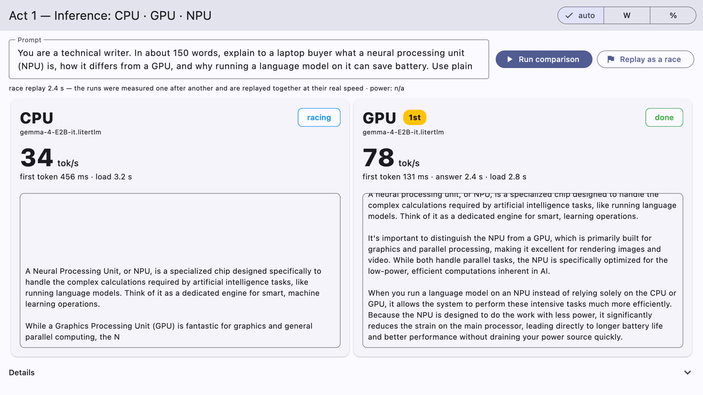
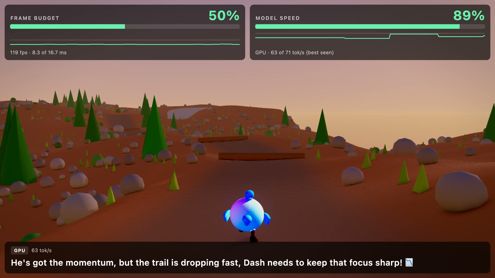

# Intel NPU demo: Gemma on the NPU of a Core Ultra laptop

A Flutter desktop app in four acts about the NPU of an Intel Core Ultra Series 3 laptop (Panther Lake): what it
brings to desktop-grade on-device language models, Gemma 4 12B and 26B A4B, next to the CPU and the GPU. Everything
runs on the machine; once the model files are there, the app needs no network. Each act shows one side of the NPU:

- **Act 1 — Inference.** The same prompt to Gemma 4 12B on the CPU, the GPU and the NPU, one lane each: decode
  speed in numbers the back of the room can read, time to first token, the answer streaming in, and what the CPU,
  GPU and NPU were doing meanwhile (load or watts). The runs are measured one at a time, then **replayed as a
  race**, side by side at their real speed. On Panther Lake the NPU decodes the 12B about as fast as the GPU (13.1
  vs 14.2 tok/s), answers first (0.46 s to the first token), and leaves the GPU free; that it also draws a fraction
  of the power is the claim still to be measured (watts need Memory Integrity off). All three engines stay loaded
  in one process, so switching is instant.
- **Act 2 — Long context.** A 45-minute meeting transcript (about 7,000 tokens) goes into the 12B's context on the
  NPU once, before anyone asks anything; every question then reuses the warm context and answers with the
  timestamp and the quoted line, which the transcript viewer jumps to. Gemma 4 E2B, the mobile model, gets the
  same transcript in its 4K window and fails with the runtime's own "too long" error.
- **Act 3 — The NPU's own argument: parallel work.** Dash runs an endless generated landscape on the GPU — terrain,
  forests, rivers, a day that turns to night — while the 12B commentates the run live, as subtitles. The scene
  calibrates itself to the edge of the frame budget, and two meters show the cost: FRAME BUDGET (how much of a frame
  the scene uses) and MODEL SPEED (how much of its own solo speed the model still gets). Put the commentator on the
  GPU and both drop; put it on the NPU and neither does. With `ACT3_EYES_MODEL` set, Dash also
  [drives himself](#dash-drives-himself): EmbeddingGemma 2 looks at the screen on the NPU and presses the keys.
- **Act 4 — Meeting agent.** Gemma 4 26B A4B on the NPU reads the transcript of any meeting (a plain text file) and
  does the follow-up with six tools (tasks, email, drafts for approval, meetings, documents, questions), through the
  plugin's native tool calling. The tools only record the call. Nothing about the meeting
  is in the app: the model first lists the follow-ups it finds, and that list is the checklist; then each action
  names the item it is for, and the item is ticked. The rules (no mail straight to an outside address, meetings
  only where everyone is free, every action on the list, nothing done twice) are checked against a workspace file:
  the people, the company's mail domain, the calendars and the shared documents.

| Act 1: the race replay | Act 3: the runner and its commentator |
|---|---|
|  |  |

Both screenshots are from a Mac, where there is no NPU lane; on a Panther Lake laptop Act 1 has a third lane, and
the Act 3 commentator can move to the NPU.

The app runs on macOS too (CPU and GPU only), which is where most of it was developed. It is built on
[`flutter_edge_ai`](https://pub.dev/packages/flutter_edge_ai) and its LiteRT-LM engine
[`flutter_edge_ai_litertlm`](https://pub.dev/packages/flutter_edge_ai_litertlm), and on
[`flutter_scene`](https://pub.dev/packages/flutter_scene) for the 3D scene; all three are community packages, not
Google SDKs. Intel, Core Ultra and Gemma are trademarks of their owners.

## Models and processors

The app ships no model: you download the `.litertlm` files and point the app at them.

| Act | Model and source | Size | macOS (Apple silicon) | Windows on Intel Core Ultra Series 3 (Panther Lake) |
|---|---|---|---|---|
| 1, 2 and 3 | Gemma 4 12B, `gemma-4-12B-it.litertlm` from [litert-community/gemma-4-12B-it-litert-lm](https://huggingface.co/litert-community/gemma-4-12B-it-litert-lm) (Gemma 4: Apache-2.0) | 6.9 GB | CPU, GPU (Metal) | CPU, GPU (DirectX 12) |
| 1, 2 and 3, on the NPU | Gemma 4 12B compiled for the Panther Lake NPU, `gemma4-12B-it-Intel_PTL_NPU.litertlm` from the same repository (`NPU_MODEL_PATH`; 32K context) | 7.7 GB | — | NPU |
| 4 | Gemma 4 26B A4B compiled for the Panther Lake NPU, `gemma4-26B-A4B-it-Intel_PTL_NPU.litertlm` from [litert-community/gemma-4-26B-A4B-it-litert-lm](https://huggingface.co/litert-community/gemma-4-26B-A4B-it-litert-lm) (32K context, NPU only), listed in `ACT4_MODELS`. Any Gemma 4 model with native tool calling works there; the 12B NPU build was measured too | 13.3 GB | the 12B (not measured) | NPU |
| 2, the short-window model | Gemma 4 E2B, the mobile model, with a 4K window (`ACT2_CONTRAST_MODEL_PATH`): `gemma-4-E2B-it_intel_PTL.litertlm` on the NPU, `gemma-4-E2B-it.litertlm` on a CPU or a GPU, from [litert-community/gemma-4-E2B-it-litert-lm](https://huggingface.co/litert-community/gemma-4-E2B-it-litert-lm) | 2.5–3.0 GB | GPU | NPU |

- **NPU** is Intel's NPU, through LiteRT-LM's Intel dispatch library and the OpenVINO runtime that
  `flutter_edge_ai_litertlm` bundles on Windows. macOS has no NPU row: LiteRT-LM does not use the Apple Neural
  Engine, and the app does not offer it.
- **The standard files are not NPU models.** The NPU refuses them, so the NPU row needs an NPU build
  (`NPU_MODEL_PATH`). An NPU build has a fixed context (32K for Intel's 12B and 26B) and runs only on the NPU. The
  26B has no build for a CPU or a GPU that LiteRT-LM's open-source runtime loads (its `-gpu` file needs Google's
  own GPU engine), so Act 4's 26B is an NPU act.
- The app never moves a model to another processor on its own. A backend that fails to load is a failed row, not a
  silent fall back to the CPU.

## Requirements

| | |
|---|---|
| Flutter | 3.47.1 or newer, stable channel ([fvm](https://fvm.app) works). `flutter_scene` needs 3.47.0; Flutter GPU on Windows needs 3.47.1 |
| macOS | macOS 14 or newer on Apple silicon, Xcode and CocoaPods |
| Windows | Windows 11, Visual Studio 2022 with "Desktop development with C++", Developer Mode on (Flutter plugins need symlinks), the Visual C++ Redistributable on machines that run the build |
| NPU | Intel Core Ultra Series 3 (Panther Lake) with the Intel NPU driver |
| Memory | measured on a 64 GB Panther Lake laptop, with the 12B loaded on all three processors at once; Act 2's 12B also ran on a 24 GB Mac. Loading an NPU build writes its weights to `%TEMP%` first (about 13 GB for the 26B) |
| Disk | the models (above), and the GPU caches LiteRT-LM writes on a model's first GPU load, up to the model's own size again (the 12B's are 6 GB) |
| Network | the first build downloads the LiteRT-LM native libraries (a GitHub release, SHA-256 checked) |
| Optional | `ffmpeg` on the PATH (or `FFMPEG=…`) for recording Act 3 to video; [LibreHardwareMonitor](https://github.com/LibreHardwareMonitor/LibreHardwareMonitor) for watts on Windows |

## Set up

```sh
flutter pub get
cp config.json.example config.json     # then point the paths at your models
```

The example is for a Panther Lake laptop. On a Mac, leave `NPU_MODEL_PATH` empty, set `ACT2_BACKEND` to `gpu`
with `ACT2_MODEL_PATH` at `gemma-4-12B-it.litertlm` and `ACT2_CONTRAST_MODEL_PATH` at `gemma-4-E2B-it.litertlm`, and
list the 12B on the GPU in `ACT4_MODELS`.

Download the models from the links above (no login needed), for example with the Hugging Face CLI:

```sh
hf download litert-community/gemma-4-12B-it-litert-lm gemma-4-12B-it.litertlm --local-dir ~/models
hf download litert-community/gemma-4-12B-it-litert-lm gemma4-12B-it-Intel_PTL_NPU.litertlm --local-dir ~/models
hf download litert-community/gemma-4-26B-A4B-it-litert-lm gemma4-26B-A4B-it-Intel_PTL_NPU.litertlm --local-dir ~/models   # Act 4
hf download litert-community/gemma-4-E2B-it-litert-lm gemma-4-E2B-it_intel_PTL.litertlm --local-dir ~/models   # Act 2's mobile model
```

`config.json` is gitignored. Every setting has a default except `MODEL_PATH`: without it the scene still runs, and
every model row says what is missing.

## Run

Use a profile build for anything you want to measure; debug frame and token numbers mean little.

```sh
flutter run -d macos   --profile --dart-define-from-file=config.json
flutter run -d windows --profile --dart-define-from-file=config.json
```

The home screen lists the four acts. `ACT=1` to `4` opens one directly.

The first GPU load of a model is slow: LiteRT-LM compiles its GPU programs and caches them, with the weights in GPU
layout, in the app's support folder (`%APPDATA%\com.google.ai.edge.examples\intel_npu_demo` on Windows). Later loads
take a second or two.

## Using the demos

- **Act 1:** **Run comparison** measures `BACKENDS` one after another, each on its own lane: decode speed, time to
  first token, how long the whole answer took, and bars for the CPU, GPU and NPU load during that answer (Windows,
  with the power sidecar; `auto / W / %` switches to watts). **Replay as a race** then plays the recorded answers
  together at their real speed and ranks them by finish. Measuring them at the same time would spoil both numbers:
  the iGPU and the NPU share memory bandwidth. **Details** has every number, runtime-reported and wall-clock.
- **Act 2:** wait for "Context is warm", then ask, e.g. "What cost centre code did finance assign, who said it,
  and at what timestamp?". Timestamps in the answer become chips that jump to the line; a timestamp that is not in
  the transcript stays grey. **Same source into 4096** feeds the same transcript to the mobile model's 4K window.
- **Act 4:** open a transcript with the folder button (or `ACT4_MEETING`; the bundled example is a product
  meeting at a made-up company, `assets/agent/example/`), pick a model, thinking on or off, and press **Run**. The
  left pane shows the thinking as it streams, then the actions as they arrive (the plugin hands a turn's calls over
  when the turn ends, so they land together; they are let in one after another). The right pane is the checklist:
  the follow-ups the model listed, ticked as actions name them, then the rules. *Follow-ups done* counts against
  the model's own list, so it measures follow-through, not whether the list is right: a list that misses
  something costs nothing. *Rules kept* stays open until the first action, because a model that does nothing
  keeps every rule. Thinking is capped at 2048 tokens a turn (`LiteRtLmEngine(thinkingTokenBudget:)`):
  uncapped, the 26B on the NPU thinks until the output limit and never calls a tool. Listing and acting are
  one request, not two: on the NPU a second message after a tool loop fails (the executor rolls back one token at
  most).

  The workspace is `ACT4_WORKSPACE`, else `<transcript name>.workspace.json` or `workspace.json` beside the
  transcript, else none: the agent then knows only the meeting, and the rules that need a domain or a calendar are
  left out. Its format is the example's, `nimbus.workspace.json`: `company`, `today`, `internal_domain`,
  `work_hours`, `people` (`name`, `email`, `role`, `internal`), `calendars` (`date`, `busy`: address → `[["HH:MM",
  "HH:MM"]]` or `"out"`), `documents`, and `notes` (Markdown handed to the model as is).
- **Act 3:** the presenter's keys:

  | Key | |
  |---|---|
  | `1` `2` `3` / `0` | commentator on the CPU / GPU / NPU / off |
  | `A` `D`, arrows | steer Dash (the autopilot, or the eyes, take over again when you let go) |
  | `Space`, `W` | jump |
  | `P` | pause |
  | `N` | fast-forward to the next part of the day |
  | `H` | detail panels (frame timing, event log, load dials) and the back button |
  | `B` | measure each backend's solo speed again, e.g. after changing the load by hand |

  On start the act walks a load ladder (draw distance, then vegetation, then pixels) until the scene sits at the
  edge of the frame budget, then measures each backend's solo tokens/sec with the scene at its lightest. Both are
  needed for the act to show anything: a scene with headroom loses no frames when the model takes the GPU, and a
  model compared with its own best reading under load always looks 100 % fast. The budget is `ACT3_TARGET_FPS`
  (60), or the display's refresh rate when the display cannot show more than that.

## Dash drives himself

With `ACT3_EYES_MODEL` set, the autopilot hands Dash to EmbeddingGemma 2, the 440M text and vision embedding
model, and it drives from the screen alone. Several times a second it reads fixed parts of the frame in front of
Dash, turns each into a vector, and a decider per question names what the part shows:

| Question | Part of the frame | Answers |
|---|---|---|
| zones | the middle of the band ahead | trail, grass, rock, jump (a log or a stream) |
| near | the strip just over Dash | jump, run |
| steer | the whole band ahead, read while a rock is in front | left, right, straight |

A reflex turns the answers into the keys: two `jump` looks in a row jump, a rock in front sends Dash to the
side `steer` names. Nothing reads the game's world: no obstacle positions, no distances, only pixels and Dash's
own place on the trail. The overlay (`ACT3_EYES_OVERLAY`, on by default) draws the parts being read and each
answer, so the boxes are what is turned into vectors at that moment, and counts Dash's stumbles.

- **The model.** Any EmbeddingGemma 2 440m `.litertlm` that runs on `ACT3_EYES_BACKEND` (`npu` by default): an NPU
  build on the NPU. The one to use is fine-tuned on this game's frames,
  [sasha-denisov/dash-infinite-run](https://huggingface.co/sasha-denisov/dash-infinite-run):
  `eg2-440m-steer-ft3ep_Intel_PTL.litertlm` for the Panther Lake NPU, `eg2-440m-dash-eyes.litertlm` for a CPU or a
  GPU. Google's own is in
  [litert-community/embeddinggemma-2-text-vision-440m-litert-lm](https://huggingface.co/litert-community/embeddinggemma-2-text-vision-440m-litert-lm),
  `…_Intel_PTL.litertlm` for the NPU. The app gives images 70 vision tokens, the budget all of them were tuned and
  measured at.
- **The deciders.** For the two Panther Lake files on the NPU, the fine-tune and Google's, the app loads the ones
  in `assets/eyes/deciders/`, fitted on thousands of frames (keep the files' names: a decider is bound to its
  model file). With any other model or backend it fits them from the ten examples per answer in `assets/eyes/`
  (about 5 s on the NPU, 30 s on a CPU) and keeps them in the temp folder, so later starts load them.
- **Start.** The eyes' model loads while the act starts (about a second for either NPU file); until then the
  autopilot drives. A badge over the scene says who drives Dash: the eyes, the autopilot, or the presenter.
- **Speed.** A look (the near strip and the middle, two embeddings) takes about 130 ms on the Panther Lake NPU,
  and Dash keeps up. On a CPU a look takes about 0.7 s, in which Dash runs 7 to 10 m: the act runs, but he jumps
  late or not at all.

Stumbles in five minutes on the Panther Lake laptop's NPU, in daylight, on two stretches of trail no frame was
trained on (`ACT3_START_Z=7000` and `25000`):

| Who drives | 7 km | 25 km |
|---|---|---|
| The autopilot (`ACT3_PILOT_MISS_RATE=0`) | 14 | 20 |
| Google's EmbeddingGemma 2, deciders fitted from the examples | 91 | 92 |
| Google's EmbeddingGemma 2, the bundled deciders | 64 | 67 |
| The fine-tune, deciders fitted from the examples | 51 | |
| The fine-tune, the bundled deciders | 39–47 (five runs) | 46 |

The fine-tune was trained on frames of this game, recorded with the scene's geometry: each part of a frame
labelled with what lies in it, whether the autopilot would jump then, and which way it would go round a rock,
including frames from runs the eyes drove themselves. The model card on Hugging Face has the recipe.

## What it measured

Intel Core Ultra X7 358H (Panther Lake, Arc B390, 64 GB), Windows 11, `flutter_edge_ai_litertlm` 1.20.1, profile
builds in the desktop session.

**Act 1**, Gemma 4 12B, all three engines loaded in one process (`MAX_TOKENS=4096`), the default prompt (70 tokens
in, about 190 out), second sweep:

| Backend | Load | Time to first token | Decode |
|---|---|---|---|
| CPU | 12.1 s | 2.7 s | 8.7 tok/s |
| GPU (DirectX 12) | 10.0 s | 0.83 s | 14.2 tok/s |
| NPU (Intel's build) | 16.0 s | 0.46 s | 13.1 tok/s |

**Act 2**, the 7.3K-token transcript and "What cost centre code did finance assign, who said it, and at what
timestamp?":

| Engine | Window | Transcript in | First token of the answer | Answer |
|---|---|---|---|---|
| 12B, NPU | 32K | 19.3 s | 0.44 s | correct, with the cited line, 13.3 tok/s |
| 12B, GPU | 16K | 27.8 s | 0.98 s | correct, with the cited line, 13.1 tok/s |
| E2B, NPU (the mobile model) | 4K | refused: `7267 >= 4096` | — | — |

On a Mac (M4 Pro, 24 GB) the 12B on Metal at a 16K window takes the transcript in 33.8 s and answers correctly.

**Act 3**, the 12B commentating (1280×720, calibrated to a 60 fps budget: 896 m draw distance, vegetation ×5.5,
render scale 2.5, about 50K instances). The commentator's solo speed with the scene at its lightest is 10.6 tok/s
on the GPU and 10.7 on the NPU:

| Commentator | Scene | Commentator speed | First token |
|---|---|---|---|
| off | 54.8 fps | — | — |
| GPU | 51.9 fps | **4.9 tok/s, 46 % of its solo speed** | 7.9 s |
| NPU | 55.5 fps | 12.0 tok/s, all of it | 1.5 s |

On the GPU the scene and the model share the iGPU, and both lose: the frame rate drops and the model runs at half
speed. On the NPU the scene keeps its frame rate and the model its speed.

**Act 4**, the bundled meeting, thinking on, on the NPU:

| Model | Follow-ups done | Rules kept | Calls | Run | Decode |
|---|---|---|---|---|---|
| 26B A4B (Intel's build) | 13 of 13 | 4 of 4 | 14 | 5.7 min (load 20 s) | 17 tok/s |
| 12B (Intel's build) | 9 of 9 | 4 of 4 | 12 | 6.7 min (load 15 s) | 13 tok/s |

## Configuration

Settings come from `--dart-define` (or `--dart-define-from-file=config.json`), and a JSON file named in the
`DEMO_CONFIG` environment variable overrides them at run time with the same keys, so one build serves many runs.
A value the app does not understand is reported, never silently replaced: on screen, or as `CONFIG_ERROR` lines and
exit code 2 in a headless run.

| Key | Default | |
|---|---|---|
| `MODEL_PATH` | — | the `.litertlm` for Acts 1 and 3 (the 12B) |
| `MAX_TOKENS` | 4096 | context window. On an NPU build, at most the length it was compiled for (32K for Intel's 12B and 26B) |
| `BACKENDS` | `cpu,gpu,npu` | Act 1's rows, in order |
| `POLICY` | `resident` | `resident` keeps every backend loaded (one `FlutterEdgeAi.openModel` model each); `sequential` loads one at a time |
| `PROMPT`, `PROMPT_FILE` | a 150-word explainer | Act 1's measured prompt |
| `WARMUP` | true | an unmeasured short turn after each load |
| `MAX_OUTPUT_TOKENS`, `TOP_K` | model's, 1 | Act 1 sampling |
| `ACT` | 0 | open an act directly (0 = home) |
| `ACT2_MODEL_PATH` | `MODEL_PATH`; required when `ACT2_BACKEND` is npu | the long-context model (the 12B) |
| `ACT2_BACKEND`, `ACT2_MAX_TOKENS` | gpu, 16384 | |
| `ACT2_CONTRAST_MODEL_PATH`, `ACT2_CONTRAST_MAX_TOKENS` | `MODEL_PATH` (`NPU_MODEL_PATH` when `ACT2_BACKEND` is npu), 4096 | the engine that must not fit the transcript: the mobile model, E2B, rather than a second copy of the 12B |
| `ACT2_TRANSCRIPT` | the bundled meeting | a `[mm:ss] Speaker: text` file |
| `ACT2_QUESTION`, `ACT2_MAX_OUTPUT_TOKENS` | —, 300 | ask unattended |
| `NPU_MODEL_PATH` | `MODEL_PATH` | the model for the NPU in every act: an NPU build. `ACT3_NPU_MODEL_PATH` still works |
| `ACT3_TARGET_FPS` | 60 | frame budget; 0 = the display's refresh rate |
| `ACT3_CALIBRATE`, `ACT3_BASELINE` | true, true | the load ladder and the solo-speed pass |
| `ACT3_VIEW_CHUNKS`, `ACT3_PROP_DENSITY`, `ACT3_RENDER_SCALE`, `ACT3_SHADOWS`, `ACT3_POST` | 7, 1.0, 1.0, true, true | load dials (the calibrator sets the first three) |
| `ACT3_NARRATOR_INTERVAL_MS`, `ACT3_NARRATOR_MAX_TOKENS` | 4000, 4096 | how often the commentator speaks, its context |
| `ACT3_DAY_SECONDS`, `ACT3_TIME_OF_DAY` | 240, `day` | length of a day (0 freezes it), where it starts: `morning`, `day`, `sunset`, `night`, `dawn` |
| `ACT3_PILOT_MISS_RATE` | 0.08 | how often the autopilot fumbles on purpose |
| `ACT3_DETAILS` | true | false starts on the stage view: meters and subtitles only |
| `ACT3_START_Z` | 4 | where on the trail Dash starts, in metres |
| `ACT3_SCENE` | `runner` | `arena` is the earlier physics scene |
| `ACT3_EYES_MODEL`, `ACT3_EYES_BACKEND` | —, `npu` | [Dash drives himself](#dash-drives-himself): the EmbeddingGemma 2 440m bundle and where it runs |
| `ACT3_EYES_OVERLAY` | true | draw the parts the eyes read and their answers |
| `POWER_FILE`, `POWER_MODE` | see below, `auto` | Windows power and load; `auto`, `watts` or `utilization` |
| `ACT4_MODELS` | — | Act 4's menu, a JSON array: `[{"name", "path", "backend", "maxTokens", "think"}]` |
| `ACT4_MODEL`, `ACT4_THINK` | 0, the entry's `think` | the preselected entry, and thinking for it |
| `ACT4_SAMPLER`, `ACT4_TEMP`, `ACT4_SEED` | `greedy`, 0.3, 1 | `seeded` samples with top-k 64, top-p 0.95. The NPU decodes greedily either way. Config only: the screen has no sampler control |
| `ACT4_MAX_OUTPUT_TOKENS`, `ACT4_MAX_CALLS` | 6144 with thinking, 4096 without; 40 | per turn, thinking included; calls past the limit are refused |
| `ACT4_AUTORUN` | false | run the preselected entry once when the act opens (with `AUTORUN_EXIT`, then exit) |
| `ACT4_MEETING`, `ACT4_WORKSPACE` | the bundled example | the transcript (.txt, UTF-8) and its workspace (JSON); a configured transcript takes the workspace beside it, else none |

Headless runs: `AUTORUN=true` starts Act 1 by itself, `AUTORUN_REPEAT=2` runs it twice (the second sweep is warm),
`AUTORUN_EXIT=true` exits when done, `RESULTS_PATH=…` appends the results as JSON lines, with every chunk's arrival
time. Next to it Act 1 saves the race replay's middle and finish as PNGs, Act 3 a frame per phase. Act 4 runs
unattended with `ACT4_AUTORUN=true`: one result line (`ACT4_JSON` on stdout, appended to `RESULTS_PATH`), no PNGs;
it exits 1 if the run failed or the line could not be written. Act 3 runs unattended with `ACT3_NARRATOR_PLAN=off:12,gpu:25,cpu:25` (phase:seconds; one set
of frame, commentator and power numbers per phase) or `ACT3_AUTORUN_SECONDS=25` (scene only). In debug builds the
plugin redirects stdout to `$TMPDIR/litertlm_native.log`, so read `RESULTS_PATH`, not the console.

```sh
flutter run -d macos --profile --dart-define=ACT=3 --dart-define-from-file=config.json \
  --dart-define=ACT3_NARRATOR_PLAN=off:12,gpu:25,cpu:25 \
  --dart-define=AUTORUN_EXIT=true --dart-define=RESULTS_PATH=/tmp/act3.ndjson
```

**macOS window.** macOS stops drawing a window that is covered, and a run then reports a frame rate it never drew.
These environment variables (macOS only) keep it honest: `DEMO_WINDOW=1600x1000` sets and pins the content size,
`DEMO_ON_TOP=1` keeps the window above others, `DEMO_NO_FOCUS=1` does that without taking the keyboard (otherwise
what you type elsewhere lands in Act 3 as presenter keys).

**Recording Act 3.** `ACT3_RECORD=/path/run.mp4` films the stage from inside the app through ffmpeg (H.264:
VideoToolbox on macOS; Media Foundation on Windows, not yet tried there), at `ACT3_RECORD_FPS` (30). If ffmpeg is
missing or fails, the act carries on and the log says `ACT3_RECORD_FAILED`. `ACT3_RECORD_SCALE=2` keeps a Retina
frame as drawn: `DEMO_WINDOW=1280x720` gives 2560×1440. The read-back costs GPU time, so a recorded run is for
showing, not measuring; with the GPU commentator add `ACT3_RENDER_SCALE=0.75`, or the densest forest repeats frames.

**Power and load on Windows.** [`tools/power_sidecar/power_sidecar.ps1`](tools/power_sidecar/power_sidecar.ps1)
writes `%ProgramData%\intel_npu_demo\power.json` (the app's default `POWER_FILE`) about every 1.5 s: CPU, GPU 3D,
GPU compute and NPU load from the Windows `GPU Engine` counters (the NPU is the compute-only adapter), and watts from
LibreHardwareMonitor. Run it from an elevated PowerShell, with the LibreHardwareMonitor DLL in a folder only
administrators can write to. It writes into a folder of its own and makes that folder admin-only (users may read); it
refuses a folder an ordinary user created, or one that holds other files:

```powershell
powershell -ExecutionPolicy Bypass -File tools\power_sidecar\power_sidecar.ps1 `
  -Lib 'C:\Program Files\LibreHardwareMonitor\LibreHardwareMonitorLib.dll' -LibSha256 <hash>
```

Watts read zero while Memory Integrity (VBS) is on; the loads are always there, and the app shows them instead.

## Licences

The code is Apache-2.0, like the rest of this repository ([LICENSE](../../../LICENSE)). `assets/models/dash.glb` is the Dash model from
[bdero/flutter_scene](https://github.com/bdero/flutter_scene), MIT ([assets/models/NOTICE.md](assets/models/NOTICE.md)).
The meeting transcripts in `assets/prompts/` and the Act 4 example in `assets/agent/example/` (its people, company
and mail domain included) are synthetic, written for this demo; the images in `assets/eyes/` are crops of frames
this app rendered. The models are not part of this
repository. Gemma 4 12B, 26B A4B and E2B, and the LiteRT-LM conversions used here, are Apache-2.0
([Gemma 4 licence](https://ai.google.dev/gemma/docs/gemma_4_license)); the Hugging Face repositories are not gated. The LiteRT-LM runtime (Apache-2.0) and, on
Windows, Intel's OpenVINO NPU runtime are downloaded by `flutter_edge_ai_litertlm` at build time.

## Tests

```sh
flutter analyze
flutter test
```

The tests cover the world generator (chunk seams, winding, rivers, the trail's geometry, determinism), the day
cycle, the commentator's situation block and per-phase statistics, the load calibrator and frame budget, transcript
citations and the configuration parser. Act 4: reading a transcript, the workspace and its errors, the checklist
and the rules built from a run, the tool-call checks, the result line and the one-request contract of the agent
loop. Anything that needs a model or a GPU is checked in headless runs (above).

## Known limitations

- **The NPU is Windows on Intel Core Ultra only**, and the NPU lane needs an NPU build of the model
  (`NPU_MODEL_PATH`). Intel's builds of the 12B and the 26B are for Panther Lake.
- **Act 3 on Windows needs a desktop session.** Over ssh (session 0) nothing renders.
- `DEMO_WINDOW`, `DEMO_ON_TOP` and `DEMO_NO_FOCUS` are macOS only; on Windows the window opens at 1280×720.
- The app sandbox is off on macOS: it reads models and writes results wherever the configuration says, and starts
  ffmpeg for recordings, none of which a sandboxed app may do.
