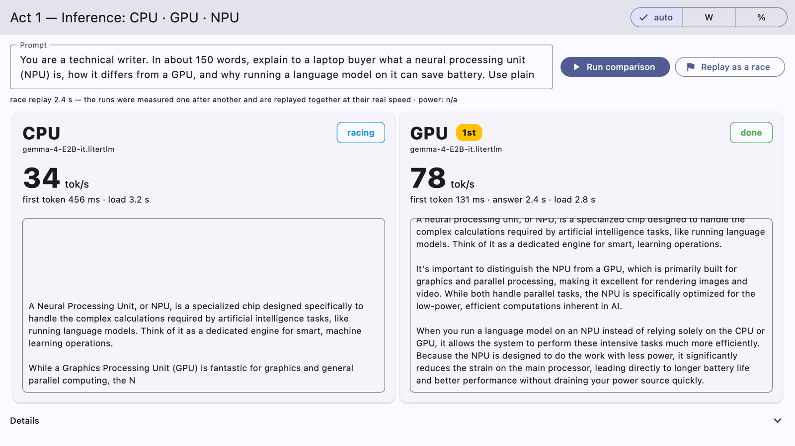
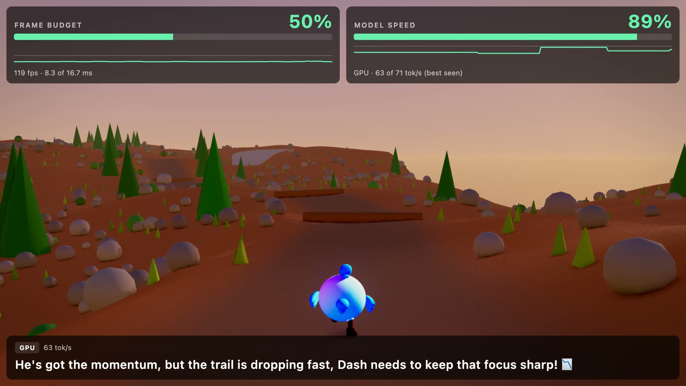

# Intel NPU demo: Gemma on the NPU of a Core Ultra laptop

A Flutter desktop app in three acts about the NPU of an Intel Core Ultra laptop (Lunar Lake, Panther Lake): what it
brings to an on-device language model, Gemma 4, next to the CPU and the GPU. Everything runs on the machine; once
the model file is there, the app needs no network. Each act shows one side of the NPU:

- **Act 1 — Inference.** The same prompt on the CPU, the GPU and the NPU, one lane each: decode speed in numbers the
  back of the room can read, time to first token, the answer streaming in, and what the CPU, GPU and NPU were doing
  meanwhile (load or watts). The runs are measured one at a time, then **replayed as a race**, side by side at their
  real speed. On Lunar Lake the NPU build decodes faster
  than the GPU (50–54 vs 29.5 tok/s) and leaves the GPU free; that it also draws a fraction of the power is the
  claim still to be measured (watts need Memory Integrity off). All three engines stay loaded in one process, so
  switching is instant.
- **Act 2 — Long context.** A 45-minute meeting transcript (about 7,000 tokens) goes into the model's context once,
  before anyone asks anything; every question then reuses the warm context and answers with the timestamp and the
  quoted line, which the transcript viewer jumps to. A second engine with a 4K window gets the same transcript and
  fails with the runtime's own "too long" error. The goal is a 12B model at a 16K window on the NPU; no NPU build of
  the 12B exists yet, so today this act runs the 12B on the GPU (see [Known limitations](#known-limitations)).
- **Act 3 — The NPU's own argument: parallel work.** Dash runs an endless generated landscape on the GPU — terrain,
  forests, rivers, a day that turns to night — while the model commentates the run live, as subtitles. The scene
  calibrates itself to the edge of the frame budget, and two meters show the cost: FRAME BUDGET (how much of a frame
  the scene uses) and MODEL SPEED (how much of its own solo speed the model still gets). Put the commentator on the
  GPU and one of them drops; put it on the NPU and neither does.

| Act 1: the race replay | Act 3: the runner and its commentator |
|---|---|
|  |  |

Both screenshots are from a Mac, where there is no NPU lane; on a Lunar Lake laptop Act 1 has a third lane, and the
Act 3 commentator can move to the NPU.

The app runs on macOS too (CPU and GPU only), which is where most of it was developed. It is built on
[`flutter_gemma`](https://pub.dev/packages/flutter_gemma) and its LiteRT-LM engine
[`flutter_gemma_litertlm`](https://pub.dev/packages/flutter_gemma_litertlm), and on
[`flutter_scene`](https://pub.dev/packages/flutter_scene) for the 3D scene; all three are community packages, not
Google SDKs. Intel, Core Ultra and Gemma are trademarks of their owners.

## Models and processors

The app ships no model: you download the `.litertlm` files and point the app at them.

| Act | Model and source | Size | macOS (Apple silicon) | Windows on Intel Core Ultra (Lunar Lake / Panther Lake) |
|---|---|---|---|---|
| 1 and 3 | Gemma 4 E2B, `gemma-4-E2B-it.litertlm` from [litert-community/gemma-4-E2B-it-litert-lm](https://huggingface.co/litert-community/gemma-4-E2B-it-litert-lm) (Gemma 4: Apache-2.0) | 2.5 GB | CPU, GPU (Metal) | CPU, GPU (DirectX 12), NPU |
| 2 | Gemma 4 12B, `gemma-4-12B-it.litertlm` from [litert-community/gemma-4-12B-it-litert-lm](https://huggingface.co/litert-community/gemma-4-12B-it-litert-lm) (Apache-2.0) | 6.9 GB | GPU | GPU (the NPU once an NPU build exists) |
| 2, contrast engine | Gemma 4 E2B again, with a 4K window | — | GPU | GPU |
| 1 and 3, on the NPU | an NPU build of Gemma 4 E2B for Lunar Lake (`NPU_MODEL_PATH`) | — | — | NPU; not yet published |

- **NPU** is Intel's NPU, through LiteRT-LM's Intel dispatch library and the OpenVINO runtime that
  `flutter_gemma_litertlm` bundles on Windows. It exists only on Core Ultra Series 2 (Lunar Lake) and later. macOS
  has no NPU row: LiteRT-LM does not use the Apple Neural Engine, and the app does not offer it.
- **The standard E2B file loads on the NPU too, at about 5 tok/s**, slower than the CPU: an NPU row worth showing
  needs a build compiled for the NPU. Such a build has a fixed context (4096 tokens for the one measured here) and
  runs only on the NPU.
- The app never moves a model to another processor on its own. A backend that fails to load is a failed row, not a
  silent fall back to the CPU.

## Requirements

| | |
|---|---|
| Flutter | 3.47.1 or newer, stable channel ([fvm](https://fvm.app) works). `flutter_scene` needs 3.47.0; Flutter GPU on Windows needs 3.47.1 |
| macOS | Apple silicon, Xcode and CocoaPods |
| Windows | Windows 11, Visual Studio 2022 with "Desktop development with C++", Developer Mode on (Flutter plugins need symlinks), the Visual C++ Redistributable on machines that run the build |
| NPU | Intel Core Ultra Series 2 (Lunar Lake) or newer with the Intel NPU driver |
| Memory | Act 2's 12B was run on a 24 GB Mac and a 32 GB Lunar Lake machine |
| Disk | the models (above), and ~0.4 GB of GPU program cache LiteRT-LM writes next to each model on first load |
| Network | the first build downloads the LiteRT-LM native libraries (a GitHub release, SHA-256 checked) |
| Optional | `ffmpeg` on the PATH (or `FFMPEG=…`) for recording Act 3 to video; [LibreHardwareMonitor](https://github.com/LibreHardwareMonitor/LibreHardwareMonitor) for watts on Windows |

## Set up

```sh
flutter pub get
cp config.json.example config.json     # then set MODEL_PATH to your gemma-4-E2B-it.litertlm
```

Download the models from the links above (no login needed), for example with the Hugging Face CLI:

```sh
hf download litert-community/gemma-4-E2B-it-litert-lm gemma-4-E2B-it.litertlm --local-dir ~/models
hf download litert-community/gemma-4-12B-it-litert-lm gemma-4-12B-it.litertlm --local-dir ~/models   # Act 2
```

`config.json` is gitignored. Every setting has a default except `MODEL_PATH`: without it the scene still runs, and
every model row says what is missing.

## Run

Use a profile build for anything you want to measure; debug frame and token numbers mean little.

```sh
flutter run -d macos   --profile --dart-define-from-file=config.json
flutter run -d windows --profile --dart-define-from-file=config.json
```

The home screen lists the three acts. `ACT=1`, `2` or `3` opens one directly.

The first GPU load of a model is slow: LiteRT-LM compiles its GPU programs and caches them next to the model file.
Later loads take a second or two.

## Using the demos

- **Act 1:** **Run comparison** measures `BACKENDS` one after another, each on its own lane: decode speed, time to
  first token, how long the whole answer took, and bars for the CPU, GPU and NPU load during that answer (Windows,
  with the power sidecar; `auto / W / %` switches to watts). **Replay as a race** then plays the recorded answers
  together at their real speed and ranks them by finish. Measuring them at the same time would spoil both numbers:
  the iGPU and the NPU share memory bandwidth. **Details** has every number, runtime-reported and wall-clock.
- **Act 2:** wait for "Context is warm", then ask, e.g. "What cost centre code did finance assign, who said it,
  and at what timestamp?". Timestamps in the answer become chips that jump to the line; a timestamp that is not in
  the transcript stays grey. **Same source into 4096** feeds the same transcript to the small-window engine.
- **Act 3:** the presenter's keys:

  | Key | |
  |---|---|
  | `1` `2` `3` / `0` | commentator on the CPU / GPU / NPU / off |
  | `A` `D`, arrows | steer Dash (the autopilot takes over again when you let go) |
  | `Space`, `W` | jump |
  | `P` | pause |
  | `N` | fast-forward to the next part of the day |
  | `H` | detail panels (frame timing, event log, load dials) and the back button |
  | `B` | measure each backend's solo speed again, e.g. after changing the load by hand |

  On start the act walks a load ladder (draw distance, then vegetation, then pixels) until the scene sits at the
  edge of the frame budget, then measures each backend's solo tokens/sec with the scene at its lightest. Both are
  needed for the act to show anything: a scene with headroom loses no frames when the model takes the GPU, and a
  model compared with its own best reading under load always looks 100 % fast. The budget is `ACT3_TARGET_FPS`
  (60), or the display's refresh rate when the display cannot show more than that.

## What it measured

Apple M4 Pro (24 GB), macOS, Gemma 4 E2B, short prompt:

| Backend | Load (warm) | Time to first token | Decode |
|---|---|---|---|
| CPU | 1.0 s | 231–347 ms | 41–44 tok/s |
| GPU (Metal) | 1.5 s | 51–52 ms | 93–98 tok/s |

Intel Core Ultra 7 258V (Lunar Lake, 32 GB), Windows 11, all three engines loaded in one process, second sweep:

| Model | Backend | Load | Time to first token | Decode |
|---|---|---|---|---|
| Gemma 4 E2B | CPU | 0.6 s | 1209 ms | 9.4 tok/s |
| Gemma 4 E2B | GPU (DirectX 12) | 8.9 s | 105 ms | 29.5 tok/s |
| Gemma 4 E2B | NPU | 9.9 s | 2957 ms | 5.4 tok/s |
| Gemma 4 E2B, NPU build | NPU | 0.9–1.5 s | 82 ms | 50–54 tok/s |

These CPU numbers come from runs over ssh, which Windows throttles (the same binary decoded at 31.5 tok/s on the CPU
in the desktop session): read them as lower bounds.

**Act 3, M4 Pro** (1600×1000, calibrated to a 60 fps budget: 896 m draw distance, vegetation ×6, render scale 3,
~59K instances). Solo speeds: GPU 79 tok/s, CPU 38 tok/s. With the scene running, the GPU commentator holds 62 fps
(91 % of the budget) at **31 tok/s, 39 % of its own solo speed**; the CPU commentator costs the frame nothing and
keeps 93 % of its speed. On Metal the contention lands on the model, not the frame: the system keeps the display fed
and the model's throughput halves.

**Act 3, Lunar Lake** (the earlier physics-arena scene, 120 bodies): scene alone 60 fps / 3.6 ms; with the NPU
commentator 60 fps / 4.6 ms, no janky frames, 55.9 tok/s. There the iGPU contention landed on the frame rate
instead. Which of the two moves is a property of the platform, so say what you measured.

**Act 2:** Gemma 4 12B on Metal at a 16K window prefills the 7.3K-token transcript in 33.8 s and answers correctly
with the cited line; the first token of a question comes after 0.7 s.

## Configuration

Settings come from `--dart-define` (or `--dart-define-from-file=config.json`), and a JSON file named in the
`DEMO_CONFIG` environment variable overrides them at run time with the same keys, so one build serves many runs.
A value the app does not understand is reported, never silently replaced: on screen, or as `CONFIG_ERROR` lines and
exit code 2 in a headless run.

| Key | Default | |
|---|---|---|
| `MODEL_PATH` | — | the `.litertlm` for Acts 1 and 3 |
| `MAX_TOKENS` | 4096 | context window. On an NPU build, exactly the length it was compiled for |
| `BACKENDS` | `cpu,gpu,npu` | Act 1's rows, in order |
| `POLICY` | `resident` | `resident` keeps every backend loaded (raw LiteRT-LM clients); `sequential` loads one at a time through the public flutter_gemma API |
| `PROMPT`, `PROMPT_FILE` | a 150-word explainer | Act 1's measured prompt |
| `WARMUP` | true | an unmeasured short turn after each load |
| `MAX_OUTPUT_TOKENS`, `TOP_K` | model's, 1 | Act 1 sampling |
| `ACT` | 0 | open an act directly (0 = home) |
| `ACT2_MODEL_PATH` | `MODEL_PATH` | the long-context model (the 12B) |
| `ACT2_BACKEND`, `ACT2_MAX_TOKENS` | gpu, 16384 | |
| `ACT2_CONTRAST_MODEL_PATH`, `ACT2_CONTRAST_MAX_TOKENS` | `MODEL_PATH`, 4096 | the engine that must not fit the transcript; a small model, never a second 12B |
| `ACT2_TRANSCRIPT` | the bundled meeting | a `[mm:ss] Speaker: text` file |
| `ACT2_QUESTION`, `ACT2_MAX_OUTPUT_TOKENS` | —, 300 | ask unattended |
| `NPU_MODEL_PATH` | `MODEL_PATH` | the model for the NPU, in Act 1 and Act 3: an NPU build. `ACT3_NPU_MODEL_PATH` still works |
| `ACT3_TARGET_FPS` | 60 | frame budget; 0 = the display's refresh rate |
| `ACT3_CALIBRATE`, `ACT3_BASELINE` | true, true | the load ladder and the solo-speed pass |
| `ACT3_VIEW_CHUNKS`, `ACT3_PROP_DENSITY`, `ACT3_RENDER_SCALE`, `ACT3_SHADOWS`, `ACT3_POST` | 7, 1.0, 1.0, true, true | load dials (the calibrator sets the first three) |
| `ACT3_NARRATOR_INTERVAL_MS`, `ACT3_NARRATOR_MAX_TOKENS` | 4000, 4096 | how often the commentator speaks, its context |
| `ACT3_DAY_SECONDS`, `ACT3_TIME_OF_DAY` | 240, `day` | length of a day (0 freezes it), where it starts: `morning`, `day`, `sunset`, `night`, `dawn` |
| `ACT3_PILOT_MISS_RATE` | 0.08 | how often the autopilot fumbles on purpose |
| `ACT3_DETAILS` | true | false starts on the stage view: meters and subtitles only |
| `ACT3_START_Z` | 4 | where on the trail Dash starts, in metres |
| `ACT3_SCENE` | `runner` | `arena` is the earlier physics scene |
| `ACT3_NARRATOR_INLINE` | false | run the engines on the UI isolate (diagnostic) |
| `POWER_FILE`, `POWER_MODE` | see below, `auto` | Windows power and load; `auto`, `watts` or `utilization` |

Headless runs: `AUTORUN=true` starts Act 1 by itself, `AUTORUN_REPEAT=2` runs it twice (the second sweep is warm),
`AUTORUN_EXIT=true` exits when done, `RESULTS_PATH=…` appends the results as JSON lines, with every chunk's arrival
time. Next to it Act 1 saves the race replay's middle and finish as PNGs, Act 3 a frame per phase. Act 3 runs unattended with `ACT3_NARRATOR_PLAN=off:12,gpu:25,cpu:25` (phase:seconds; one set
of frame, commentator and power numbers per phase) or `ACT3_AUTORUN_SECONDS=25` (scene only). In debug builds the
plugin redirects stdout to `$TMPDIR/litertlm_native.log`, so read `RESULTS_PATH`, not the console.

```sh
flutter run -d macos --profile --dart-define=ACT=3 --dart-define-from-file=config.json \
  --dart-define=ACT3_NARRATOR_PLAN=off:12,gpu:25,cpu:25 \
  --dart-define=AUTORUN_EXIT=true --dart-define=RESULTS_PATH=/tmp/act3.ndjson
```

**macOS window.** macOS stops drawing a window that is covered, and a run then reports a frame rate it never drew.
These environment variables (macOS only) keep it honest: `DEMO_WINDOW=1600x1000` sets and pins the content size,
`DEMO_ON_TOP=1` keeps the window above others, `DEMO_NO_FOCUS=1` does that without taking the keyboard (otherwise
what you type elsewhere lands in Act 3 as presenter keys).

**Recording Act 3.** `ACT3_RECORD=/path/run.mp4` films the stage from inside the app through ffmpeg (H.264:
VideoToolbox on macOS; Media Foundation on Windows, not yet tried there), at `ACT3_RECORD_FPS` (30). If ffmpeg is
missing or fails, the act carries on and the log says `ACT3_RECORD_FAILED`. `ACT3_RECORD_SCALE=2` keeps a Retina
frame as drawn: `DEMO_WINDOW=1280x720` gives 2560×1440. The read-back costs GPU time, so a recorded run is for
showing, not measuring; with the GPU commentator add `ACT3_RENDER_SCALE=0.75`, or the densest forest repeats frames.

**Power and load on Windows.** [`tools/power_sidecar/power_sidecar.ps1`](tools/power_sidecar/power_sidecar.ps1)
writes `%ProgramData%\intel_npu_demo\power.json` (the app's default `POWER_FILE`) about every 1.5 s: CPU, GPU 3D,
GPU compute and NPU load from the Windows `GPU Engine` counters (the NPU is the compute-only adapter), and watts from
LibreHardwareMonitor. Run it from an elevated PowerShell, with the LibreHardwareMonitor DLL in a folder only
administrators can write to:

```powershell
powershell -ExecutionPolicy Bypass -File tools\power_sidecar\power_sidecar.ps1 `
  -Lib 'C:\Program Files\LibreHardwareMonitor\LibreHardwareMonitorLib.dll' -LibSha256 <hash>
```

Watts read zero while Memory Integrity (VBS) is on; the loads are always there, and the app shows them instead.

## Licences

The code is Apache-2.0, like the rest of this repository ([LICENSE](../../../LICENSE)). `assets/models/dash.glb` is the Dash model from
[bdero/flutter_scene](https://github.com/bdero/flutter_scene), MIT ([assets/models/NOTICE.md](assets/models/NOTICE.md)).
The meeting transcripts in `assets/prompts/` are synthetic, written for this demo. The models are not part of this
repository. Gemma 4 E2B and 12B, and the LiteRT-LM conversions used here, are Apache-2.0
([Gemma 4 licence](https://ai.google.dev/gemma/docs/gemma_4_license)); the Hugging Face repositories are not gated. The LiteRT-LM runtime (Apache-2.0) and, on
Windows, Intel's OpenVINO NPU runtime are downloaded by `flutter_gemma_litertlm` at build time.

## Tests

```sh
flutter analyze
flutter test
```

The tests cover the world generator (chunk seams, winding, rivers, the trail's geometry, determinism), the day
cycle, the commentator's situation block and per-phase statistics, the load calibrator and frame budget, transcript
citations and the configuration parser. Anything that needs a model or a GPU is checked in headless runs (above).

## Known limitations

- **The NPU is Windows on Intel Core Ultra Series 2 or later only**, and an NPU lane worth showing needs an NPU
  build of the model (`NPU_MODEL_PATH`), which is not yet published. An NPU build has a fixed context: keep
  `MAX_TOKENS` at the length it was compiled for (4096 for the one measured here).
- **Act 2 is not on the NPU yet.** There is no NPU build of the 12B, and the E2B NPU build measured here is
  compiled for a 4096-token window: the 7.2K-token meeting does not fit (the runtime refuses it, `7249 >= 4096`),
  while a 21-minute version (3.5K tokens) is answered correctly on the NPU at 53 tok/s, prefill 1.6 s.
- **Gemma 4 E2B on the GPU returns garbage above ~5.5K input tokens** with LiteRT-LM 0.17 (Metal and DirectX 12;
  deterministic for a given input). The CPU and the 12B are correct at the same length, which is why Act 2 uses
  the 12B.
- **Act 3 on Windows needs a desktop session.** Over ssh (session 0) nothing renders. Launched into the console
  session with PsExec, the standard E2B's GPU engine fails to create (`Failed to create engine: UNKNOWN`); the same
  binary loads it from session 0. Not yet understood.
- `DEMO_WINDOW`, `DEMO_ON_TOP` and `DEMO_NO_FOCUS` are macOS only; on Windows the window opens at 1280×720.
- The app sandbox is off on macOS: it reads models and writes results wherever the configuration says, and starts
  ffmpeg for recordings, none of which a sandboxed app may do.
