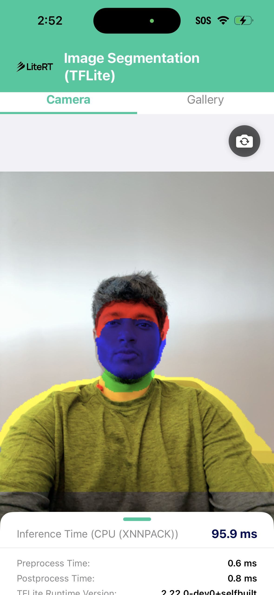

# TensorFlow Lite (Swift API) Image Segmentation - iOS

An iOS application demonstrating real-time and static multi-class image segmentation using the **TensorFlow Lite Swift API** (`TensorFlowLite` module integrated into the `LiteRT` Swift Package release `2.3.0`). The app uses multi-threaded CPU execution powered by the built-in **XNNPACK delegate** (`Interpreter.Options.isXNNPackEnabled = true`, `threadCount = 4`).

> [!NOTE]
> The LiteRT 2.3.0 Swift release package (`https://github.com/google-ai-edge/LiteRT` branch `release/2.3.0`) provides the core TensorFlow Lite C runtime (`TensorFlowLiteC`) optimized for CPU with XNNPACK. For native GPU acceleration on iOS, see the sibling [`swift_litert`](../swift_litert) sample utilizing LiteRT's native Swift API and Metal accelerator.

---

## Screenshot

| CPU (`XNNPACK`) Inference |
|:---:|
|  |

---

## Features

- **TFLite Swift API on LiteRT 2.3.0**: Runs inference via the standard `TensorFlowLite.Interpreter` API resolved from the official `LiteRT` Swift release package.
- **CPU Acceleration via XNNPACK**: Highly optimized 4-threaded CPU execution enabled through `Interpreter.Options.isXNNPackEnabled = true`.
- **Real-Time Camera Stream**: Run live segmentation on the front/back camera feed with auto aspect ratio matching.
- **Gallery Image Selection**: Run static segmentation on the bundled portrait (`image.jpeg`) or import custom images from the photo library.
- **Performance Metrics Display**: Live measurements of Pre-process, Inference, and Post-process execution times in milliseconds alongside `TensorFlowLite.Runtime.version`.

---

## Architecture

| Component | File | Description |
|-----------|------|-------------|
| **TFLiteSegmenter** | `ImageSegmentation/TFLiteSegmenter.swift` | Native Swift implementation utilizing `TensorFlowLite` (`Interpreter`, `Interpreter.Options`, `Tensor`) |
| **ContentView** | `ImageSegmentation/ContentView.swift` | Single-page SwiftUI interface displaying camera/gallery segmentation and latency telemetry |
| **CameraManager** | `ImageSegmentation/CameraManager.swift` | Manages `AVFoundation` camera capture session and frame streams |
| **ImagePicker** | `ImageSegmentation/ImagePicker.swift` | Wraps `PHPickerViewController` in `UIViewControllerRepresentable` for photo library access |
| **ImageSegmentationApp** | `ImageSegmentation/ImageSegmentationApp.swift` | SwiftUI application entry point |
| **LiteRT** (Swift Package) | `https://github.com/google-ai-edge/LiteRT` (`release/2.3.0`) | Provides the `TensorFlowLite` Swift module and `TensorFlowLiteC` precompiled runtime |

---

## Prerequisites & Setup

### 1. LiteRT Swift Package Dependency

#### Option A: Using the Released LiteRT Swift Package (Default)

The project is pre-configured to resolve the official LiteRT Swift release package via Swift Package Manager:
* **Repository URL:** `https://github.com/google-ai-edge/LiteRT`
* **Dependency Rule:** Branch `release/2.3.0` (or exact version `2.3.0`)
* **Product:** `TensorFlowLite`

When you open `ImageSegmentation.xcodeproj` in Xcode or run `xcodebuild`, Swift Package Manager will automatically fetch and resolve the dependencies.

> [!TIP]
> **Git LFS Troubleshooting:** If Xcode reports an error during package checkout such as `smudge filter lfs failed` or `git-lfs: command not found`, run `git lfs uninstall` or build with `GIT_LFS_SKIP_SMUDGE=1`. The Swift package does not need Git LFS prebuilts. See the [LiteRT Swift Troubleshooting guide](https://github.com/google-ai-edge/LiteRT/tree/main/litert/swift#troubleshooting) for details.

#### Option B: Building `TensorFlowLiteC` Locally from Source

If you are developing LiteRT locally or testing from source:
```bash
# Navigate to the LiteRT repository
cd path/to/LiteRT

# Build the TensorFlowLiteC runtime xcframework target
bazel build -c opt --config=ios //litert/swift:TensorFlowLiteC

# Copy the compiled xcframework archive into LiteRT/prebuilt/ for the Swift Package
mkdir -p prebuilt
cp -f bazel-bin/litert/swift/TensorFlowLiteC.xcframework.zip prebuilt/
```
In Xcode, remove the remote package under **ImageSegmentation** > **Package Dependencies**, and add your local `LiteRT` directory via **File > Add Package Dependencies... > Add Local...**.

### 2. Download the Model File (if not already present)
```bash
cd path/to/litert-samples/samples/litert/image_segmentation/swift_tflite
curl -L -o selfie_multiclass_256x256.tflite \
  https://storage.googleapis.com/mediapipe-models/image_segmenter/selfie_multiclass_256x256/float32/latest/selfie_multiclass_256x256.tflite
```

### 3. Open in Xcode
1. Open `ImageSegmentation.xcodeproj` in Xcode.
2. Select the **ImageSegmentation** target and configure your **Signing & Capabilities** team.
3. Build and run on an iOS device or Simulator.

---

## How the CPU Backend Works in `TFLiteSegmenter.swift`

The app initializes the TFLite interpreter with the built-in XNNPACK engine:

```swift
var options = Interpreter.Options()
options.threadCount = 4
options.isXNNPackEnabled = true

let interpreter = try Interpreter(modelPath: modelPath, options: options)
try interpreter.allocateTensors()
```

Preprocessing normalizes input pixels to `[-1.0, 1.0]` (NHWC float32), copies data to input tensor 0, runs `interpreter.invoke()`, and postprocesses the 6-class output tensor (`1 x 256 x 256 x 6`) into a colored alpha mask.
