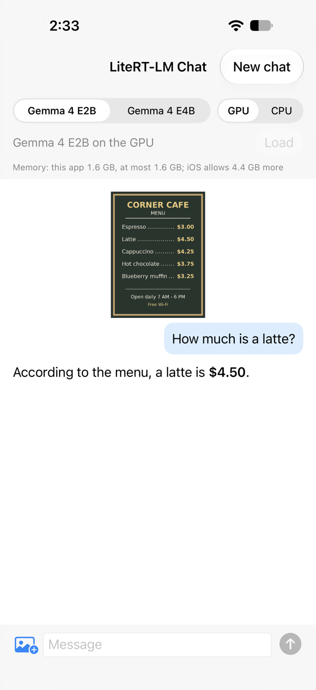

# Chat with Gemma 4 on an iPhone, with text and a photo

A small SwiftUI app that runs [Gemma 4 E2B](https://huggingface.co/litert-community/gemma-4-E2B-it-litert-lm) or [Gemma 4 E4B](https://huggingface.co/litert-community/gemma-4-E4B-it-litert-lm) on the iPhone with the [LiteRT-LM](https://github.com/google-ai-edge/LiteRT-LM) Swift package, v0.19.1. Type a question, attach a photo if you like, and the answer streams in. Nothing leaves the phone. It is meant as a starting point for your own app: about 870 lines of Swift, plus a 256-line scripted self-check, with the app's LiteRT-LM calls in one file.



## What this sample shows

- The text decoder on the GPU (Metal) and the image encoder on the CPU, as in the [LiteRT-LM Swift guide](https://ai.google.dev/edge/litert-lm/swift), and a switch that runs the decoder on the CPU instead.
- Gemma 4 E4B as well as E2B: the app's two memory capabilities, and a check before loading that compares what the model needed in this app with what iOS lets the app use.
- Streaming replies, Stop, New chat and switching models, with LiteRT-LM's objects released in an order that does not stall (see [How it works](#how-it-works)).

## Requirements

- An iPhone. Everything below was measured on an iPhone 18 Pro (iOS 27.2 beta) only.
- A Mac with Xcode 27.0 and [XcodeGen](https://github.com/yonaskolb/XcodeGen) (`brew install xcodegen`). The app targets iOS 17 and later.
- An Apple developer team to sign the app. The app asks for two memory capabilities, Increased Memory Limit and Extended Virtual Addressing (in `LiteRTLMChat.entitlements`). If your team cannot use them, remove them (step 3). On the iPhone 18 Pro, a build without them got 3,360 MB at launch instead of 6,128 MB: E2B on the GPU still answered about the example picture; E4B on the GPU answered text, but not the picture (see [Known limits](#known-limits)).
- A model file, downloaded on the Mac: `gemma-4-E2B-it.litertlm` (2.6 GB) from [litert-community/gemma-4-E2B-it-litert-lm](https://huggingface.co/litert-community/gemma-4-E2B-it-litert-lm/blob/main/gemma-4-E2B-it.litertlm) or `gemma-4-E4B-it.litertlm` (3.7 GB) from [litert-community/gemma-4-E4B-it-litert-lm](https://huggingface.co/litert-community/gemma-4-E4B-it-litert-lm/blob/main/gemma-4-E4B-it.litertlm).

## Build and run

1. Generate the project and fetch the LiteRT-LM package:

   ```bash
   cd samples/litert_lm/chat/ios
   xcodegen generate
   GIT_LFS_SKIP_SMUDGE=1 xcodebuild -resolvePackageDependencies -project LiteRTLMChat.xcodeproj
   ```

   The LiteRT-LM repository keeps prebuilt libraries for Android, iOS, macOS, Linux and Windows in Git LFS. The Swift package does not use them: it downloads its own xcframework. If Git LFS is set up on your Mac (`git lfs install`), Xcode opened from the Dock stops at these files with `Git LFS is not installed`: apps opened from the Dock do not see `/opt/homebrew/bin` or `/usr/local/bin`, where git-lfs usually is. Fetching the package here in Terminal avoids that, and `GIT_LFS_SKIP_SMUDGE=1` leaves those files out. The first fetch clones the whole repository, about 2.9 GB.

2. Open `LiteRTLMChat.xcodeproj`. In the **LiteRTLMChat** target, **Signing & Capabilities**: choose your **Team** and change the **Bundle Identifier** to one of your own.
3. If your team cannot use the two memory capabilities, delete **Increased Memory Limit** and **Extended Virtual Addressing** there.
4. Choose your iPhone as the run destination and press **Run**.

## Put a model on the iPhone

The app reads models from its own Documents folder:

- **Finder**: select the iPhone, open **Files**, and drop the `.litertlm` file on **LiteRT-LM Chat**.
- **Terminal**:

  ```bash
  xcrun devicectl device copy to --device <your iPhone> \
    --domain-type appDataContainer --domain-identifier <your bundle identifier> \
    --source gemma-4-E2B-it.litertlm --destination Documents/gemma-4-E2B-it.litertlm
  ```

Keep the file names as they are: the app looks for these two. Before loading, it compares the file's size with the one on Hugging Face it was tested with, and tells you when they differ (most often a copy that stopped early).

## Use it

Choose **E2B** or **E4B** and **GPU** or **CPU**, then **Load**. Type a message and send it. The photo button attaches a picture from your library or the **Example picture** (a drawn café menu; try "How much is a latte?"). **Stop** ends a reply; **New chat** starts over with the same model.

## Measured on an iPhone 18 Pro

iOS 27.2 beta, the app built in Release with both memory capabilities.

| Model | Backend | First load | Later loads | Memory after the first load | Most memory while answering about the example picture | Decode speed |
|---|---|---|---|---|---|---|
| E2B | GPU | 5.3 s | 0.7 s | 508 MB | 1,625 MB | 68.9 tokens/s |
| E2B | CPU | 1.9 s | 0.1 s | 496 MB | 1,549 MB | 31.0 tokens/s |
| E4B | GPU | 6.3 s | 0.7 s | 722 MB | 1,802 MB | 32.4 tokens/s |
| E4B | CPU | 3.4 s | 0.2 s | 666 MB | 1,706 MB | 13.9 tokens/s |

- All four answered "$4.50" to "How much is a latte?" about the example picture.
- The first load after installing writes LiteRT-LM's caches to the app's `Library/Caches` (with both backends used, about 1.8 GB for E2B and 4.7 GB for E4B; deleted with the app); later loads read them.
- Decode speed: the reply to "Explain in about 150 words why the sky is blue." (141 to 161 tokens), from LiteRT-LM's benchmark info. The first token came after 0.19, 0.47, 0.62 and 1.17 s (rows in the order above).
- Memory is the app's footprint as iOS counts it. At launch iOS let the app use 6,128 MB more with the two capabilities and 3,360 MB without them.
- The check before loading (`Sources/Models.swift`) uses how much the app grew in an earlier run of the same steps, rounded up: 1,700 MB for E2B on the GPU, 1,600 MB on the CPU, 1,900 MB for E4B on the GPU and 1,800 MB on the CPU, plus 300 MB to spare.

## When something goes wrong

Each case below was made to happen on the iPhone 18 Pro, and the step in the last column worked. Except where the app was ended from the Mac, the app stayed up. Two cases were started with a launch argument and one by ending the app from the Mac, as marked.

| Case | What the app showed | Next step |
|---|---|---|
| The model file is not on the iPhone | "gemma-4-E2B-it.litertlm is not on this iPhone. Download it from huggingface.co/litert-community/gemma-4-E2B-it-litert-lm and copy it into this app's files: in Finder, select the iPhone, open Files, and drop it on LiteRT-LM Chat." | Copy the file, then **Load**. |
| A copy that stopped early (the first 64 MB of E4B) | "gemma-4-E4B-it.litertlm on this iPhone has 67,108,864 bytes; the file this sample was tested with has 3,659,530,240. If the copy stopped early, copy it again." **Use this file** then gave "Gemma 4 E4B on the CPU could not start. LiteRT-LM says: Failed to create engine: …" | Copy the whole file again. |
| Not enough memory (`-assumeAvailableMB 1500`) | "Not enough memory for Gemma 4 E4B on the GPU: in this sample it needed 1.9 GB (measured on an iPhone 18 Pro) plus 0.3 GB to spare, and iOS lets this app use 1.5 GB more (set with -assumeAvailableMB). Choose a smaller model or the CPU, or keep the app's two memory capabilities (see the README)." | **Load anyway** loaded E4B on the GPU, which answered. |
| The app ended during a load (SIGKILL from the Mac, 2 s into the first E4B load; iOS ends an app that runs out of memory the same way) | At the next launch: "The last launch ended while Gemma 4 E4B on the GPU was loading. If iOS stopped the app because it ran out of memory, try a smaller model or the CPU. This app can use 6.0 GB more memory now." | **Load** again: E4B loaded in 4.9 s and answered, pictures included. |
| The GPU engine does not start (`-failGPU YES`) | "Gemma 4 E2B on the GPU could not start. LiteRT-LM says: GPU failure simulated with -failGPU (no LiteRT-LM call)." | **Use the CPU** loaded E2B on the CPU, which answered. |
| A message longer than the context (26,015 characters) | "The reply failed. LiteRT-LM says: Invalid response from native layer: INVALID_ARGUMENT: Input token ids are too long. Exceeding the maximum number of tokens allowed: 5612 >= 4000. The next message starts a new conversation." | The next message was answered. |
| **Stop** during a reply | "Stopped. The next message starts a new conversation." | The next message was answered. |
| The app went to the background during a reply | "Stopped: the app went to the background. The next message starts a new conversation." | The next message was answered. |
| Switching from E2B to E4B | No message: the app released E2B, then loaded E4B in 0.6 s. | E4B answered. |

## How it works

| File | What it does |
|---|---|
| `Sources/ModelRunner.swift` | Every LiteRT-LM call the app makes: the engine settings, the conversation, sending a message with a picture, Stop, and the release order. |
| `Sources/ChatModel.swift` | The screen's state and actions: loading with the file and memory checks, the reply as it streams, Stop, New chat, the note about a launch that ended during a load. |
| `Sources/ChatView.swift`, `Sources/LiteRTLMChatApp.swift` | The screen; a reply stops when the app goes to the background. |
| `Sources/Picture.swift` | The picture the model reads: upright, sRGB, at most 1024 pixels on its longer side, saved as PNG (LiteRT-LM decodes the file itself, ignores a photo's EXIF orientation and color profile, and does not read HEIC). |
| `Sources/Models.swift`, `Sources/Memory.swift` | The two model files, their sizes and the memory they needed in this app; the app's memory as iOS counts it. |
| `Sources/SelfCheck.swift` | A scripted run for checking the app on a phone (launch arguments, described at the top of the file). |

The release order matters. A reply's stream holds the conversation until its last piece and lets go of it on LiteRT-LM's callback thread. If the app had already let go, the conversation is deleted on that thread, and the deletion waits for the very callback it runs in until a 10-minute timeout passes: the next conversation cannot start until then. This was seen with LiteRT-LM 0.19.0 on an iPhone 18 Pro and on a Mac; on the Mac the wait ended after 600 seconds. The Swift and C++ code involved is the same in 0.19.1. `ModelRunner` keeps its own reference until the stream's is gone, and releases the conversation, then the engine, itself.

## Known limits

- After Stop or an error, the next message starts a new conversation with the same model, so the model no longer remembers the chat.
- Without the two memory capabilities, E4B on the GPU answered text but failed on the example picture with LiteRT-LM's `Failed to allocate tensors`, while iOS still let the app use about 2 GB more. The check before loading does not catch this. The app stays up; E2B on the GPU answered about the picture.
- One picture per message. Context 4,000 tokens (the prompt, pictures and replies of one conversation); a reply stops at 1,024 tokens.
- The iOS Simulator was not tried.

## License

The code is under the Apache License 2.0. The example picture was drawn for this sample. Gemma 4 E2B and E4B are under the Apache License 2.0 ([model card](https://huggingface.co/litert-community/gemma-4-E2B-it-litert-lm)).
