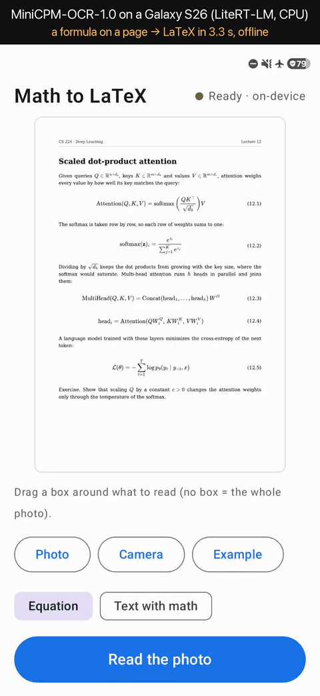

# Math to LaTeX on Android with LiteRT-LM

## What this sample demonstrates

- Getting a formula from a printed page into LaTeX on the phone: take or pick a photo, drag a box around the formula, and the app writes its LaTeX and typesets it under the photo, so you can check it before you tap **Copy LaTeX**. Reading runs on the phone, offline, once the model file is downloaded.
- [MiniCPM-OCR-1.0](https://huggingface.co/openbmb/MiniCPM-OCR-1.0) (OpenBMB, 1.3B parameters: a SigLIP vision encoder and a Qwen3.5 language model trained for OCR), converted to a LiteRT-LM bundle, with its text decoder and vision encoder on the CPU, through the LiteRT-LM Kotlin API (`litertlm-android` 0.18.1).
- Two of the model's prompts: `Formula Recognition:` (a display formula to LaTeX) and `Text Recognition:` (a passage to text, with its formulas as inline LaTeX).
- One `Engine` per read, made in advance. The model's text decoder keeps a recurrent state that a second conversation on the same `Engine` would continue from ([LiteRT-LM #3165](https://github.com/google-ai-edge/LiteRT-LM/issues/3165)), so the app makes a new `Engine` for every read, and makes the next one while you frame the next box. A read then spends its time only on encoding the pictures, the prompt and the answer.
- The bundle reads 448 × 448 pictures. The app prepares them as the model card's page script does ([`ocr_page.py`](https://github.com/john-rocky/hf-to-litertlm/blob/main/minicpmocr_work/ocr_page.py), linked from the card; the same rules in Kotlin): the box centred on a white square and resized with Pillow's bicubic filter, or, for a whole page, the model processor's grid of slices. JVM tests check the app's pixels against Pillow's.



One read on a Galaxy S26 in airplane mode, at real speed: the example handout, a box around equation (12.1), **Read the box**, and the answer in 3.3 s (first text after 2.1 s). The answer is the one the original model gives for the same picture, character for character.

## The model

| Hugging Face repo | File | Size | License | Revision |
|---|---|---|---|---|
| [litert-community/MiniCPM-OCR-1.0](https://huggingface.co/litert-community/MiniCPM-OCR-1.0) | `MiniCPM-OCR-1.0-VL_int8.litertlm` (int8 text decoder, fp16 vision encoder) | 2.00 GB | Apache-2.0 | `c818533a` |

The app downloads the file on first use into its private storage and checks its size and SHA-256 against [`app/src/main/assets/models.json`](android/app/src/main/assets/models.json). The model file is not in the APK. The bundle is a conversion of [openbmb/MiniCPM-OCR-1.0](https://huggingface.co/openbmb/MiniCPM-OCR-1.0) (Apache-2.0); its card describes the conversion and its checks.

## Requirements

JDK 17 and Android SDK platform 36 to build. The app builds for arm64-v8a on Android 12+ (minSdk 31). The first start downloads 2.00 GB and needs twice that free in the app's storage. Before it makes an `Engine`, the app checks that the phone has 2.5 GB of available memory (`MemAvailable`) and says so if it does not; on the Galaxy S26 below, a run of reads took the phone's available memory down by at most 1.4 GB.

## Architecture

```
a photo (system photo picker or camera)
  -> turned upright by its EXIF orientation
  -> your box (no box: the whole photo)
  -> Pictures.prepare: one 448 x 448 picture (centred on white, Pillow's bicubic resize),
     or, for a picture larger than twice 448 x 448, an overview and up to 9 slices on the
     processor's grid, with the extra-context value slice_cols for the chat template
  -> PNG -> Conversation.sendMessageAsync([pictures..., prompt], extraContext) -> the answer, streamed
  -> MathJax (in a WebView, from the app's assets) typesets it -> Copy
one Engine per read; the next Engine is made on the runtime thread as soon as a read ends
```

| File | What it holds |
|---|---|
| `OcrEngine.kt` | The LiteRT-LM `Engine` and `Conversation` of one read, the next one made in advance, the stream, Stop |
| `Pictures.kt`, `PilBicubic.kt` | The 448 × 448 pictures of the page script: the white square, the processor's grid, Pillow 13.0.0's bicubic resize |
| `Photo.kt` | Decoding a photo as Pillow reads it (no color conversion), the EXIF turn, PNG for the runtime |
| `MemoryCheck.kt` | The free-memory check before an `Engine` is made |
| `MathViewModel.kt`, `MathScreen.kt`, `MathView.kt` | The screen: the photo and its box, the modes, the answer and its typeset copy |
| `AutoRun.kt` | Debug builds: a plan of reads through the Read button's code, one result line each |
| `data/` | `models.json`, the free-space rule and the download store (resume, SHA-256, HTTPS only), from [`voice_assistant`](../voice_assistant/) |

## Quickstart

```sh
cd samples/litert_lm/math_to_latex/android
./gradlew :app:installDebug
```

Open the app and tap **Download (2.0 GB) and load**. Then tap **Example** (two lecture handouts drawn for this sample) or **Photo** / **Camera**, drag a box around a formula and tap **Read the box**. **Text with math** reads a passage instead; with no box, the app reads the whole photo.

## Measured on a Galaxy S26

Galaxy S26 SM-S942Q, Android 16, a debug build of this sample, `litertlm-android` 0.18.1, the text decoder and the vision encoder on the CPU, 2026-10-30. Every read below ran the Read button's code path, driven from a plan file by `AutoRun.kt` (debug builds), and logged the 448 × 448 pictures it sent (their SHA-256) and the answer. The reference is the original model, `openbmb/MiniCPM-OCR-1.0` in transformers (float32, greedy) on the same pictures, made by the page script (Pillow 13.0.0).

| Pictures | The app's pictures equal the page script's | The answer equals the original model's, character for character |
|---|---|---|
| 20 textbook formulas, from the quadratic formula to scaled dot-product attention, typeset by MathJax and cropped with a small margin, as a finger's box would be | 20/20 | 20/20 |
| 16 of the same formulas as photo-like JPEGs (turned 1.2°, uneven light, blur, noise, quality 70) | 16/16 | 16/16 |
| The 9 display formulas and the first paragraph of each example handout | 11/11 | 11/11 |
| A whole handout page, no box: an overview and 8 slices, `slice_cols` 2 | 9/9 | the same 1,264 characters |

The original model also reads these formulas correctly: on the 20 textbook formulas and their 20 photo-like copies, its LaTeX is the LaTeX that drew them, once spaces, `\,`, primes (`'` against `^{\prime}`), bracket sizes (`\Big` against `\left` / `\right`) and one-character braces are set aside. On the handouts it misreads two spots named in the first limit below (the first paragraph's subscripts and equation (12.3)), and the app gives the same answers.

| One read (the next `Engine` already made) | Read → first text | Read → the whole answer |
|---|---|---|
| A display formula (17 to 141 tokens), 20 reads, the phone at thermal status 2 | 2.3 to 4.3 s | 3.2 to 9.5 s |
| A whole handout page (9 pictures, 476 tokens) | 31.5 s | 48.2 s |

In this run (thermal status 2 and a battery at 40 °C at the start), the first `Engine` took 8 s and the sixth 20 s, 1 min 45 s after the app started; from there to the end of the 22-minute run every `Engine` took 18 to 20 s. An earlier run that started cool (thermal status 0, 30 °C) went from 6.5–9 s to 18–20 s over eight minutes. What drives the rise was not isolated: the thermal status did not change during this run, and the CPU clock caps were not recorded. The app's resident memory peaked at 5.2 GB (5,109,332 kB), and the phone's available memory stayed above 5.2 GB.

The failure paths, in the same run:

- A file that is not a picture: the message "not a picture this phone can decode"; the reads after it ran.
- Stop 1.5 s into a whole-page read: the read ended 24.6 s after Read was tapped, with no text.
- A read asked for before the next `Engine` was ready: it waited 19.4 s for the `Engine`, then answered.
- A memory check set to 1 TB: the message "About 1000.0 GB of free memory is needed and 6.7 GB is free. Close other apps and try again. Nothing was loaded."
- The read after it, with the usual check: answered in 5.4 s.

One phone, one day: not a promise for other devices or other photos.

## Known limits

- One box is read as one 448 × 448 picture, so a wide box shrinks its letters. On the attention handout, the original model itself (transformers, float32, the same picture) reads the subscripts `d_k` and `d_v` as `d_s` in the first paragraph, which spans the page's width, and `head_h` as `head_n` in equation (12.3). Draw the box around one formula or a few lines, or read the whole page with no box: the app then cuts it into the model's slices, and the same page reads correctly.
- The model writes LaTeX in its own spelling (spaces such as `d x`, `\left(`, braces): the typeset formula matches the page, the characters can differ from the source's LaTeX.
- A read needs the `Engine` the app makes after the previous read (8 to 10 s right after the app starts, 18 to 20 s a few minutes in, on the Galaxy S26); a read asked for sooner waits for it.
- Stop does not end a read at once: a Stop 1.5 s into a whole-page read (9 pictures) on the Galaxy S26 ended it 13.6 s (a cool phone) and 24.6 s (a warm one) after Read was tapped, with no text (LiteRT-LM 0.18.1; a one-picture read was not stopped in the test).
- Handwriting was not measured.
- The text decoder and the vision encoder run on the CPU. The model card measured the vision encoder on phone GPUs: creating its GPU executor took 7.8–8.0 s on the Galaxy S26 and 10.2–10.9 s on the Pixel 8a, about as long as a one-box read here.

## Development

**Side-load (development only).** A copy of the model file in the app's external files dir is hashed and, when its size and SHA-256 match `models.json`, imported instead of downloaded; the next load logs `side-loaded <file> ... (sha256 verified)` under `adb logcat -s MathToLatexDownload`. The copy must be readable by the app: the block below makes it as the app (`run-as`, a debug build). This worked on the Galaxy S26. On a Pixel 8a (Android 16) the copy failed with `Permission denied`, also after the app had been started once; download the model in the app there.

```sh
P=com.google.ai.edge.examples.math_to_latex
adb push MiniCPM-OCR-1.0-VL_int8.litertlm /data/local/tmp/
adb shell "run-as $P sh -c 'mkdir -p /sdcard/Android/data/$P/files && cp /data/local/tmp/MiniCPM-OCR-1.0-VL_int8.litertlm /sdcard/Android/data/$P/files/'"
```

**Launch extras (debug builds only; a release build ignores them).** A running screen takes them again (`singleTop`). With any of them the screen shows over the keyguard and stays on.

| Extra | What it does |
|---|---|
| `--ez autoload true` | load the model now (the side-loaded copy, else the download) |
| `--es image <path>` | show this picture (a path in the app's external files dir), with no box and no answer |
| `--es mode EQUATION` or `TEXT` | the mode |
| `--es plan <path>` | once the model is loaded, run the reads of this plan through the Read button's code (`AutoRun.kt`) and write one result line each to `runs/<plan>.jsonl` beside it |

**Tests.** `./gradlew :app:testDebugUnitTest` checks the picture preparation against Pillow 13.0.0 and the page script ([`tools/make_picture_rows.py`](android/tools/make_picture_rows.py) writes the expected SHA-256 of every picture: resizes in both pass orders, the white square, the grid and its slices, the eight EXIF orientations), the catalog and the memory check.

**Example pages.** [`tools/make_examples.py`](android/tools/make_examples.py) renders the two handouts (text written for this sample, formulas typeset by MathJax, DejaVu Serif) in headless Chrome and writes `examples.json` with each formula's LaTeX and box.

## Licenses

See [NOTICE](android/NOTICE) and [licenses/](android/licenses/): the Pillow port (MIT-CMU) and MathJax (Apache-2.0, fetched by the build).
