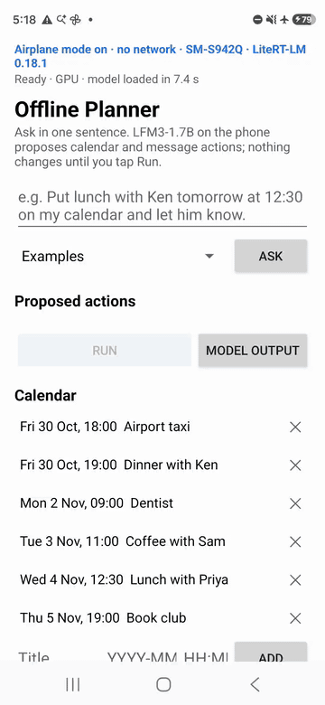
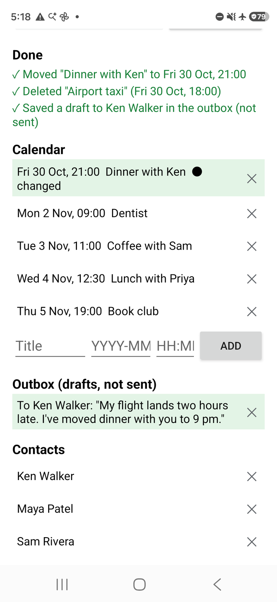

# Offline planner: one sentence to calendar and message actions on the phone

This Android sample turns one typed sentence into actions on the app's own calendar and outbox, with the language model running on the phone's GPU. Ask "My flight lands two hours late. Move dinner with Ken to 9 pm, let him know, and delete the 6 pm taxi." and [LiquidAI/LFM3-1.7B](https://huggingface.co/LiquidAI/LFM3-1.7B) writes the tool calls: move the dinner, delete the taxi, draft a message to Ken. The app shows each action with what it would change; nothing changes until you tap Run. The app has no internet permission and was tested in airplane mode.

| One request, start to finish | The screen after Run |
|---|---|
|  |  |

In the recording: the request typed into the field and Ask and Run tapped from adb (`input text`, `input tap`), on a Galaxy S26 in airplane mode with the model loaded; the three actions were on screen 4.6 s after the tap. The recording plays at real speed, with its last frame held for 1.5 s.

The model runs with [LiteRT-LM](https://github.com/google-ai-edge/LiteRT-LM)'s Kotlin API (0.18.1). LFM3-1.7B writes tool calls in its own XML format, which LiteRT-LM returns as text for this model; the app parses them (`ToolCalls.kt`), and an app can do the same for another model whose tool-call format the runtime does not parse.

## What you can give it

1. **A request**: type it, or pick one of the five examples (four ask for actions, one is a question that needs no tool).
2. **The app's calendar and contacts**: six fictional contacts and a week of events, created from today's date on the first start. Add or remove events and contacts on the screen; **Reset the example data** restores them. The app never reads or writes the phone's own calendar, contacts or messages.
3. **Run**: carries out the actions that passed their checks, in order. Messages go to the outbox as drafts and are never sent.

Ask sends the request. The proposed actions appear one by one as the model writes them. Each action shows its check. It will not run when: the app has no such tool; an argument the tool needs is missing; the person is not in the contacts; no event, or more than one, matches; the time cannot be read. A reply with no tool calls is shown as the answer. A reply the app cannot read as calls is shown as the model wrote it; **Model output** shows the raw text of any reply. If the request itself fails, the reason is shown where the answer goes.

## How it runs

- **Model**: `LFM3-1.7B_mixed_int4_ekv2048.litertlm` from [litert-community/LFM3-1.7B-LiteRT](https://huggingface.co/litert-community/LFM3-1.7B-LiteRT) (MLP gate and up projections in int4, every other weight in int8, a 2,048-token context), on the GPU.
- **The prompt**: a system instruction with the phone's date and time, the next seven days with their dates, the contacts' names, the calendar from today on (at most 12 events) and a few rules. The four tools go as JSON schemas in `ConversationConfig.extraContext["tools"]`, which the model's chat template renders into the system turn. Thinking off (`ThinkingConfig(enableThinking = false)`), greedy decoding, at most 256 output tokens.
- **The tools**: `create_event(title, start, end?, location?, attendees?)`, `move_event(title, new_start)`, `delete_event(title, date?)` and `draft_message(recipient, message)`, times as `YYYY-MM-DDTHH:MM:SS`. Three tool names and all four argument shapes follow Liquid AI's phone-assistant example for this model (the [GRPO notebook](https://colab.research.google.com/github/Liquid4All/cookbook/blob/main/finetuning/notebooks/lfm3_grpo_with_trl.ipynb) and its dataset `LiquidAI/phone-assistant-tools`); `draft_message` is this sample's name for the dataset's `send_sms` (same arguments), because the app saves drafts and never sends. The descriptions and the instruction are this sample's.
- **One Engine per request**: LFM3 carries a running state from token to token. On LiteRT-LM a new conversation on an Engine that already served one starts from that state ([LiteRT-LM issue #3165](https://github.com/google-ai-edge/LiteRT-LM/issues/3165)), so each request gets its own Engine. After each reply the app closes the Engine and creates the next one in the background, so a new request finds a fresh Engine ready.

| File | Role |
|---|---|
| `MainActivity.kt` | the screen: the request, Ask, the proposed actions, Run, the calendar, outbox and contacts |
| `PlannerEngine.kt` | the LiteRT-LM `Engine` (one per request) and the streaming reply |
| `Planner.kt` | the tools' JSON schemas, the system instruction, the examples |
| `ToolCalls.kt` | the parser of LFM3's XML tool calls, the checks, and what each call does |
| `PlannerState.kt` | the app's calendar, contacts and outbox (a JSON file in the app's storage), name and event matching |
| `AutoRun.kt` | the measuring tool (below) |

## The model file

| File | Bytes | SHA-256 |
|---|---|---|
| `LFM3-1.7B_mixed_int4_ekv2048.litertlm` | 1,441,620,928 | `0400d8ffdb00e4bbe1209120e2c7baf05322a8c900839b0a94cc28f599011196` |

```bash
pip install -U huggingface_hub
hf download litert-community/LFM3-1.7B-LiteRT --include "LFM3-1.7B_mixed_int4_ekv2048.litertlm" --local-dir lfm3
```

## Build and install

Build with Android Studio or, on the command line, JDK 17 and the Android SDK (`ANDROID_HOME`); the Gradle wrapper fetches Gradle 8.13. The app needs Android 12 or newer (minSdk 31) and an arm64-v8a phone. With more than one phone connected, set `ANDROID_SERIAL` to the phone's serial first.

```bash
cd android
./gradlew :app:installDebug
./install_to_device.sh <path to lfm3>
```

`install_to_device.sh` copies the model into the app's external files dir (`/sdcard/Android/data/com.google.ai.edge.examples.offline_planner/files`) with `adb push`, checks its size and restarts the app, which loads the model on the GPU and says Ready. The app has to create that dir itself, so the script opens the app once first when the dir is not there yet; until the copy is done, the app's status line names the missing file and Ask stays off.

## Performance

Galaxy S26 (SM-S942Q, Android 16), airplane mode. The measuring tool ran the five requests below on the example data at Friday 2026-10-30 09:00, each on a fresh Engine, after one warm-up request. "On screen" is the time from the tap on Ask to the frame that shows the last proposed action (for the question, the answer).

| Request | Calls (the same in both runs) | Run 1: on screen (s) | Run 2: on screen (s) |
|---|---|---|---|
| Put lunch with Ken tomorrow at 12:30 on my calendar and let him know. | `create_event` (Lunch with Ken, Sat 31 Oct 12:30), `draft_message` (Ken Walker) | 3.67 | 3.50 |
| Move my dentist appointment to Wednesday at 4 pm. | `move_event` (Dentist, Wed 4 Nov 16:00) | 2.96 | 2.59 |
| Schedule a project meeting on Monday at 3 pm and tell Maya and Leo about it. | `create_event` (Project Meeting, Mon 2 Nov 15:00), `draft_message` (Maya Patel), `draft_message` (Leo Martin) | 6.31 | 5.66 |
| Add a call with Dana on Tuesday at half past nine in the morning. | `create_event` (Call with Dana, Tue 3 Nov 09:30) | 3.71 | 3.46 |
| How many minutes are in two and a half hours? | none; the answer says 150 minutes | 3.41 | 3.33 |
| Mean | | 4.01 | 3.71 |

Run 1 started on a warm phone (Android's thermal status 1, rising to 2 during the second request); run 2 came after a 5-minute rest and one more request (thermal status 0, rising to 1 during the first request). The target set before the runs was a mean of at most 4.0 s, with one re-run allowed: run 1 missed it by 0.01 s, the re-run met it. The first proposed action came 2.4 to 3.7 s after the tap, and the others followed as the model wrote them.

- The calls were right in both runs: the tools, their order, the people, the dates and the times, and no call the request did not ask for.
- Preparing a fresh Engine after a reply took 3.8 to 6.9 s on the Galaxy S26; the first load after an install, which builds the GPU programs once, took 7.1 to 7.4 s.
- On a Pixel 8a (GPU) the nine development requests took 8.4 to 15.7 s to show all their calls, and a fresh Engine took 12 to 13 s; in later runs on the same phone a fresh Engine took 5 to 7 s. The first load after an install took 26 to 61 s in five installs on the Pixel 8a.
- The same request can come out differently on different phones: of four ways to ask for the flight example, "to 9 pm" and "to 21:30" gave the right new time on the Galaxy S26 and "back two hours" did not; on the Pixel 8a only "back two hours" did, and "to 9:30 pm" failed on both (same model file, same prompt).

Every step above ran once as written: the download on a Mac (its SHA-256 matched the table), then `./gradlew :app:installDebug` and `install_to_device.sh` onto a Pixel 8a (Android 16) with no copy of the app. Then every feature ran once on that phone in airplane mode: an example picked from the list, Ask, **Model output**, Run, adding and removing a contact and an event, **Reset the example data**, each check's refusal (through `inject_reply`), a request longer than the context and a file that is not a model. The phone's keyboard was Japanese and put full-width digits into the date and time fields; the app read them.

## The measuring tool

A debug build started with a plan runs the screen without a finger, through the functions the buttons call, and writes a report:

```bash
adb shell am start -n com.google.ai.edge.examples.offline_planner/.MainActivity \
  --es plan plans/example.json --es report example
```

- **Where the plan goes**: the app's internal files dir, which `adb shell run-as com.google.ai.edge.examples.offline_planner` reaches on a debug build (copy it to `/data/local/tmp` with `adb push`, then `run-as … cp` it to `files/plans/`).
- **What a plan holds**: `{"now": "2026-10-30T09:00", "verify_model": true, "items": [...]}`; `now` fixes the clock the prompt and the example data use. An item is `{"id", "request", "reset", "press", "run", "inject_reply", "ready_timeout_ms", "rest_ms"}`: `reset` restores the example data, `press` taps Ask once the Engine is ready, `run` taps Run after the reply, and `inject_reply` puts a given text through the same parse, checks and display as a model reply (to see the failure paths). `--es model <file name>` opens another file from the app's external files dir.
- **What the report holds**: `files/reports/<report>.json` (read it with `adb exec-out run-as … cat`) has, per item, the system instruction, the raw reply, the parsed calls, each action's check, the screen's lines, the times from the tap (first token, first call on screen, all calls on screen) and the Engine's load time. Every request sent to the model, tapped or planned, and every injected reply also leaves its record in `files/runs/`.

The JVM tests (`./gradlew :app:testDebugUnitTest`) cover the parser of the XML calls, the checks and what the calls change.

## Known limits

- Check the actions before Run. In the development runs the model wrote "quarter to six in the evening" as 18:00, and when asked to move the 19:00 dinner it sometimes wrote a new time close to the old one (see Performance).
- Each request is a new conversation on a new Engine: the app does not remember earlier requests, and after each reply it takes a while to prepare the next Engine (5 to 13 s on a Pixel 8a; the Galaxy S26 time is under Performance).
- The model's context is 2,048 tokens, so the calendar in the prompt stops at 12 events. A request that does not fit fails and the app shows why. In the test a 2,737-word request got: "Input token ids are too long. Exceeding the maximum number of tokens allowed: 4348 >= 2048".
- GPU only: the app has no CPU switch on the screen (the measuring tool's `--es backend cpu` extra exists; not tested). Tested in English.

## License

The sample code is Apache-2.0. LFM3-1.7B's weights are under the LFM Open License v1.0 (Liquid AI); the converted file keeps that license, whose section 5 does not license commercial use by an organization with annual revenue of 10 million US dollars or more. The names, events and messages in the example data are fictional.
