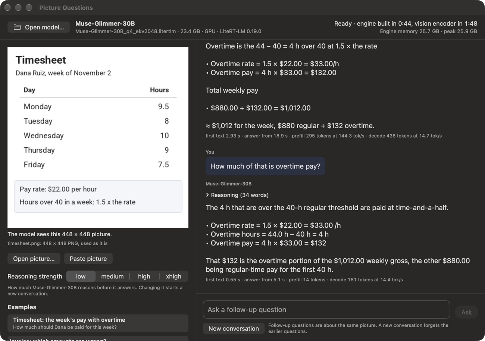

# Ask a large vision-language model about a picture, offline on a Mac

A macOS app that answers questions about a picture with [Muse-Glimmer-30B](https://huggingface.co/litert-community/Muse-Glimmer-30B-LiteRT) or [Qwen2.5-VL-72B-Instruct](https://huggingface.co/litert-community/Qwen2.5-VL-72B-Instruct-LiteRT), run by [LiteRT-LM](https://github.com/google-ai-edge/LiteRT-LM) 0.19.0 on the Mac's GPU. Show it a timesheet, an invoice, a price list or a timetable, as a photo or a screenshot, and ask something that takes a few steps: what this week's pay comes to with overtime, which amounts on an invoice are wrong. The model reads the numbers, works through the steps and shows them. The picture and the question never leave the Mac.



## What this sample demonstrates

- Two examples drawn for this sample, each a question whose steps depend on one another: **Timesheet** (44 hours at $22.00 an hour, the hours over 40 paid at 1.5 times the rate: $1,012.00) and **Invoice** (a printed line amount and the subtotal are wrong: the flyers come to $168.00, not $186.00, so the total due is $323.40, not $332.20). Both models here answer both. LFM3-VL-2B, which reads every number in these pictures correctly, gets neither right, with its thinking off or on ([the comparison](#the-examples-and-two-smaller-models)).
- A Swift app on LiteRT-LM's C API: the `CLiteRTLM_mac.xcframework` of the LiteRT-LM v0.19.0 release, pinned by URL and SHA-256 in a local Swift package (`LiteRTLMRuntime/Package.swift`). The decoder and the vision encoder both run on the GPU (WebGPU over Metal).
- The picture the model reads, made by the app: these model files read one picture at a fixed 448 × 448 pixels, and the runtime would stretch any other size to that square and ignore a photo's EXIF orientation. The app turns the picture upright, scales its longer side to 448 and centers it on white, shows that square, and gives the model exactly that file.
- Follow-up questions about the same picture in the same conversation (the picture stays in the KV cache, so the reply to a follow-up starts in 0.4 s with Muse-Glimmer-30B and 0.9 s with the 72B).
- Muse-Glimmer-30B's reasoning strength (low, medium, high, xhigh), set in the system message as its model card describes; its reasoning is shown folded above the answer.
- One engine process per model file: an engine that runs out of memory ends that process, not the app, and the window says what happened.
- A recorder (`--autoplay`) that drives the same code path as the buttons and writes every answer, timing and engine record to a JSON file.

## The models

| Model | File | Size | Memory the engine used in this app | License |
|---|---|---|---|---|
| [Muse-Glimmer-30B](https://huggingface.co/meta-models/Muse-Glimmer-30B) | [`Muse-Glimmer-30B_q4_ekv2048.litertlm`](https://huggingface.co/litert-community/Muse-Glimmer-30B-LiteRT) | 23.4 GB | 25.9 GB | Apache 2.0, and Meta's [Muse Glimmer Usage Policy](https://huggingface.co/meta-models/Muse-Glimmer-30B/blob/main/USAGE_POLICY.md) |
| [Qwen2.5-VL-72B-Instruct](https://huggingface.co/Qwen/Qwen2.5-VL-72B-Instruct) | [`Qwen2.5-VL-72B-Instruct_q4_ekv2048.litertlm`](https://huggingface.co/litert-community/Qwen2.5-VL-72B-Instruct-LiteRT) | 42.7 GB | 43.7 GB | [Qwen license](https://huggingface.co/litert-community/Qwen2.5-VL-72B-Instruct-LiteRT/blob/main/LICENSE) (Built with Qwen) |

Both files hold an int4 text decoder, a vision encoder (fp32 in Muse-Glimmer-30B, int8 weights in the 72B), the tokenizer and the chat template; their context is 2,048 tokens (the picture takes 256 of them). Another `.litertlm` vision-language model opens too; the app then estimates its memory need from the file size.

## Requirements

- A Mac with Apple silicon. Memory: the app refuses a model when the Mac's memory is below the engine's need plus 6 GB for macOS, so Muse-Glimmer-30B needs a Mac with 32 GB or more and Qwen2.5-VL-72B-Instruct one with 64 GB or more. Everything below was measured on a Mac Studio with an M4 Max and 128 GB.
- Xcode and [XcodeGen](https://github.com/yonaskolb/XcodeGen) (`brew install xcodegen`). The app targets macOS 14 and later; it was built with Xcode 27.0 and XcodeGen 2.44.1 and run on macOS 27.0 only.
- The `hf` command of [huggingface_hub](https://huggingface.co/docs/huggingface_hub/guides/cli) to download a model file, and room for it: 23.4 GB or 42.7 GB.

## Quickstart

1. Download a model file (Muse-Glimmer-30B here; for the 72B use `litert-community/Qwen2.5-VL-72B-Instruct-LiteRT Qwen2.5-VL-72B-Instruct_q4_ekv2048.litertlm`):

   ```bash
   hf download litert-community/Muse-Glimmer-30B-LiteRT Muse-Glimmer-30B_q4_ekv2048.litertlm --local-dir ~/models
   ```

2. Build the app. The first build downloads the LiteRT-LM runtime (the release's `CLiteRTLM_mac.xcframework.zip`, 47 MB) and checks its SHA-256:

   ```bash
   cd samples/litert_lm/picture_questions/macos
   xcodegen generate
   xcodebuild -project PictureQuestions.xcodeproj -scheme PictureQuestions -configuration Release -derivedDataPath build build
   open build/Build/Products/Release/PictureQuestions.app
   ```

3. Click **Open a .litertlm file…** and choose the file. The app starts the engine once per launch: it builds the decoder on the GPU, then loads the vision encoder and passes one gray picture through it, so that your first question does not wait for its GPU programs. The window says **Ready** when that is done: 56 s for Muse-Glimmer-30B (median of 9 starts) and 62 s for the 72B (1 start) on the Mac below ([measured](#measured-in-this-app)).
4. Click an example, or give it your own picture: **Open picture…**, drop a file on the left, or **Paste picture** (⇧⌘V) after copying a screenshot (⌃⇧⌘4). Type a question and press Return.
5. Ask a follow-up about the same picture, or click **New conversation** to start over with the same picture.

## Measured in this app

From the app's own run records (`--run-out`) on the Mac Studio above (M4 Max, 128 GB, macOS 27.0), each model file on the internal SSD, Muse-Glimmer-30B at reasoning strength low. Other work ran on the Mac at the same time, so some ranges are wide.

| | Muse-Glimmer-30B | Qwen2.5-VL-72B-Instruct |
|---|---|---|
| From opening the file to **Ready** | 56 s (21 s to 3 min 17 s; 9 starts) | 62 s (1 start; engine 55 s, vision 7 s) |
| A new picture: the first text | 3.2 s (2.6 to 4.8 s; 7 pictures), the start of its reasoning | 5.1 s (4.8 to 5.4 s; 2 pictures) |
| A new picture: the answer starts | 21.8 s (15.6 to 29.4 s), after its reasoning | 5.1 s, with the first text |
| A follow-up: the first text | 0.42 s (0.41 to 0.55 s; 5 follow-ups) | 0.91 s (2 follow-ups) |
| Prefill | 149 tokens/s (94 to 154) | 62 tokens/s (59 to 65; 2 pictures) |
| Decode | 15.8 tokens/s (6.8 to 18.3; 12 replies) | 8.5 tokens/s (8.4 to 8.5; 4 replies) |
| Engine memory at its peak (as Activity Monitor counts it) | 25.9 GB | 43.7 GB |

Medians, with the range and the count in parentheses. The times count from pressing Ask (or clicking an example) to the text on the screen; prefill and decode are LiteRT-LM's own counters for each reply. Ready for the 72B was 62 s in this start and 25 s in an earlier start with the previous version of its file (fp32 vision weights); in one session, LiteRT-LM's Python API built the engine of the previous file in 57.7 s and of this one in 59.7 s, so the start time is the run's, not the file's (the page cache before the 25 s start was not recorded).

## The examples and two smaller models

Ten pictures were drawn for this sample, each with a question of three or more steps that depend on one another. The two examples are pictures where both models here also answered right when asked only to list the values and when given the same values as text, and where LFM3-VL-2B did not give the right answer with its thinking off or on. Each model answered each question once, greedy, in a new conversation, from the same 448 × 448 PNG; Muse-Glimmer-30B at reasoning strength low:

| Picture and question | Muse-Glimmer-30B | Qwen2.5-VL-72B | LFM3-VL-2B, thinking off | LFM3-VL-2B, thinking on | Qwen2.5-VL-3B |
|---|---|---|---|---|---|
| Timesheet, overtime (example) | right | right | wrong | wrong | wrong |
| Invoice, a wrong line and a wrong subtotal (example) | right | right | wrong | no answer | right |
| Invoice, one wrong line | right | right | right | no answer | wrong |
| Calendar, first free hour | right | right | wrong | right | wrong |
| Bar chart, biggest rise | right | wrong | wrong | right | wrong |
| Storage plans, cheapest for 300 GB | right | right | right | right | wrong |
| Bus timetable, arrive by 9:30 | right | right | right | wrong | wrong |
| Budget, most over | right | wrong | right | right | right |
| Bus then train, 5-minute change | right | right | wrong | no answer | wrong |
| Order, discount then shipping | right | wrong | wrong | no answer | right |

- LFM3-VL-2B: `LFM3-VL-2B_f16.litertlm` of [litert-community/LFM3-VL-2B-LiteRT](https://huggingface.co/litert-community/LFM3-VL-2B-LiteRT) on LiteRT-LM 0.19.0 (GPU), with its thinking off (`enable_thinking: false`, replies up to 512 tokens) and on (replies up to 1,536 tokens; "no answer" = all 1,536 went to its thinking).
- [Qwen2.5-VL-3B-Instruct](https://huggingface.co/Qwen/Qwen2.5-VL-3B-Instruct) with Hugging Face Transformers, bf16.
- Asked only to list the values in each picture, LFM3-VL-2B listed every value in all ten pictures (both ways) and Qwen2.5-VL-3B in nine: their mistakes are in the steps, not in the reading.
- The two examples hold with the original weights too: Muse-Glimmer-30B in Hugging Face Transformers (bf16, greedy, the same picture and system message) answers both right, and for Qwen2.5-VL-72B-Instruct the original weights (Transformers, fp32) pick the same next token as the `.litertlm` file's answer at 98.1 % (timesheet) and 99.0 % (invoice) of its tokens.

## When something goes wrong

Every case below was made to happen on the Mac (with the recorder) and the app stayed up and said so:

| What happened | What the window shows |
|---|---|
| The model file is not there any more | **File not found**, with the path, and **Open another file…** |
| A file whose name does not end in `.litertlm` | **Not a .litertlm file** |
| A `.litertlm` file LiteRT-LM cannot read (here 1 MB of random bytes) | **Not a model this app can run**: it does not begin the way a .litertlm file does |
| A Mac with too little memory for the model (tried with `-assumePhysicalMemoryGB 24` for Muse-Glimmer-30B and `48` for the 72B) | **Not enough memory**, before anything is loaded: what the engine used in this app, the 6 GB macOS needs besides, and the memory the Mac needs |
| A file that is not a picture (a `.png` name on 38 bytes of text) | macOS could not read “not_a_picture.png” as a picture. It may be damaged, cut short, or not a picture at all. |
| A very large picture (an 8000 × 6000 HEIC of a bar chart) | The picture with “chart_8000x6000.heic: 8000 × 6000, scaled into 448 × 448 on white” under it, and the answer (April, 60 kWh more than in 2025) |
| The engine process ends in the middle of an answer (killed with SIGKILL, as the out-of-memory killer or a force quit would) | **The engine stopped**: ended by signal 9 (SIGKILL), what ends a process this way, the engine log, and **Start the engine again**; the unfinished answer says “The engine stopped before the answer was finished.” |
| The engine process stops in the middle of an answer for longer than LiteRT-LM waits for the GPU (stopped with SIGSTOP for 3 minutes, then continued) | **The engine took too long**: LiteRT-LM gave up on the reply and this engine cannot answer again, the engine log, and **Start the engine again**; the unfinished answer says “LiteRT-LM gave up on this reply: a wait passed its time limit (DEADLINE_EXCEEDED: DEADLINE_EXCEEDED: Timed out waiting for future: 2m).” |

## The recorder

The app runs a script of the same actions a person takes (open the model, click an example or open a picture, type, Ask, Stop, New conversation) and writes a run JSON with each answer, its timing and the engine records:

```bash
build/Build/Products/Release/PictureQuestions.app/Contents/MacOS/PictureQuestions \
  --model ~/models/Muse-Glimmer-30B_q4_ekv2048.litertlm \
  --autoplay checks/examples.json --run-out /tmp/run.json --snapshot-dir /tmp/snaps
```

`checks/examples.json` clicks every example, checks its answer, then asks its follow-up and checks that answer too. The script format, with the other actions (open or paste a picture, Stop, New conversation, stop or kill the engine process in the middle of an answer), is described at the top of `Sources/Autoplay.swift`.

## How it works

| File | What it does |
|---|---|
| `Sources/main.swift`, `Sources/App.swift` | One binary, two modes: the window, or (with `--engine-host`) the engine process. `App.swift` has the menu commands, their shortcuts and the command-line options. |
| `Sources/LiteRTLM.swift` | The Swift layer over the C API: engine settings (GPU for the decoder and the vision encoder, one picture, no cache files), a conversation with a greedy sampler and a token limit, streaming replies, cancel, the runtime's counters. |
| `Sources/EngineHost.swift` | The engine process: the app starts itself with `--engine-host` for each model file and talks to it in JSON lines (`Sources/Protocol.swift`). |
| `Sources/EngineClient.swift` | The window's side of that process: start, commands, events, the engine log, how it ended. |
| `Sources/Picture.swift` | The 448 × 448 picture: EXIF upright, scaled, centered on white, saved as PNG. |
| `Sources/AppModel.swift`, `Sources/ContentView.swift` | The window's state and actions, and its views. |
| `Sources/ReplyText.swift`, `Sources/MarkdownText.swift` | Splits Muse-Glimmer-30B's reply into its reasoning and its answer; shows an answer's Markdown. |
| `Sources/Models.swift`, `Sources/SystemMemory.swift` | The two model files this sample was measured with (memory need, reply length), and the Mac's memory size for the check before an engine starts. |
| `Sources/Examples.swift`, `Resources/examples/` | The example pictures and questions. |
| `Sources/Autoplay.swift`, `checks/` | The recorder, and the script that checks the examples. |

The app gets the runtime from `LiteRTLMRuntime/Package.swift`, a local Swift package whose one target is the `CLiteRTLM_mac.xcframework.zip` of the LiteRT-LM v0.19.0 release, and calls its C API. It does not use the LiteRT-LM Swift package. That package's v0.19.0 tag points at the v0.18.1 zips. On LiteRT-LM's main branch as of 2026-10-31 (commit c642af86), the package points at the v0.19.0 zips, but its Swift code calls `litert_lm_speculative_decoding_config_set_lenience`, which the v0.19.0 `CLiteRTLM_mac.xcframework` does not export.

## Known limits

- One picture per conversation, read at 448 × 448: small print does not survive. Crop to the part you are asking about.
- A reply and the picture share a context of 2,048 tokens; replies stop at 1,536 tokens (Muse-Glimmer-30B, with its reasoning) or 1,024 (72B). A long conversation can fill the context; New conversation empties it.
- LiteRT-LM 0.19.0 reads the picture with its own decoder (stb), so the app always hands it a PNG it made.
- LiteRT-LM 0.19.0 gives up on a reply when one of its waits passes its time limit (its WebGPU sampler waits at most 2 minutes for the GPU's result, counted in wall-clock time, also while the process is stopped), and the engine cannot answer again after that; the app then closes the engine and offers to start it again, which takes as long as opening the file.

## License

The code is under the Apache License 2.0. The example pictures were drawn for this sample (the numbers, names and dates in them are made up). The models keep their own licenses (above).
