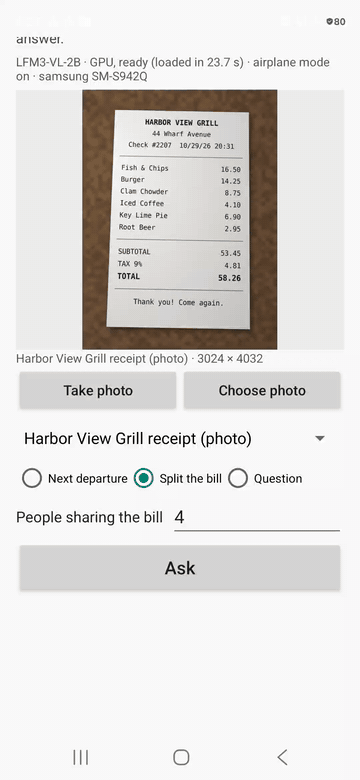

# Timetable and receipt answers on Android with LiteRT-LM (LFM3-VL-2B)

This sample answers two everyday questions from a photo, on an Android phone with no network connection: the next train, bus or ferry after a given time, and a receipt's total and each person's share. The model, [LiquidAI/LFM3-VL-2B](https://huggingface.co/LiquidAI/LFM3-VL-2B) (LFM Open License v1.0), reads the departure times or the priced lines from the picture with [LiteRT-LM](https://github.com/google-ai-edge/LiteRT-LM); the app does the arithmetic and lists the values it used, so you can check them against the paper.



On screen: a Galaxy S26 in airplane mode with the model loaded, starting from the bundled photo example "Harbor View Grill receipt (photo)" (not from the camera) and split between 4 people; the recording plays at real speed (Ask to the answer: 5.9 s).

It is meant for places where a phone is often offline: over a third (34%) of people who used a mobile phone while travelling in the EU said they had switched off data roaming ([European Commission, 2021](https://digital-strategy.ec.europa.eu/en/news/eurobarometer-europeans-use-and-views-electronic-communications-eu)).

## What you can give it

1. **Take photo**: the phone's camera app takes the picture (the app asks for the camera permission first).
2. **Choose photo**: the Android photo picker. The app also appears under "Open with" and "Share" for pictures from other apps.
3. **Examples**: five bundled pictures, two timetables and three receipts; three of them are made to look like phone photos of the printed sheet (see [The example pictures](#the-example-pictures)).
4. **The question**:
   - **Next departure**: the time you are leaving after (HH:MM). The answer is the first departure later than that time.
   - **Split the bill**: how many people share the bill (1 to 20). The answer is the receipt's total and each person's share, rounded to the cent.
   - **Question**: your own question about the picture; the model's answer is shown as it writes it.

Ask streams what the model reads under "What the model writes", then shows the answer, the values behind it (the departure times, or the receipt's lines with two checks: the items against the subtotal, the subtotal plus tax against the total) and the time since the tap. The app has no internet permission.

## How it works

1. **The picture**: decoded upright (`ImageDecoder` applies the photo's EXIF orientation) and stretched to 512 × 512, the size the bundle's vision encoder takes. The app does the stretch itself, so the model gets exactly the pixels the app made: LiteRT-LM 0.18.1 was measured to stretch a picture to this size too, but without applying its EXIF orientation (not measured again on 0.19.0). One picture becomes 256 image tokens.
2. **The instruction**: for a timetable, "List every departure time in this timetable from top to bottom, one per line, in 24-hour HH:MM form. If there is no timetable in the picture, answer NONE."; for a receipt, "List each item on this receipt with its price, one per line as 'item: price'. Then write the subtotal, tax and total lines the same way. If there is no receipt in the picture, answer NONE." Thinking is turned off through the chat template's `enable_thinking` (the conversation's `extraContext`), so the answer starts right away.
3. **The arithmetic** (`Reading.kt`): every time in the model's text is a departure read; the answer is the earliest one later than the time typed. On a receipt each line's last amount with two decimals is that line's value; the total is the TOTAL line (else subtotal plus tax, else the sum of the items), and each person's share is the total divided by the number of people, rounded half up to the cent.

Why the model only reads: in this sample's development runs on a Mac (the same `.litertlm` file, LiteRT-LM 0.19.0, GPU), the model was also asked to answer directly. Asked "It is 09:20. Using this timetable, what is the first departure after 09:20? Answer with that time, then list the departure times you read.", it answered 09:17, a time before 09:20, on one of the two development timetables. Asked only to list the values, it listed every time and every price of the four development pictures correctly.

The app keeps one engine loaded and gives every question a conversation of its own.

| File | Role |
|---|---|
| `MainActivity.kt` | the screen: the inputs, Ask, the streamed text, the answer and the values |
| `ModelEngine.kt` | the LiteRT-LM engine (GPU for the text decoder and the vision encoder), the memory check before loading, one conversation per question |
| `Picture.kt` | reading a picture: EXIF orientation, the 512 × 512 input, damaged or incomplete files |
| `Reading.kt` | the departure times and the receipt lines in the model's text, and the arithmetic |
| `Tasks.kt` | the three questions and their instructions |
| `Examples.kt` | the bundled examples (`assets/examples.json`) |
| `AutoRun.kt` | the measuring tool (below) |

## The model file

| File | Bytes | SHA-256 |
|---|---|---|
| `LFM3-VL-2B_f16.litertlm` | 4,439,967,995 | `e9e15f4da346a8eb7fc5d2dc276dde9a9cecf1424d50193deeb2d098bf664877` |

The file holds the text decoder with fp16 weights, the token embedding table in int8, the vision encoder in fp32 and its adapter with fp16 weights, with a 2,048-token context ([litert-community/LFM3-VL-2B-LiteRT](https://huggingface.co/litert-community/LFM3-VL-2B-LiteRT)):

```bash
pip install -U huggingface_hub
hf download litert-community/LFM3-VL-2B-LiteRT --include "LFM3-VL-2B_f16.litertlm" --local-dir lfm3_vl
```

## Build and install

Android Studio, or JDK 17 and Android SDK platform 36 on the command line; the Gradle wrapper fetches Gradle 8.13. minSdk 31, arm64-v8a only. LiteRT-LM comes from Maven (`com.google.ai.edge.litertlm:litertlm-android:0.19.0`).

```bash
cd android
./gradlew :app:installDebug
```

Open the app once: it creates its files folder (`/sdcard/Android/data/com.google.ai.edge.examples.timetable_receipt/files`) and names the model file it is missing. Then push the file into that folder:

```bash
./install_to_device.sh <path to lfm3_vl>
```

`install_to_device.sh` copies the file with `adb push` and checks its size on the phone. Open the app again: it loads the model on the GPU (on a Galaxy S26, 24 to 31 s right after a push and 21 to 24 s on later starts), and the status line then says ready. Before loading, the app stops with a message when the file is missing or incomplete, or when less than 4.8 GB of memory is available (the most this app's resident memory reached while answering on that phone).

## Performance

Galaxy S26 (SM8850, Android 16), airplane mode, the five examples one after another on one engine after a warm-up question, the debug build:

| Example | Answer on the screen | Right | Every value read right | Tap to the first words | Tap to the answer |
|---|---|---|---|---|---|
| Harbor Line timetable | Next departure after 09:15: 09:36 | yes | yes (11 times) | 1.7 s | 5.7 s |
| Willow Bay Ferry timetable (photo) | Next departure after 09:00: 09:20 | yes | yes (10 times) | 1.7 s | 5.2 s |
| Corner Bistro receipt | Total $41.21 · 2 people · $20.61 each | yes | yes (8 lines) | 1.7 s | 8.6 s |
| Pine & Co. Market receipt (photo) | Total $37.13 · 3 people · $12.38 each | yes | yes (9 lines) | 1.7 s | 9.6 s |
| Harbor View Grill receipt (photo) | Total $58.26 · 4 people · $14.57 each | yes | yes (9 lines) | 1.7 s | 9.3 s |

On average the first words appeared 1.7 s after the tap and the answer 7.7 s after it; a receipt takes longer because the model writes every line. The first question after the model loads takes longer: 4.7 s and 5.2 s to the first words in two runs. The phone started this run warm (thermal status 2). In the same session, a photo with no text in it gave "No receipt found in this picture." and "No timetable found in this picture.", and a damaged and an incomplete JPEG each gave a message saying why they could not be read.

Each input was also run once on the same phone, after the steps of Build and install in their order. A photo from Take photo (after allowing the camera in its dialog) gave "No timetable found in this picture." Your own question about the Harbor View Grill example, "Which item on this receipt costs the most, and how much is it?", gave "The most expensive item is Fish & Chips, costing $16.50." A copy of the Pine & Co. Market photo, put in the phone's gallery and given to the app through Choose photo, Open with and Share, gave "Total $37.13 · 3 people · $12.38 each" each time. For Open with and Share, adb sent the app a VIEW and a SEND intent with the photo's address.

## The measuring tool

Started with a plan, the same activity drives the screen through the functions the buttons call and writes a report:

```bash
adb shell am start -n com.google.ai.edge.examples.timetable_receipt/.MainActivity \
  --es plan plans/example.json --es report example.json
```

The plan (in the app's external files dir) lists items `{"id", "example": "<example id>" | "file": "<path in the files dir>", "task": "NEXT_DEPARTURE" | "SPLIT_BILL" | "ASK_ANYTHING", "after", "people", "question", "action": "camera", "press", "rest_ms", "dump_input"}`; an item without `press` only sets the screen. The report `reports/<name>.json` has every item's screen lines and, for each Ask, the model's text, the answer, the values, the time from the tap to the first text on the screen and to the answer; `dump_input` keeps the 512 × 512 picture the model was given. Every answer, tapped or planned, also leaves a record in `runs/`. To see the memory check's message on a phone with enough memory, add `--el need_bytes <bytes>` to raise its threshold, in a fresh process (`am start -S`): the check runs only before the first load.

## The example pictures

The timetables and receipts were drawn for this sample by a script (Pillow, DejaVu fonts); every name, address and number is invented. The three "(photo)" examples are the drawn sheet placed on a generated desk surface with a perspective tilt, a shadow, uneven light, a slight blur, sensor noise and JPEG compression at 12 megapixels; two of them store their pixels sideways with EXIF orientation 6, as a phone held upright does.

| Example | Question | Answer |
|---|---|---|
| Harbor Line timetable | Next departure after 09:15 | 09:36 |
| Willow Bay Ferry timetable (photo) | Next departure after 09:00 | 09:20 |
| Corner Bistro receipt | Split the bill, 2 people | $41.21, $20.61 each |
| Pine & Co. Market receipt (photo) | Split the bill, 3 people | $37.13, $12.38 each |
| Harbor View Grill receipt (photo) | Split the bill, 4 people | $58.26, $14.57 each |

## Known limits

- One picture per question, stretched to 512 × 512: hold the phone so that the timetable or the receipt fills the frame. A long receipt is squeezed and its small print may be unreadable.
- Only printed English timetables and receipts like the examples were tried.
- On LiteRT-LM 0.19.0, a new conversation on the same engine starts from the short-convolution state that the previous conversation left behind ([LiteRT-LM issue #3165](https://github.com/google-ai-edge/LiteRT-LM/issues/3165)). On a Mac, 24 questions asked one after another on one engine were compared with the same questions on a fresh engine: the 16 answers that list values came out the same, and 4 of the 8 answers written as sentences changed their wording partway. Answers to your own questions can therefore differ from those of a freshly started app.
- The model was run on a Galaxy S26 only. On a Pixel 8a, the install steps, the checks before loading and the picture inputs were tried without the model.

## License

The sample code is Apache-2.0. LFM3-VL-2B's weights are under the LFM Open License v1.0 (LiquidAI); the converted file keeps that license. The example pictures were drawn for this sample.
