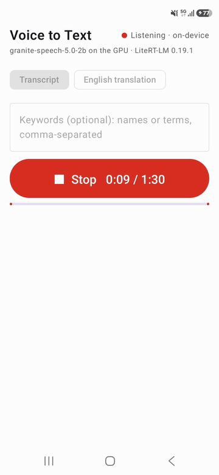

# Voice to Text on Android with LiteRT-LM

## What this sample demonstrates

- Speech to text on the phone: tap **Record**, speak in English, French, German, Spanish, Portuguese or Japanese, tap **Stop**, and the app writes down what you said, with punctuation. The recording stays in the app's memory (a debug build started with `save_audio` also writes it to a file, see Development) and never leaves the phone; once the model file is downloaded, the app works offline.
- [granite-speech-5.0-2b](https://huggingface.co/ibm-granite/granite-speech-5.0-2b) (IBM, about 2.3B parameters: a 16-layer conformer speech encoder, a 2-layer query transformer and a 40-layer Granite language model), converted to a LiteRT-LM file whose language model and audio encoder both run on the GPU, through the LiteRT-LM Kotlin API (`litertlm-android` 0.19.1).
- Four of the model card's prompts: a transcript with punctuation (`transcribe the speech with proper punctuation and capitalization.`), a translation into English (`translate the speech to English with proper punctuation and capitalization.`), and each of the two with a list of names and terms the model should expect (`transcribe the speech to text. Keywords: ...`, `translate the speech to English. Keywords: ...`). **Run the last recording again** sends the same audio with another prompt.
- One `Engine` for the app, a new `Conversation` for every recording (the model card measures one conversation per clip). The audio goes in as a 16 kHz mono WAV built in memory (`Content.AudioBytes`), followed by the prompt.



The end of one recording on a Galaxy S26: the first English sentence and the first French sentence of IBM's [`multilingual_sample.wav`](https://huggingface.co/ibm-granite/granite-speech-5.0-2b/blob/main/multilingual_sample.wav) (9.2 s) played from a speaker into the phone's microphone. The first words came 1.4 s after **Stop**, the whole text 2.9 s after.

## The model

| Hugging Face repo | File | Size | License | Revision |
|---|---|---|---|---|
| [litert-community/granite-speech-5.0-2b](https://huggingface.co/litert-community/granite-speech-5.0-2b) | `granite-speech-5.0-2b_ekv2048.litertlm` (int8 language model, float16 audio encoder, a 2,048-token context) | 2.82 GB | Apache-2.0 | `53f901f0` |

The app downloads the file on first use into its private storage and checks its size and SHA-256 against [`app/src/main/assets/models.json`](android/app/src/main/assets/models.json). The model file is not in the APK. The file is a conversion of [ibm-granite/granite-speech-5.0-2b](https://huggingface.co/ibm-granite/granite-speech-5.0-2b) (Apache-2.0); its card describes the conversion and its checks.

## Requirements

JDK 17 and Android SDK platform 36 to build. The app builds for arm64-v8a on Android 12+ (minSdk 31) and needs a GPU that LiteRT-LM's GPU backend can run the model on (checked on the phones below). The first start downloads 2.82 GB and needs twice that free in the app's storage. Before it makes the `Engine`, the app checks that about 4.8 GB of memory is free (`MemAvailable`), a little above what the phones below lost in `MemAvailable` from the `Engine`'s start through the first transcriptions (up to 4.78 GB on the Galaxy S26, 4.71 GB on the Pixel 11 Pro).

## Architecture

```
Record -> AudioRecord, 16 kHz mono 16-bit PCM (VOICE_RECOGNITION), at most 90 s
  -> Stop -> samples as floats (x / 32768) -> checks: at least 0.5 s, not digital silence, some speech
  -> from 0.2 s before the speech starts to the end, as a 16 kHz mono float WAV in memory
  -> new Conversation -> sendMessageAsync([audio, prompt]) -> the text, streamed
one Engine (language model and audio encoder on the GPU), made when the model is ready, then a short warm-up message
```

| File | What it holds |
|---|---|
| `Recorder.kt` | The microphone: one recording at a time, the 90-second cap, the level for the screen, the checks before the model, where the speech starts |
| `Wav.kt` | The WAV the model gets (float32), and the WAV reader of the debug plan runs |
| `Prompts.kt` | The model card's prompts, the keyword list, the reply budget |
| `SpeechEngine.kt` | The LiteRT-LM `Engine` (GPU), a `Conversation` per recording, the stream, Stop |
| `Messages.kt` | What the screen says when something does not work |
| `MemoryCheck.kt` | The free-memory check before the `Engine` is made |
| `VoiceViewModel.kt`, `VoiceScreen.kt`, `MainActivity.kt` | The screen, the microphone permission, the transcripts |
| `AutoRun.kt` | Debug builds: a plan of WAV files sent through `afterCapture` in `VoiceViewModel.kt`, the same code a microphone recording goes through after **Stop**, one result line each |
| `data/` | `models.json`, the free-space rule and the download store (resume, SHA-256, HTTPS only), from [`math_to_latex`](../math_to_latex/) |

## Quickstart

```sh
cd samples/litert_lm/voice_to_text/android
./gradlew :app:installDebug
```

Open the app and tap **Download (2.8 GB) and load**. When the status says **Ready**, tap **Record**, allow the microphone, speak, and tap **Stop**. Pick **English translation** before recording (or before **Run the last recording again**) to get English text from speech in another language, and type names or terms into **Keywords** when the recording has words the model may not know.

## Measured

Galaxy S26 (Android 16) and Pixel 11 Pro (Tensor G6, Android 17), 2026-11-07, debug builds made while testing this sample. The Galaxy S26 times and file transcripts below are from the code in this commit, on a warm phone (Android thermal status 2–3). Only English and French speech went through the app; the model card's [Accuracy](https://huggingface.co/litert-community/granite-speech-5.0-2b#accuracy) section compares the same file with the original model on 220 clips in all six languages on a Mac, and on 38 of them on a Pixel 11 Pro.

**Load.** Making the `Engine` took 2.8–3.9 s on the Galaxy S26 (eight starts, two of them the first after installing) and its warm-up message 8.9–11.6 s; a start right after the memory check had refused one took up to 4.5 s + 16.7 s. On the Pixel 11 Pro the first start took 18.9 s + 10.6 s and a later one 2.4 s + 9.7 s.

**Download.** On the Galaxy S26, the first start downloaded the file from Hugging Face and its SHA-256 matched. When the connection closed or stopped carrying data, the screen said "The download stopped (…). The part already downloaded is kept" (at once, or after the 30 s read timeout); when the app was killed, the next start said "Downloaded 1.6 of 2.8 GB so far". Each time the download went on from that point. In this test the phone reached Hugging Face through a computer over USB.

**Time from Stop to the first words and to the whole text** (WAV files sent through `afterCapture`, as a recording is after **Stop**):

| Clip | Length | Galaxy S26 | Pixel 11 Pro |
|---|---|---|---|
| LibriSpeech dev-clean 1272-128104-0001 | 4.8 s | 1.3 s / 1.9 s | 2.1 s / 3.2 s |
| LibriSpeech dev-clean 1272-128104-0000 | 5.9 s | 1.3 s / 2.2 s | 2.5 s / 4.4 s |
| LibriSpeech dev-clean 1272-128104-0003 | 9.9 s | 1.5 s / 2.9 s | 2.6 s / 5.2 s |
| LibriSpeech dev-clean 1272-128104-0002 | 12.5 s | 1.3 s / 2.9 s | 2.4 s / 5.4 s |
| IBM `multilingual_sample.wav` (English, then French) | 24.9 s | 2.2 s / 6.3 s | 4.3 s / 12.7 s |
| LibriSpeech dev-clean 1272-128104-0004 | 29.4 s | 2.4 s / 6.6 s | 4.3 s / 12.3 s |

**Against the original model.** The reference is [ibm-granite/granite-speech-5.0-2b](https://huggingface.co/ibm-granite/granite-speech-5.0-2b) in transformers, greedy, with the transcript prompt, on each whole file (the app sends it from 0.2 s before the speech), compared word by word after lower-casing and removing punctuation. On the Galaxy S26, five of the six clips above come back word for word; the 29.4 s clip differs in 4 of 71 words (the app writes "Linnell's" and "Mr. Burkitt Foster's", the original model "Lennell's" and "Mr. Burke, it fosters,"). The Pixel 11 Pro wrote the same words as the Galaxy S26, except "pécheur" for "pêcheur" in the French part of IBM's sample. Played from a speaker into the phone's microphone, the two sentences in the GIF came back word for word with the French part in French, the whole IBM sample with 1 of 66 words different (Galaxy S26), and clip 0003 with 1 of 25 words different on each phone.

## Known limits

- One recording holds at most 90 s; at 1:30 the recording stops and the screen says so. The model's context is 2,048 tokens and the audio takes 10 of them per second, so 90 s leaves room for the reply.
- The app translates into English only. The model card also lists translation from English into French, German, Spanish, Japanese, Italian and Mandarin (`translate the speech to <language>.`).
- The model writes a sentence even when nobody speaks: 5 s of a quiet room came back as a sentence in Spanish. The app therefore refuses a recording without speech ("No speech was heard…") and sends each recording from 0.2 s before the speech starts, because 1.4 s of room noise before quiet speech turned the English half of a transcript into French. A 20 ms frame counts as speech when it is at least four times as loud as the recording's quieter frames (its 20th percentile) and above a fixed floor, and a recording with fewer than five such frames is refused (`SpeechTrim` in `Recorder.kt`), so speech barely louder than the room is refused too.
- With keywords, the card's prompt (`transcribe the speech to text. Keywords: ...`) does not ask for punctuation, and the text came back without punctuation or capitals.
- Both parts of the model run on the GPU and the app has no CPU fallback: on a phone whose GPU cannot run the model, the screen says "The model did not start on this phone's GPU (…)" and shows **Load** to try again.

## Development

**Side-load (development only).** Put a copy of the model file in the app's external files dir; the app makes the dir on its first start. When you tap **Download (2.8 GB) and load**, the app hashes the copy and, when its size and SHA-256 match `models.json`, imports it instead of downloading. The log line is `side-loaded <file> ... (sha256 verified)` under `adb logcat -s VoiceToTextDownload`. Delete the copy afterwards: the app keeps its own.

```sh
P=com.google.ai.edge.examples.voice_to_text
adb push granite-speech-5.0-2b_ekv2048.litertlm /sdcard/Android/data/$P/files/
adb shell rm /sdcard/Android/data/$P/files/granite-speech-5.0-2b_ekv2048.litertlm   # after the import
```

**Launch extras (debug builds only; a release build ignores them).** If the app is already open, `am start` with new extras reaches the running screen (`singleTop`). With any of them the screen shows over the keyguard and stays on.

| Extra | What it does |
|---|---|
| `--ez autoload true` | load the model now (the side-loaded copy, else the download) |
| `--es plan <path>` | once the model is loaded, send the WAV files of this plan (a path in the app's external files dir) through `afterCapture` and write one result line each to `runs/<plan name>.jsonl` in that dir (`plan/b.json` → `runs/b.jsonl`); the plan is `{"rows": [{"tag": "t1", "wav": "plan/clip.wav", "task": "TRANSCRIPT"}, ...]}`, the optional fields are in `AutoRun.kt` |
| `--ez save_audio true` | write each recording (`runs/rec_<n>.wav`) and its text (`runs/texts.jsonl`) |
| `--ei max_seconds <n>` | the recording cap, 1 to 90 s |
| `--el need_bytes <n>` | the free memory the check asks for before the `Engine` is made |
| `--es task TRANSCRIPT` or `ENGLISH`, `--es keywords <text>` | the task and the keyword field |
| `--ez clear true` | clear the transcripts and the message |

**Tests.** `./gradlew :app:testDebugUnitTest` checks the WAV writer and reader, the prompts and the reply budget, the checks before the model, where the speech starts, the error sentences for a message the runtime refuses as too long and for a download that stopped, the catalog and the memory check.

## Licenses

See [NOTICE](android/NOTICE).
