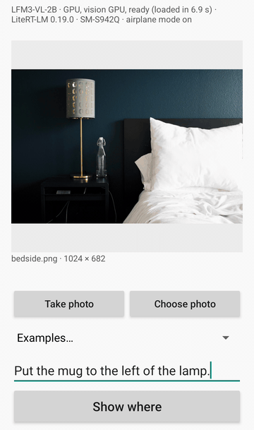

# Where to put it, on Android with LiteRT-LM (LFM3-VL-2B)

This sample marks where to put something in a photo of a table, a desk or a shelf, on an Android phone with no network connection. You give it a photo and a request such as "Put the mug between the lamp and the books."; the model, [LiquidAI/LFM3-VL-2B](https://huggingface.co/LiquidAI/LFM3-VL-2B) (LFM Open License v1.0), points at the free spot for it with [LiteRT-LM](https://github.com/google-ai-edge/LiteRT-LM), and the app puts a drawing of the item there: one point in the picture, the kind of target a robot arm or an app that places things in a room needs.



On screen: a Galaxy S26 in airplane mode with the model loaded, the picture of the bundled example "Nightstand and bed" opened as a file (bedside.png), and the request "Put the mug to the left of the lamp." typed in; the wait for the answer plays at 2× (Show where to the ring: 11.5 s, most of it thinking), the rest at real speed.

Liquid AI's model card names this ability ("Spatial and embodied reasoning: the model finds objects and reasons about how they are placed relative to each other, a strong foundation for robotics applications") and reports 40.6 on RefSpatial-Bench without thinking and 49.8 with it.

## What you can give it

1. **Take photo**: the phone's camera app takes the picture (the app asks for the camera permission first).
2. **Choose photo**: the Android photo picker. The app also appears under "Open with" and "Share" for pictures from other apps.
3. **Examples**: five photos from Wikimedia Commons (CC0, see [The example pictures](#the-example-pictures)), each with one or two requests to try: tap one and it fills the request field.
4. **The request**: type what to put where, in your own words, for example "Put the book on the shelf next to the plant."

Show where sends the photo and the request to the model. While the model thinks, the line under the photo says so, with the seconds since the tap and the last words of its thinking. The app then marks the model's point on the photo with a ring and drops a drawing of the item onto it (a mug or a cup, a book, a vase, a bag, a pan or a sugar bowl; for any other item the ring stays), and shows the point (x and y from 0 to 1000 across the photo) and the time from the tap to the first text, to the answer and to the mark; the model's answer and its whole thinking are at the bottom of the screen. The app has no internet permission.

## How it works

1. **The picture**: decoded upright (`ImageDecoder` applies the photo's EXIF orientation) and stretched to 512 × 512, the size the bundle's vision encoder takes. One picture becomes 256 image tokens. The model's point is a fraction of the whole picture's width and height (0 to 1000), so the stretch does not move it relative to what is in the photo.
2. **The request**: the app puts your words into the model's own pointing request (Liquid AI's [Vision Capabilities](https://docs.liquid.ai/lfm/key-concepts/vision-capabilities) page, "Pointing"), with the free spot as the thing to point to: `Point to the free spot where the item should be placed for the request "<your words>". Answer in JSON as a list of points: [{"point_2d": [x, y], "label": "<short label>"}, ...], with x and y as integers normalized to 0-1000.`
3. **Thinking** is on (`ModelEngine.THINKING`, passed to the chat template as `enable_thinking`): the model first reasons about the request and the photo, then gives the point. On the 30 requests of [How well it places](#how-well-it-places), LiquidAI's original weights at the same 512 × 512 input put the point in the free spot for 6 with thinking off and 21 with thinking on. The thinking comes in the bundle's `thought` channel, apart from the answer, and takes hundreds of tokens: on those 30 requests, this sample's file replied (thinking and answer) in about 610 tokens at the median and 3,746 at most. The photo and the request take about 340 of the file's 4,096-token context, so the reply's cap is the rest of it; LiteRT-LM ends a reply that reaches the context's end like a finished one. If the model is still thinking then, there is no answer: the app says the answer was too long and marks nothing. With the 4,096-token file none of the 30 requests ran out of room (the longest used 4,085 tokens); with the 2,048-token int4 file in the same repository, 7 of them did.
4. **The point** (`Pointing.kt`): the first `"point_2d": [x, y]` in the answer (the text after the thinking); else the centre of a `"bbox_2d": [x1, y1, x2, y2]`; else the first bracket holding only numbers (two numbers are a point, four are a box and its centre counts), which also reads an answer whose JSON is broken. Nothing is read from the thinking. The mark goes at x / 1000 of the photo's width and y / 1000 of its height, on the photo shown at its own aspect ratio, as soon as the answer's `point_2d` is complete. With no point in the answer, or a point outside 0 to 1000, nothing is marked and the app shows the model's text.
5. **The drawing** (`Items.kt`): the first word in the request that names one of the app's drawings picks it ("Put the mug in front of the books." gives the mug; a cup gets the mug too). The drawings are paths in the code, with no image files. The ring shows the point, with the item held just above it, for 0.4 s; then the item drops onto it, standing with the middle of its foot on the point, and the ring fades. For a bundled request the drawing is about as wide as such an item looks in that photo (`item_width` in `examples.json`, in thousandths of the photo's width, set by hand from a like object in the same photo); for any other request it takes a fixed share of the photo's width. The size is the app's guess: the model gives a point, not a size.

The app keeps one engine loaded and gives every request a conversation of its own.

| File | Role |
|---|---|
| `MainActivity.kt` | the screen: the inputs, the suggested requests, Show where, the progress line while the model thinks, the mark, the answer and the times |
| `ModelEngine.kt` | the LiteRT-LM engine (GPU for the text decoder and the vision encoder), thinking on, the reply's cap, the memory check before loading, one conversation per request |
| `Pointing.kt` | the request sent to the model and the point read from its answer (plain Kotlin) |
| `MarkedPhotoView.kt` | the photo at its aspect ratio, the ring and the item dropping onto it |
| `Items.kt` | the item drawings and which one a request names |
| `Picture.kt` | reading a picture: EXIF orientation, the 512 × 512 input, damaged or incomplete files |
| `Examples.kt` | the bundled examples and their requests (`assets/examples.json`) |
| `LitertlmHeader.kt` | what a `.litertlm` file's header lists |
| `AutoRun.kt` | the measuring tool (below) |

## How well it places

In this sample's development, the earlier form of the `.litertlm` file below (its weights inside the graphs) answered 30 placement requests on a Mac (LiteRT-LM 0.19.0, GPU, thinking on): 10 photos of desks, tables, a shelf, a kitchen counter and a bedside, three requests each, asking for a spot to the left or right of an object, between two objects, in front of or behind an object, or on a surface. The five example photos are five of the ten. For each request, the region where the point counts as right was drawn by hand before any model ran (see [The example pictures](#the-example-pictures)). 21 of the 30 points fell in their region.

On a Pixel 11 Pro (Android 17, airplane mode), the measuring tool ran the requests chosen for the examples one after another on one engine. Of the ten first chosen, eight points fell in their regions and two did not; those two were taken out of the examples, and the remaining eight, run again, all fell in theirs, with the ring 28 s after the tap at the median (18 to 137 s): the model thinks before it answers, and its replies ran from about 260 to 2,200 tokens. With the earlier form of the file, 7 of the 8 fell in their regions ("Put the pan on the stove." did not; the ring 30 s after the tap at the median, 16 to 98 s); with the file below, all 8 did (the ring 30 s after the tap at the median, 18 to 143 s). On a Galaxy S26 (Android 16), the request in the recording above, typed in, put its point in the region drawn for "Put the glass to the left of the lamp." (one of the 30; the same spot, asked for a mug because the app has no drawing of a glass), with the ring 11.5 s after the tap.

## The model file

| File | Bytes | SHA-256 |
|---|---|---|
| `LFM3-VL-2B_int4_ctx4096.litertlm` | 2,071,674,880 | `fc1a6c38f4084d501f9a05f14c7576ef22378c0d3bf7b8ff72e9e67694cdd0b3` |

The file holds the text decoder with int4 weights in blocks of 32 and an int8 output projection, the token embedding table in int8, the vision encoder with fp32 weights and its adapter with fp16 weights, with a 4,096-token context ([litert-community/LFM3-VL-2B-LiteRT](https://huggingface.co/litert-community/LFM3-VL-2B-LiteRT)):

```bash
pip install -U huggingface_hub
hf download litert-community/LFM3-VL-2B-LiteRT --revision da14b7b0d9c3b2846928815fb23e42c312de90f7 --include "LFM3-VL-2B_int4_ctx4096.litertlm" --local-dir lfm3_vl
```

The app runs either form of this file: the one above, with its weights in `TFLiteWeights` sections, or the earlier one, with its weights inside the graphs (`--revision f547c061f063788155b9f95a19959293f558418b`, 2,071,611,643 bytes, SHA-256 `64d89b85…`). On a Pixel 11 Pro and on a Galaxy S26, the app loaded each form, and the two forms put one typed request at the same point.

## Build and install

Android Studio, or JDK 17 and Android SDK platform 36 on the command line; the Gradle wrapper fetches Gradle 8.13. minSdk 31, arm64-v8a only. LiteRT-LM comes from Maven (`com.google.ai.edge.litertlm:litertlm-android:0.19.0`).

```bash
cd android
./gradlew :app:installDebug
```

Open the app once: it creates its files folder (`/sdcard/Android/data/com.google.ai.edge.examples.where_to_put/files`) and names the model file it is missing. Then push the file into that folder:

```bash
./install_to_device.sh <path to lfm3_vl>
```

`install_to_device.sh` copies the file with `adb push` and checks its size on the phone. Open the app again: it loads the model on the GPU (12.5 s on a Pixel 11 Pro, 6.7 s on a Galaxy S26), and the status line then says ready. Before loading, the app stops with a message when the file is missing or incomplete (its own header says how long a whole copy is), or when less than 6.0 GB of memory is available (on a Pixel 11 Pro the app took 6.0 GB while it answered, most of it GPU memory).

## The measuring tool

Started with a plan, the same activity drives the screen through the functions the buttons call and writes a report:

```bash
adb shell am start -n com.google.ai.edge.examples.where_to_put/.MainActivity \
  --es plan plans/example.json --es report example.json
```

The plan (in the app's external files dir) lists items `{"id", "example": "<example id>" | "file": "<path in the files dir>", "request_id": "<a bundled request's id>" | "request": "<text>", "action": "camera", "press", "rest_ms", "dump_input", "dump_view"}`; an item without `press` only sets the screen, and an `example` item alone shows the photo with an empty request field. The report `reports/<name>.json` has every item's screen lines and, for each Show where, the model's text, the point and where it was read from, whether it was marked, the time from the tap to the first text and to the ring, and for a bundled request whether the point fell in the region where the item can go (`in_spot`; the regions are the `*_spot.png` masks next to the photos, white where the point counts). `dump_input` keeps the 512 × 512 picture the model was given, and `dump_view` the photo as the screen shows it, with the ring or the item's drawing (`reports/<name>_<id>_view.png`, kept once the item has landed). Every answer, tapped or planned, also leaves a record in `runs/`. In a fresh process (`am start -S`), `--el need_bytes <bytes>` raises the memory check's threshold (to see its message on a phone with enough memory), and `--es backend cpu` / `--es vision_backend cpu` load the text decoder or the vision encoder on the CPU. `--ei max_output <tokens>` lowers the reply's cap for the requests that follow (a reply cut while the model thinks shows the too-long message without waiting for a long reply); `--ei max_output 0` puts the app's cap back. Each answer in the report also has `too_long`, the number of streamed pieces with text (`pieces`, about one per token), the time to the first character of the answer (`answer_ms`), and the drawing put on the point with its width (`item`, `item_width`; null when only the ring marks it).

## The example pictures

Photos from Wikimedia Commons, all CC0 (the license read from each file's page), stored as PNG at 1024 pixels on the long side:

| Example | Photo (Wikimedia Commons) | Author | Requests |
|---|---|---|---|
| Desk with a lamp | [Minimal desk and painting (Unsplash).jpg](https://commons.wikimedia.org/wiki/File:Minimal_desk_and_painting_(Unsplash).jpg) | Breather breather | Put the mug between the lamp and the books. · Put the mug in front of the books. |
| Nightstand and bed | [Bedside (Unsplash).jpg](https://commons.wikimedia.org/wiki/File:Bedside_(Unsplash).jpg) | Rhema Kallianpur rhemakallianpur | Put the book on the bed. |
| Table with enamel cups | [Enamel cups on a table (Unsplash).jpg](https://commons.wikimedia.org/wiki/File:Enamel_cups_on_a_table_(Unsplash).jpg) | André Freitas andrekerygma | Put the sugar bowl to the right of the glass shaker. |
| Round table by a window | [Round table in a bright room (Unsplash).jpg](https://commons.wikimedia.org/wiki/File:Round_table_in_a_bright_room_(Unsplash).jpg) | Nirzar Pangarkar nirzar | Put the vase to the right of the books. · Put the bag on the chair on the right. |
| Kitchen counter | [Gather (Unsplash).jpg](https://commons.wikimedia.org/wiki/File:Gather_(Unsplash).jpg) | Jeff Sheldon ugmonk | Put the cup on the counter. · Put the pan on the stove. |

Each request's region (`<request id>_spot.png`, 1000 × 1000 over the whole photo) was drawn by hand on the photo before any model ran: the visible top of the surface the item goes on, without the objects standing on it (with a margin of 4 thousandths of the photo), cut to the side the request names: beside an object, across the height of its base plus a quarter of that height above and below; in front of or behind it, across its width plus a quarter of it on each side; between the facing sides of two objects; or the whole surface for "on". The examples' requests are ones the model answered right on the Mac (both LiquidAI's original weights and this file) and on a Pixel 11 Pro: of the ten first chosen, two were left out because the phone's point fell outside their regions; [How well it places](#how-well-it-places) says how often it does on requests that were not chosen that way.

## Known limits

- One picture per request, stretched to 512 × 512.
- An answer takes tens of seconds on a phone, most of it thinking: on a Pixel 11 Pro, 16 to 143 s for the bundled requests in the runs above; on a Galaxy S26, 11.5 s for the request in the recording above.
- Tested on a Pixel 11 Pro (Android 17) and a Galaxy S26 (Android 16), with the text decoder and the vision encoder on the GPU.
- The answer is one point. The model is not told the item's size, and the drawing's size is the app's guess, so check that the item fits where it is drawn.
- With thinking on, the reply can fill the 4,096-token context before the model gives its point; the app then marks nothing (the answer was too long).
- On LiteRT-LM 0.19.0, a new conversation on the same engine starts from the short-convolution state that the previous conversation left behind ([LiteRT-LM issue #3165](https://github.com/google-ai-edge/LiteRT-LM/issues/3165)), so an answer can differ from that of a freshly started app.

## License

The sample code is Apache-2.0. LFM3-VL-2B's weights are under the LFM Open License v1.0 (LiquidAI); the converted file keeps that license. The example photos are CC0 (Wikimedia Commons; authors above).
